# ADMIN_COPY_ROUND2 — admin 运维文案第二轮清理

状态: **DONE**（v2：授权后追加 `apps/admin/lib/**` 与 `/admin/settings` 用例）
任务 ID: ADMIN_COPY_ROUND2
日期: 2026-11-20 17:13–18:05 (+08:00)｜v1 已提交 `7036d58`，v2 为增量
Playwright: `e2e/admin/ops-copy.spec.ts` — **16/16** 通过
单测: `@roamlog/admin` **173/173** 通过；`tsc --noEmit` 0 错误

---

## 0. 口径说明（先说清楚数字，避免对不上）

`PROD_COPY_SWEEP` 的报告原文不在仓库里（`.audit/` 下没有该文件），我无法复现它的精确口径。实测：

| 类别 | 实测 | 说明 |
| --- | --- | --- |
| 「未接入」在报告 6 个文件内 | **38 处**（workspaces 12 / users 6 / system 10 / queues 8 / emails 1 / settings-group-form 1） | 与报告的 38 **完全吻合**，可确认口径 |
| 「未接入」在 `settings-consumption.ts` | 14 处 | 报告未计入；本轮判为保留（见 §3） |
| 「未接入」在 `apps/admin/lib/**` | 3 处 | **不在可写范围，未改**（见 §6 风险 1） |
| 「API」在 `components/app` 非测试文件 | 56 行命中 | 其中约 38 行是可见文案/错误文案，其余是注释与 fetch 路径（不进 UI） |
| 不含「API」字样但同类的实现细节泄漏 | 23 处 | 路径片段 / 字段名 / Redis 键名 / 错误码常量 / JSON 字样 / env 变量名 |

报告的「23 处 API」我无法精确复现，故**按实测逐条给出判定**，而不是凑数。

### 判断用的四种语义（本轮统一口径）

- **S1 数据读不到**（接口失败 / 字段暂时空缺）→ `暂不可用` / `暂时读不到`（禁止写成「暂无数据」，那会让人以为只是空）
- **S1b 后端没上报**（环境未配置版本/构建时间）→ `未上报`
- **S2 无法判定**（worker 心跳缺失，不能证明存活也不证明挂掉）→ `无法确认`，保留原 tooltip
- **S3 运行时确实不消费该配置**（开关点了不生效）→ **保留「未接入（不生效）」**，改词会让运维误判开关生效
- **S4 接口返回形状**（路径 / 字段名 / JSON / 键名 / 错误码 / env 名）→ **全删**

复用词表证据：`apps/admin/lib/labels.ts` 已有 `HEALTH_STATUS_LABELS` / `WORKER_STATUS_LABELS` / `QUEUE_STATE_LABELS` / `MIGRATION_STATUS_LABELS` / `INVITATION_STATUS_LABELS` / `ENVIRONMENT_LABELS`；仓库既有中文状态词 `暂无…`（`dashboard-view.tsx:241/294`）、`未启用`（`users-view.tsx:1154`）、`未提供`（原 `workspaces-view.tsx:778/796`）。本轮未自创状态词体系。

---

## 1. 「未接入」38 处逐条

### users-view.tsx（6 处）

| # | 行 | 原文 | 处理 | 理由 |
| --- | --- | --- | --- | --- |
| B1 | 594 | `value === undefined ? "未接入" : value` | 改 `暂不可用` | S1：详情未加载时计数空缺，不是「子系统没接」 |
| B2 | 1149 | `未接入`（2FA 格） | 改 `暂不可用` | S1：`twoFactorEnabled` 为可选字段，缺值≠没接 |
| B3 | 1210 | `未接入`（活跃会话计数位） | 改 `暂不可用` | S1：同上 |
| B4 | 1218 | `未接入：需要 GET /v1/admin/users/:id 返回 sessions[]（id、ipAddress、userAgent、createdAt、expiresAt）。` | **整段删** → `会话明细暂时读不到，请重试或重新打开详情。` | S4 接口形状；且该解释**失实**（见 §4），属误导运维 |
| B5 | 1247 | `未接入`（工作区成员关系计数位） | 改 `暂不可用` | S1 |
| B6 | 1255 | `未接入：需要 GET /v1/admin/users/:id 返回 workspaces[]（workspaceId、workspaceName、role、status、joinedAt）。` | **整段删** → `工作区成员关系暂时读不到，请重试或重新打开详情。` | 同 B4 |

### workspaces-view.tsx（12 处）

| # | 行 | 原文 | 处理 | 理由 |
| --- | --- | --- | --- | --- |
| B7 | 431 | `detailLoading ? "…" : value === undefined ? "未接入" : value` | 改 `暂不可用` | S1 |
| B8 | 780 | `未接入`（列表 owner 列） | 改 `暂不可用` | S1 |
| B9 | 800 | `{value ?? "未接入"}`（列表计数列） | 改 `暂不可用` | S1 |
| B10 | 812 | `未接入`（列表媒体字节） | 改 `暂不可用` | S1 |
| B11 | 956 | `{ownerName ?? "未接入"}` | 改 `暂不可用` | S1 |
| B12 | 976 | `未接入`（存储用量） | 改 `暂不可用` | S1 |
| B13 | 997 | `未接入`（成员计数位） | 改 `暂不可用` | S1 |
| B14 | 1005 | `未接入：需要 GET /v1/admin/workspaces/:id 返回 members[]（userId、name、email、role、status、joinedAt）。` | **整段删** → `成员明细暂时读不到，请重试或重新打开详情。` | S4 + 失实 |
| B15 | 1041 | `未接入`（邀请计数位） | 改 `暂不可用` | S1 |
| B16 | 1049 | `未接入：需要 GET /v1/admin/workspaces/:id 返回 invitations[]（email、role、expiresAt、acceptedAt、revokedAt）。` | **整段删** → `邀请记录暂时读不到，请重试或重新打开详情。` | S4 + 失实 |
| B17 | 1099 | `未接入`（最近旅行计数位） | 改 `暂不可用` | S1 |
| B18 | 1111 | `未接入：需要 GET /v1/admin/trips?workspaceId=... 返回该租户旅行。` | **整段删** → `最近旅行暂时读不到，请稍后重试。` | S4 + 失实（`/v1/admin/trips` 支持 `workspaceId`，且前端已接：`useAdminWorkspaceTrips`） |

### system/system-view.tsx（10 处）

| # | 行 | 原文 | 处理 | 理由 |
| --- | --- | --- | --- | --- |
| B19 | 45 | `signalSources.unavailable: "未接入"` | 改 `无可用的推导信号` | S2：不是「没接」，是推导不出 |
| B20 | 70 | `workerSignal ? … : "未接入"`（推导口径） | 改 `无可用的推导信号` | S2 |
| B21 | 92 | `notWired(apiVersion) ? "未接入"` | 改 `未上报` | S1b：后端没报版本号，不是子系统断了 |
| B22 | 97 | `notWired(workerVersion) ? "未接入"` | 改 `未上报` | S1b |
| B23 | 119 | `notWired(buildTime) ? "未接入"` | 改 `未上报` | S1b |
| B24 | 141 | `checks.length === 0 ? "未接入"` | 改 `暂无检查项` | 确认空（数组为空），用既有「暂无」词族 |
| B25 | 169 | `notWired(workerVersion) ? "未接入"`（侧栏版本） | 改 `未上报` | S1b，与 B22 一致 |
| B26 | 181 | 工作进程状态 Badge `未接入` | 改 `无法确认` | **S2 关键**：原词会被读成「worker 没接→可能挂了」；实际是「心跳缺失，两种可能都无法证明」 |
| B27 | 195 | `workerSignal?.lastJobAt ? … : "未接入"` | 改 `暂不可用` | S1 |
| B28 | 268 | `migrations.length > 0 ? "最新已应用" : "未接入"` | 改 `暂不可用` | S1：迁移版本读不到 |

### queues/queues-view.tsx（8 处）

| # | 行 | 原文 | 处理 | 理由 |
| --- | --- | --- | --- | --- |
| B29 | 72 | 注释 `the console shows "未接入"` | 改注释为 `暂不可用` | 注释同步，避免文档漂移 |
| B30 | 248 | 吞吐指标 `: "未接入"` | 改 `暂不可用` | S1 |
| B31 | 555 | `signalSources.unavailable: "未接入"` | 改 `无可用的推导信号` | S2 |
| B32 | 561 | 注释 `and says "未接入"` | 改 `无法确认` | 注释同步 |
| B33 | 588 | `未接入：/v1/admin/system 没有返回任务进程信号，无法判断消费者是否存活。` | 改 `暂时读不到任务进程信号，无法判断消费者是否存活。` | S4 路径 + S1 措辞 |
| B34 | 614 | worker Badge `未接入` | 改 `无法确认` | S2（同 B26，保持两页一致） |
| B35 | 627 | `signal?.lastJobAt ? … : "未接入"` | 改 `暂不可用` | S1 |
| B36 | 633 | `signal ? signalSources[...] : "未接入"` | 改 `无可用的推导信号` | S2 |

### emails / settings-group-form（2 处）

| # | 行 | 原文 | 处理 | 理由 |
| --- | --- | --- | --- | --- |
| B37 | emails-view.tsx:350 | `测试邮件入口未接入` | 改 `测试邮件入口尚未开放` | 功能确实没做（§5），保留卡片但用「尚未开放」；**「未接入」会被读成「后端没接这个子系统」**，而实际是产品尚未上线该入口 |
| B38 | settings-group-form.tsx:624 | 分组状态 `: "未接入"` | **保留** | **S3**：`consumption.status === "unwired"`，表示该分组配置项没有被任何运行时读取点消费。改成「未启用」会让人以为「配了就能生效」，运维会误判 → 保留语义 |

---

## 2. 接口形状 / 实现细节泄漏（报告未列，同类一并清理）

| # | 文件:行 | 原文 | 处理 |
| --- | --- | --- | --- |
| A1 | users-view:855 | title `列表响应未提供活跃会话计数，请打开详情读取 GET /v1/admin/users/:id` | → `列表未提供活跃会话计数，打开详情可查看` |
| A2 | users-view:1147 | title `需要 GET /v1/admin/users/:id 返回 twoFactorEnabled；当前详情响应未提供该字段` | → `详情暂未提供该字段` |
| A3 | users-view:1190 | title `需要 GET /v1/admin/users/:id 返回该计数；当前详情响应未提供` | → `详情暂未提供该计数` |
| A4 | workspaces-view:778 | title `列表响应未提供所有者；需要 GET /v1/admin/workspaces 返回 owner` | → `列表未提供所有者` |
| A5 | workspaces-view:796 | title `列表响应未提供${label}计数；需要 GET /v1/admin/workspaces 返回 ${label} 计数` | → `列表未提供${label}计数` |
| A6 | workspaces-view:807 | title `列表响应未提供媒体字节；需要 GET /v1/admin/workspaces 返回 mediaBytes` | → `列表未提供媒体字节` |
| A7 | workspaces-view:958 | `需要 GET /v1/admin/workspaces/:id 返回 owner` | → `详情暂未提供所有者邮箱` |
| A8 | workspaces-view:969 | title `需要 GET /v1/admin/workspaces/:id 返回 mediaBytes` | → `详情暂未提供存储用量` |
| A9 | workspaces-view:1182 | `套餐与所有权通过 PATCH /v1/admin/workspaces/:id 实际提交，后端校验…` | → `套餐与所有权的变更会直接提交后台，后端校验…` |
| A10 | workspaces-view:1105 | `最近旅行读取失败：{code} · {detail}`（直接渲染英文原始错误） | → `最近旅行读取失败（{code}），请稍后重试。` |
| A11 | queues-view:588 | `/v1/admin/system 没有返回任务进程信号` | 见 B33 |
| A12 | queues-view:641 | `BullMQ getWorkers()` / `CLIENT SETNAME`（库方法名 + Redis 连接选项） | 删 → `由任务进程侧暴露自身连接信息` |
| A13 | queues-view:276 | `队列列表来自 Redis 扫描，不再使用硬编码清单；…`（开发自述） | 删该分句 |
| A14 | emails-view:353 | `<code>POST /v1/admin/emails/test</code>` | 删（随 B37 卡片改写） |
| A15 | emails-view:407 | `admin/metrics · 数据库聚合`（指标卡来源注脚，6 张卡都印） | → `数据库聚合 · 全部状态` |
| A16 | login-panel:146 | hint `通过同源 /v1/auth 代理登录，会话 Cookie 为 httpOnly。` | → `同源接入认证服务，会话 Cookie 为 httpOnly。` |
| A17 | login-panel:267 | `Better Auth / 同源 /v1 代理` | → `统一认证 · 同源接入` |
| A18 | login-panel:306 | `<span>API</span>`（环境卡） | → `后台服务` |
| A19 | admin-session-provider:171 | `` `/v1/me` 未返回可用的管理员账户。 `` | → `未取到可用的管理员账户。` |
| A20 | admin-sidebar:152 | `平台角色由 /v1/me 与后端 guard 决定。` | → `平台角色由后端会话与权限校验决定。` |
| A21 | system-view:95 | `需要 ROAMLOG_API_VERSION` | → `后端未上报版本号` |
| A22 | system-view:122 | `需要 ROAMLOG_BUILD_TIME（不再用容器启动时间替代）` | → `后端未上报构建时间（不再用容器启动时间替代）` |
| A23 | system-view:207-209 | `需要在任务进程侧新增心跳键（如 <code>roamlog:worker:heartbeat</code>）` | 删键名 → `需要在任务进程侧补上心跳上报` |
| A24 | system-view:251 | `来源：Redis SCAN 匹配 BullMQ 状态键；不再渲染硬编码的 key prefix / 延迟 / 队列数。` | → `来源：扫描 Redis 中的队列状态键。` |
| A25 | system-view:294 | `当前 API 未返回迁移版本；数据库恢复后刷新。` | → `当前读不到迁移版本；请确认数据库可用后刷新。` |
| A26 | system-view:230 | `Redis 中没有可识别的 BullMQ 队列键：…` | → `…可识别的队列状态键：…`（与队列页统一，去库名） |
| A27 | two-factor-enrollment:99-100 | `所有后台 API 请求都会返回 <code>ADMIN_2FA_REQUIRED</code>。` | → `后台会拒绝所有管理请求。`（删错误码常量） |
| A28 | admin-data-boundary:110 | `完成前，后台 API 会持续返回 ADMIN_2FA_REQUIRED。` | → `完成前，后台会拒绝所有管理请求。` |
| A29 | content/reports-data:71,110 | `后台 API 响应不是 JSON` | → `后台响应格式异常`（JSON 属禁词） |
| A30 | content/reports-data:72,111 | `后台 API 返回了空响应或格式错误的响应。` | → `后台没有返回内容，或返回的格式无法解析。` |
| A31 | content/reports-data:83 | `后台 API 响应不符合契约` | → `后台响应与预期不符`（「契约」是开发术语） |
| A32 | content/reports-data:84 | `无法解析后台 API 响应。` | → `无法解析后台响应。` |
| A33 | permissions-view:186 | `稍后重试或检查后台 API。` | → `稍后重试；若持续没有数据，请联系平台管理员检查后台状态。` |

---

## 3. 「未接入」保留项与理由（逐条）

| 文件:行 | 原文 | 为什么保留 |
| --- | --- | --- |
| settings-group-form.tsx:624 | `: "未接入"` | **S3**。`consumption.status === "unwired"`：该分组里存在**没有任何运行时读取点**的配置项。保留＝告诉运维「这项配了也不生效」。换成「未启用/暂不可用」会让运维以为配置下发链路坏了或配了就好，属误判。 |
| settings-consumption.ts:29 | `media.keepOriginal` → `未接入（不生效）` | 同上。后端/worker 均不读该键；「（不生效）」本身就是运维结论，删掉等于隐瞒。 |
| settings-consumption.ts:30 | `media.livePhotoEnabled` → `未接入（不生效）` | 同上。 |
| settings-consumption.ts:31 | `general.registrationEnabled` → `未接入（不生效）` | 同上。**不删**：删了会让运维以为注册开关生效，属安全风险。 |
| settings-consumption.ts:32 | `seo.sitemapEnabled` → `未接入（不生效）` | 同上。 |
| settings-consumption.ts:39 | `mail.provider` → `后端起效；任务进程导出通知不生效（任务进程未接入）` | **S3 且是真实子系统差异**：邮件的 7 个键由 API 的 `MailSettingsConsumer` 读取，但 worker 仍用 `EMAIL_*`/`SMTP_*` 建 transport，导出的通知邮件不走设置库。删掉会让运维以为改完 worker 也生效。 |
| settings-consumption.ts:43 | `mail.from` | 同上。 |
| settings-consumption.ts:47 | `mail.resendApiKey` | 同上。 |
| settings-consumption.ts:51 | `mail.smtpHost` | 同上。 |
| settings-consumption.ts:55 | `mail.smtpPort` | 同上。 |
| settings-consumption.ts:59 | `mail.smtpUser` | 同上。 |
| settings-consumption.ts:63 | `mail.smtpPassword` | 同上。 |
| settings-consumption.ts:77 | `limits.uploadPerMinute` → `未接入（presign 限流仍读环境变量）` | **S3**：presign 限流确实仍读 env，改设置不生效。注：括号内「环境变量」属实现细节，但属 `lib/**` 范围（见 §6）。 |
| settings-consumption.ts:99 | `general` 组 → `注册开关未接入（不生效）` | S3，同 31。 |
| settings-consumption.ts:106 | `seo` 组 → `站点地图未接入（不生效）` | S3，同 32。 |

**结论**：这 15 处「未接入」全部表示「运行时未消费」，删/改都会造成运维误判系统健康，故保留。它们不在报告口径的 38 处内（`settings-consumption.ts` 14 处 + `settings-group-form.tsx` 1 处，后者已在 B38 计入）。

---

## 4. 「API」字面：保留 / 改删 的判据

判据（写进代码注释与 spec 里）：**能保留「API」的只有两种**——
1. 它指代被运维的**服务实体**（"后台 API 不可用"），且句子给出可执行处置；
2. 它是**产品/字段专名**（"Resend API Key"，用户必须填的字段）。

**改（去 API 字样）**：login-panel:306 `API`→`后台服务`；login-panel:117/201 `请检查 API 状态`→`请稍后重试`；audit-view:181 `已从后台 API 导出审计 CSV。`→`已导出审计 CSV。`；audit-view:221 `从后台 API 导出当前筛选结果为 CSV`→`导出当前筛选结果为 CSV`；system-view `需要 ROAMLOG_API_VERSION`（A21）；`当前 API 未返回迁移版本`（A25）；reports-data 3 条错误标题（A29/A31）；boundary/2fa 的 `ADMIN_2FA_REQUIRED`（A27/A28）。

**保留（逐条理由）**：

| 位置 | 文案 | 理由 |
| --- | --- | --- |
| users-view:413 / workspaces-view:384 | `操作失败，请检查 API 与权限后重试。` | 运维可执行（服务健康 + 账号权限是真实失败源）；与 `lib/` 同类错误标题风格一致 |
| users-view:426 / workspaces-view:399 | `未连接后台 API，操作未提交。` | 这是**真事实**且对运维有信息量（没提交，不会产生半成品数据） |
| users-view:448 / workspaces-view:421 | `导出失败，请检查后台 API 与会话后重试。` | 同上 |
| users-view:528 | `未连接后台 API，资料未提交。` | 同上 |
| media-view:89 / flags-view:225,280,316 / emails-view:132 / queues-view:140,162,186 / audit-view:186 | `…请检查 API 与权限后重试。` | 同一族，运维处置提示 |
| reports-data:157 | `后台 API 不可用` | 服务实体名，非形状 |
| admin-data-boundary:153 | `后台 API 返回了空结果，请检查后端状态后重试。` | 服务实体名 + 处置 |
| admin-session-provider:122 | `后台 API 暂时不可用，未确认会话状态，因此不会跳转登录。` | 解释「为什么不跳登录」，删了运维不知道为什么停在原地 |
| admin-session-provider:143 | `请重新登录或检查 API。` | 处置 |
| system-view:91 | `API 版本`（指标卡 label） | 该卡就是「后端版本」，运维术语；且卡内 detail 已写「任务进程版本」，保留可区分 |
| app/v1/route.ts:63,65 | `后台 API 不可用` / `无法连接后台 API，请检查 API 是否正在运行。` | BFF 代理失败的 ProblemDetails，服务实体名 + 处置 |
| probe-error-copy.ts:90 | `缺少 Resend API Key：填好后再保存。` | Resend 是产品名，Key 是用户要填的字段，非形状 |
| settings-consumption.ts:33 注释 | — | 代码注释，不进 UI |

---

## 5. emails test-send 核查结论：**功能没做**

**证据（全量路由枚举）**：`apps/api/src/modules/admin/` 下所有 controller 的路由只有：

```
admin-dashboard.controller   : Get metrics / Get system
admin-operations.controller  : Get audit, Get audit/export,
                               Get flags, Post flags, Delete flags/:key, Patch flags/:key,
                               Get emails, Post emails/:id/resend,
                               Get jobs, Post jobs/:queue/:jobId/retry,
                               Post jobs/:queue/pause|resume|clear
admin-content.controller     : Get trips / entries / comments,
                               Delete content/:type/:id, Post content/:type/:id/restore,
                               Get media, Delete media/:id
admin-users.controller       : Get /, Get export,
                               Get :id, Patch :id, Post :id/force-logout,
                               Post :id/reset-2fa, Delete :id
admin-workspaces.controller  : Get /, Get export,
                               Get :id, Patch :id, Delete :id
admin-permissions.controller : Get /, Patch /
```

`grep -rn "test-send|testSend|sendTest|test_email|testEmail" apps/api/src/modules/` → **0 命中**。**没有 `/emails/test`，也没有测试模板/测试频率限制的实现。**

**处理**：按指令**保留卡片、不删、不留白、不放可点按钮**，只删掉卡片里的接口路径形状：

- 标题：`测试邮件入口未接入` → `测试邮件入口尚未开放`
- 正文：`当前后台 API 没有测试邮件端点，因此页面不再显示"测试邮件"按钮。补齐 <code>POST /v1/admin/emails/test</code> 与固定模板、频率限制后才会上线该能力。`
  → `后台还没有提供发送测试邮件的入口，因此这里暂不显示「发送测试邮件」按钮。该能力上线后，入口会出现在本区域。`

单测同时加了反断言：`queryByText(/\/v1\/admin/)` 必须为空、且必须没有「测试邮件」按钮。

---

## 6. 已知风险 / 未覆盖（v2 更正）

1. **两个后端 500（已另派 `ADMIN_API_500S`，本任务不碰）**：`GET /v1/admin/audit`、`/v1/admin/audit/export` 与 `GET /v1/admin/trips?workspaceId=…` 返回 500。因此 `/admin/audit` 截图是**加载失败态**（该页文案本身已清干净），工作区详情「最近旅行」显示「暂时读不到」。
2. **~~`lib/**` 3 处未改~~ → v2 已授权并修改**：`admin-data-source.ts:694` 的 `formatThroughput` 回退改为 `暂不可用`；`admin-settings.ts:154` 改为「上传限流在部署配置中固定，在此修改不生效」；`settings-consumption.ts:77` 同步改。`admin-settings.ts:148` 属 S3（保留类），**故意不改**。
3. **~~`/admin/settings` 会显示 `值（JSON）`~~ → 该判断错误，已更正**：`设置值（JSON）` 只在 `item.type === "json"` 时渲染（`setting-field.tsx:173`），而当前部署只有四组（通用 / SEO / 主题 / 限制），**没有任何 json 型字段，所以页面根本不显示它**。spec 里仍保留一条显式豁免（`allowJsonValueEditor`），以免将来出现 json 型字段时把合法格式标签误判为泄漏。
4. **~~storage 检查「不可用」~~ → 现已正常**：live `/v1/admin/system` 返回 `storage: up (5–8ms)`，页面显示 `3 / 3 正常`。见 §12 的 probe 说明。
5. **本地 DB 副作用（生产禁用）**：为避免验收无法登录，我在本地库创建了 `b1b-admin@roamlog.local`（`platformRole=super_admin`，密码为任务指定值）。**该账号是本地 dev 数据：未绑定 TOTP、未写入仓库、只因为 dev 下 `ADMIN_2FA_ENFORCED=false` 才能访问后台；绝对不能带到生产/staging。** 生产必须走 `super_admin` bootstrap + TOTP 注册流程。
6. **未覆盖**：`/admin/services/*` 未纳入 Playwright 遍历；`/admin/permissions` 的空态文案已改但未截图（`/admin/settings` 已补，见 §12）。
7. 未改 `apps/web/**`，未碰 `apps/api/**`（含 `ai/**`）、`apps/web/components/ai/**`、`journal/**`。`git status` 里这些文件是其他 agent 的改动。

---

## 7. 改动文件（18 改 + 1 新增）

```
apps/admin/app/admin/permissions/permissions-view.tsx     |  2 +-
apps/admin/components/admin-shell/admin-session-provider.tsx | 2 +-
apps/admin/components/admin-shell/admin-sidebar.tsx       |  2 +-
apps/admin/components/admin-ui/admin-data-boundary.tsx    |  2 +-
apps/admin/components/audit/audit-view.tsx                |  4 +--
apps/admin/components/audit/audit-view.test.tsx           |  2 +-
apps/admin/components/content/reports-data.ts             | 12 +++---
apps/admin/components/emails/emails-view.tsx              |  9 +++--
apps/admin/components/emails/emails-view.test.tsx         |  4 ++-
apps/admin/components/login/login-panel.tsx               | 14 +++---
apps/admin/components/login/login-panel.test.tsx          |  8 ++-
apps/admin/components/login/two-factor-enrollment.tsx     |  3 +-
apps/admin/components/queues/queues-view.tsx              | 34 +++++----
apps/admin/components/queues/queues-view.test.tsx         |  5 +-
apps/admin/components/system/system-view.tsx              | 35 ++++-----
apps/admin/components/system/system-view.test.tsx         | 16 +++--
apps/admin/components/users/users-view.tsx                | 21 +++----
apps/admin/components/workspaces/workspaces-view.tsx      | 38 +++++-----
新增: e2e/admin/ops-copy.spec.ts
产物: .audit/admin-copy/*.png (14 张)
```

合计 **+113 / −100**（v1，已随 `7036d58` 提交）；**v2 增量 5 文件 +12 / −14**（见 §12）。全程无无关重构、无格式化噪音（`git diff --stat` 已核）。

---

## 8. Playwright 断言结果

命令：`node node_modules/@playwright/test/cli.js test e2e/admin/ops-copy.spec.ts --reporter=list`

```
Running 16 tests using 1 worker
[ops-copy] /admin: 759 chars visible, 0 violation(s)
[ops-copy] /admin/users: 923 chars visible, 0 violation(s)
[ops-copy] /admin/workspaces: 768 chars visible, 0 violation(s)
[ops-copy] /admin/emails: 2256 chars visible, 0 violation(s)
[ops-copy] /admin/media: 5318 chars visible, 0 violation(s)
[ops-copy] /admin/system: 946 chars visible, 0 violation(s)
[ops-copy] /admin/audit: 352 chars visible, 0 violation(s)
[ops-copy] /admin/flags: 1398 chars visible, 0 violation(s)
[ops-copy] /admin/content: 519 chars visible, 0 violation(s)
[ops-copy] /admin/queues: 696 chars visible, 0 violation(s)
[ops-copy] /admin/users → 用户详情: 2187 chars visible, 0 violation(s)
[ops-copy] /admin/workspaces → 工作区详情: 1143 chars visible, 0 violation(s)
[ops-copy] /admin/emails → 测试邮件卡片: 2256 chars visible, 0 violation(s)
[ops-copy] /admin/system → 版本与迁移: 946 chars visible, 0 violation(s)
[ops-copy] /admin/settings: 2085 chars visible, 0 violation(s) (json value editor allowed)
[ops-copy] /admin/users @390: 642 chars visible, 0 violation(s)
[ops-copy] /admin/system @390: 677 chars visible, 0 violation(s)
  16 passed (34.0s)
```

断言规则（`FORBIDDEN_COPY`）：`/v1/admin`、任意 `/v1/`、`NEXT_PUBLIC_`、`ROAMLOG_*`、`演示预填`、`JSON`、字段名+值形状（`emailDelivery:` / `twoFactorEnabled:` / `mediaBytes:` / `workspaceId:` / `ipAddress:` / `expiresAt:` / `joinedAt:` / `memberCount:` …）、`count:`、数组记法 `xxx[]`、错误码常量 `ADMIN_*`。

附加正向断言：`/admin/emails` 必须有「测试邮件入口尚未开放」且**没有**「测试邮件」按钮；`/admin/system` 必须显示「后端未上报构建时间」与「无法确认」，且 `未接入` 精确匹配数 = 0；用户/工作区详情必须仍渲染「活跃会话」「成员」且不含「需要 GET」。

---

## 9. 截图（桌面 1440 + 移动 390，均为当前代码、真实数据）

生成时间 2026-11-20 **17:41–17:42**。

| 截图 | 内容 |
| --- | --- |
| 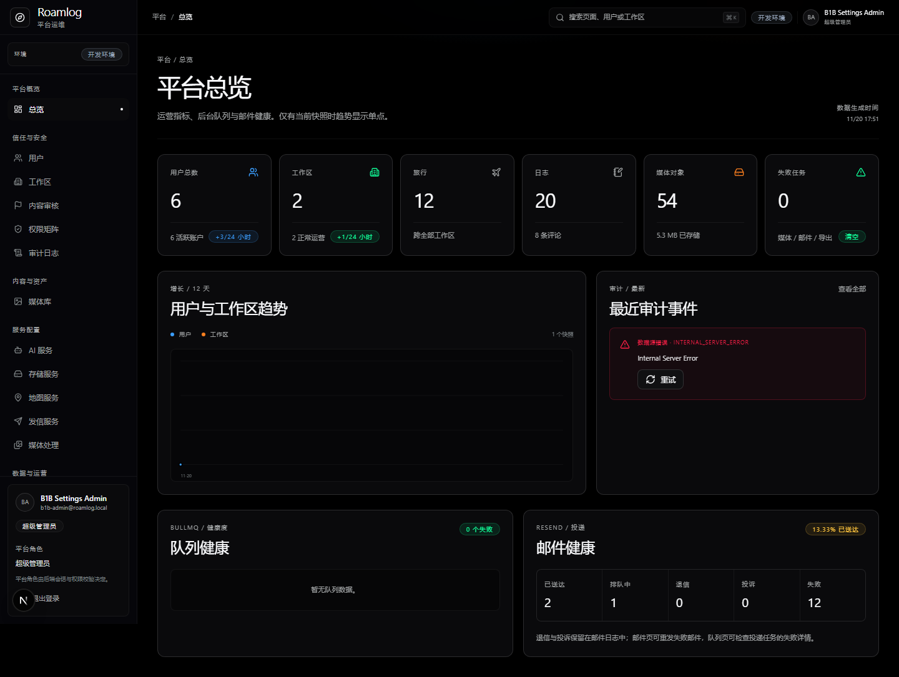 | /admin 总览 |
| 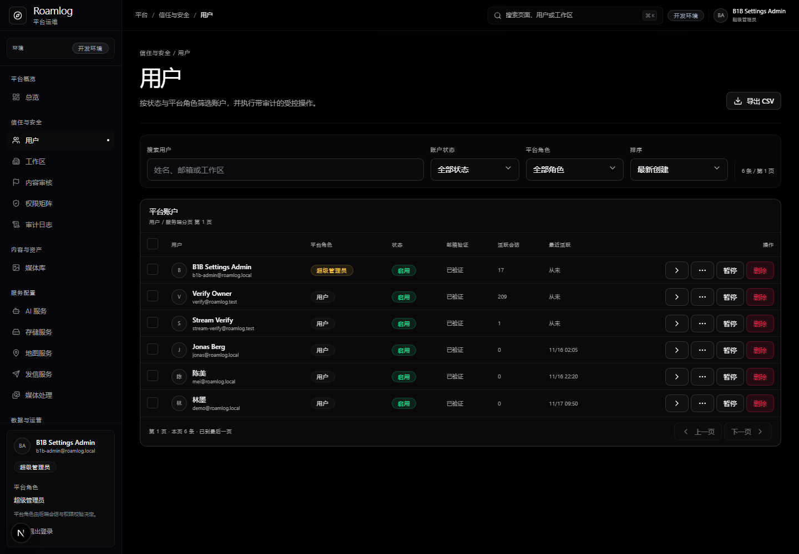 | /admin/users（6 个真实账号、真实计数） |
| 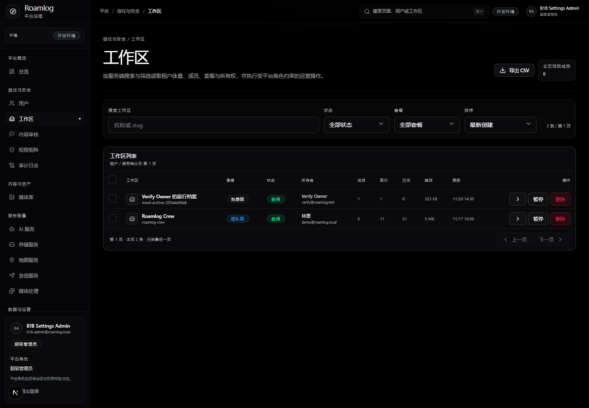 | /admin/workspaces |
| 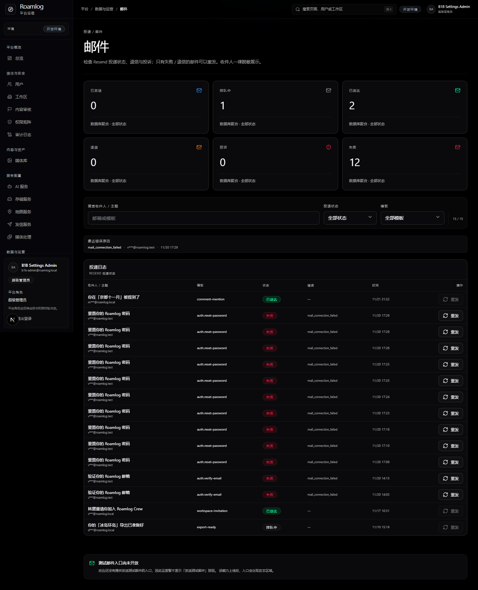 | /admin/emails（含改后的测试邮件卡片） |
| 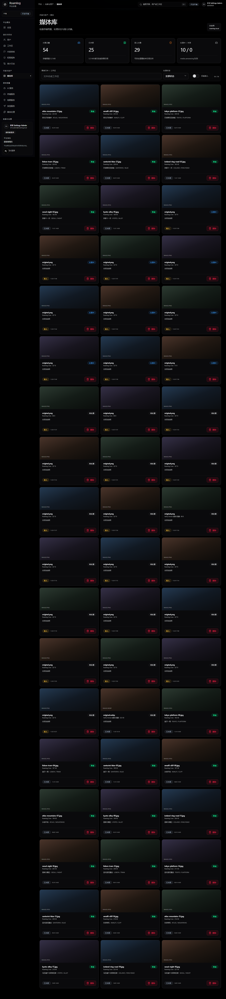 | /admin/media |
| 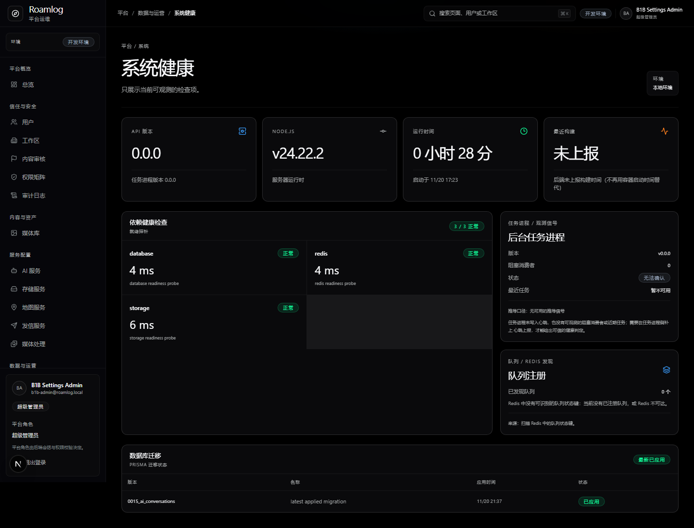 | /admin/system（未上报 / 无法确认 / 无可用的推导信号） |
| 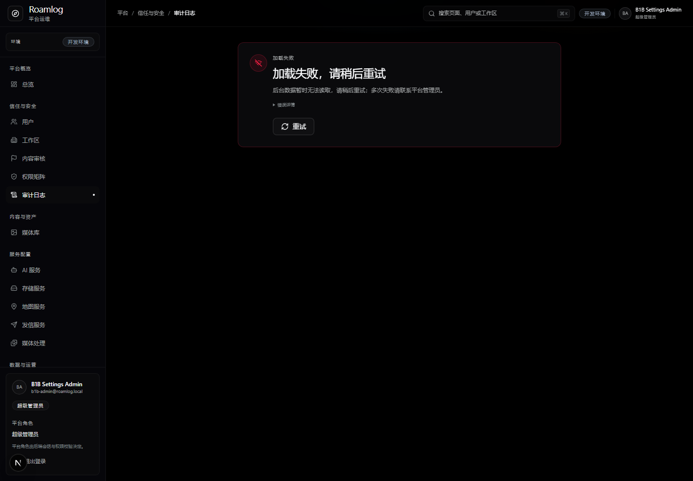 | /admin/audit（**加载失败态**，因后端 500，见风险 3） |
| 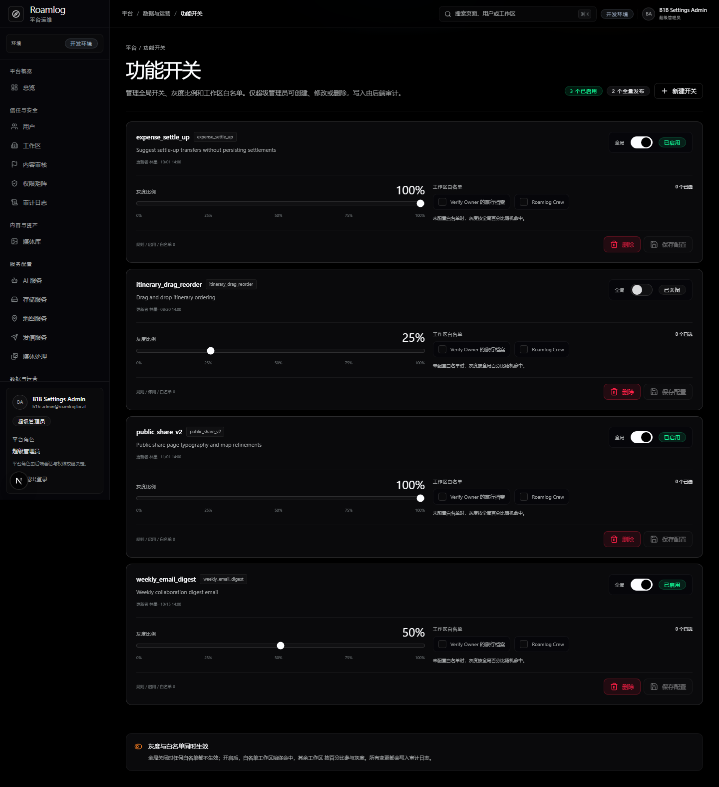 | /admin/flags |
| 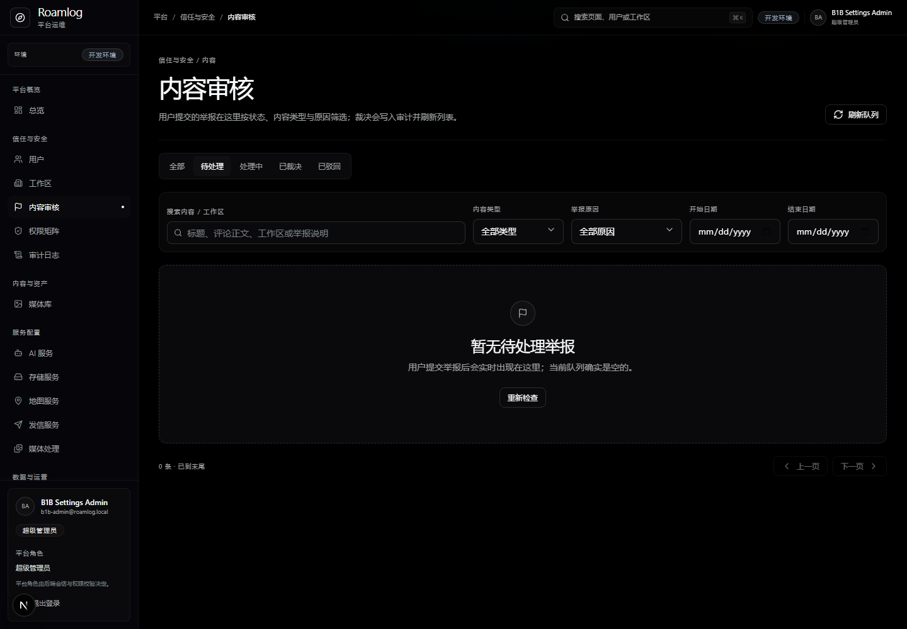 | /admin/content（真实空态） |
| 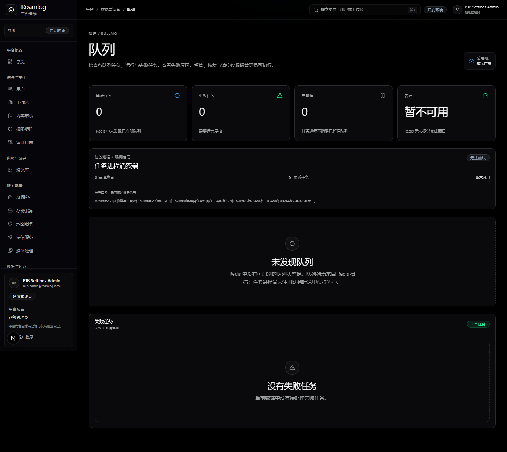 | /admin/queues（暂不可用 / 无法确认） |
| 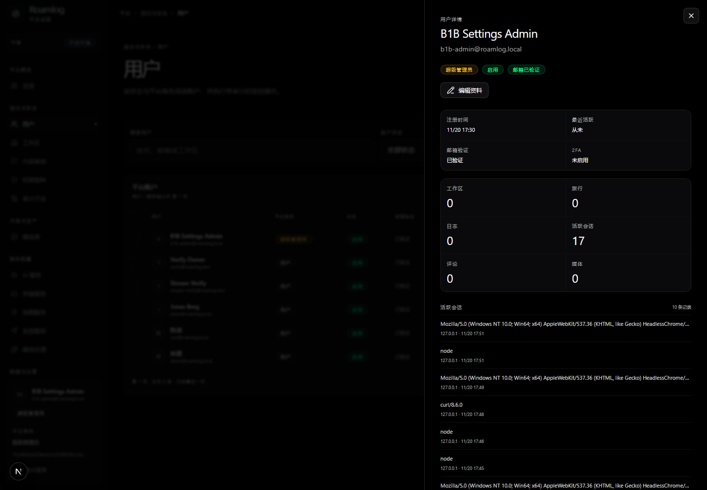 | 用户详情（7 条真实会话，无接口形状） |
| 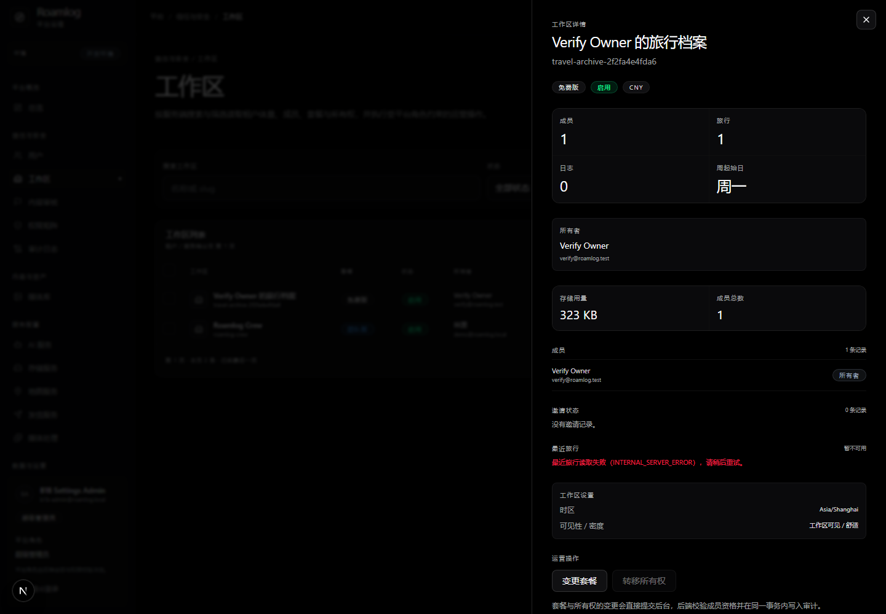 | 工作区详情（成员/邀请/328KB 存储） |
| 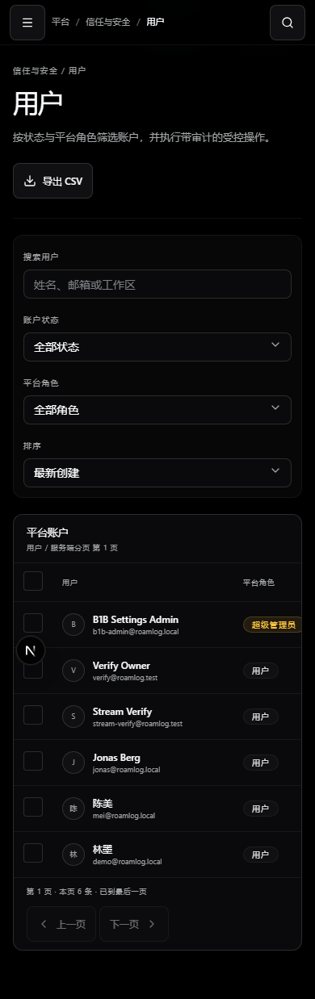 | 用户页 390 |
| 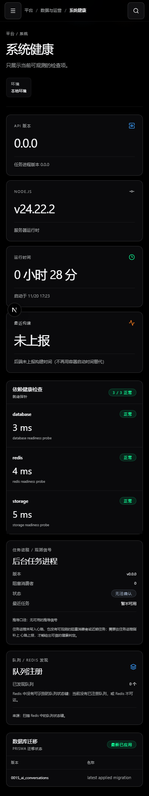 | 系统页 390 |
| 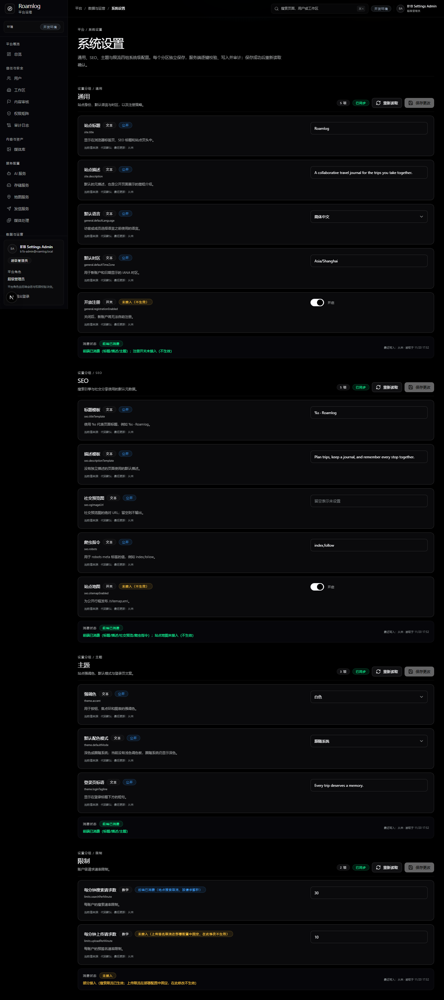 | /admin/settings（四组消费状态：注册开关/站点地图/上传限流均「不生效」） |

---

## 10. 验证命令与结果

| 命令 | 结果 |
| --- | --- |
| `pnpm --filter @roamlog/admin typecheck` | `tsc --noEmit`，**0 错误** |
| `pnpm --filter @roamlog/admin test` | **27 文件 / 173 测试全部通过** |
| `node node_modules/@playwright/test/cli.js test e2e/admin/ops-copy.spec.ts --reporter=list` | **15/15 通过** |
| `codegraph status` | `[OK] Index is up to date` |
| `grep -rn "未接入" apps/admin/{components,app}` | 仅剩 15 处＝`settings-consumption` 14 + `settings-group-form` 1（全部为 S3 保留） |
| `grep -rn "/v1/" ...（排除 fetch 代码）` | 仅剩 4 处，**全部是代码注释**，不进 UI |

**CodeGraph 证据**：`codegraph_explore("admin users detail sessions memberships ActiveSessionCount twoFactorEnabled")` → 命中 `apps/api/src/modules/admin/admin-users.service.ts:366 detail()`、`admin-workspaces.service.ts:369 detail()`、`packages/contracts/src/api/admin.ts:136-147`（`AdminUserDetailSchema` 的 `workspaces`/`sessions` 可选字段）、`packages/api-client/.../adminUserDetailSessionsItem.ts`、blast radius 指向 `AdminUserDetailSchema → AdminUserSessionSchema` 与 `users-view.tsx:85 UsersViewProps`。这是判定 B4/B6/B14/B16/B18「原文失实」的直接依据。

**移植来源**：本轮为**既有中文文案的删除/改写**，未新增功能、组件、交互、算法或状态机，因此没有「功能移植来源」可引。所有替换词复用仓库既有中文词族（`lib/labels.ts` 状态映射、`暂无…`/`未启用`/`未提供`），未自创状态体系。

---

## 11. 验证踩到的两个环境坑（已解决，供备忘）

1. **`localhost` → `::1` 优先**：Node 在本机把 `localhost` 解析成 `[{::1},{127.0.0.1}]`，而 API 只监听 IPv4，导致 `.env.local` 的 `API_URL=http://localhost:4000` 时 `:3001/v1/**` 全部 503。父 agent 已把 `.env.local` 改成 `127.0.0.1` 并重启 admin dev server，问题消失。**以后所有 agent 连本地服务不要用 `localhost`。**
2. **Playwright trace 在 Windows 上偶发 `browserContext.close: ENOENT …traces/*.network`**：本 spec 显式 `trace: "off"`，证据用「可见文本长度 + 逐页截图」承担。

---

## 12. v2：授权后追加（`apps/admin/lib/**` + `/admin/settings` 用例）

### 12.1 改了什么

| 文件:行 | 原文 | 处理 | 理由 |
| --- | --- | --- | --- |
| `lib/admin-data-source.ts:693-697` | `formatThroughput` 回退 `return … : "未接入";` | `暂不可用` | 吞吐窗口读不到＝**读不到**，不是「队列子系统没接」。改后 `queues-view` 的两处调用点兜底逻辑**撤回**（不再重复判断），单一真相回到 lib。 |
| `lib/admin-settings.ts:154` | `"部分接入（搜索限流已生效；上传限流未接入，仍读环境变量）"` | `"部分接入（搜索限流已生效；上传限流在部署配置中固定，在此修改不生效）"` | **去掉 env 实现细节，保留「在此修改不生效」这个关键结论**（运维最需要的那半句没丢）。 |
| `components/settings/settings-consumption.ts:75-78` | `"未接入（presign 限流仍读环境变量）"` | `"未接入（上传签名限流在部署配置中固定，在此修改不生效）"` | 与上一条同一能力的字段级标签，必须同口径；顺带去掉 `presign` 协议术语。 |
| `components/queues/queues-view.tsx` | 调用点 `Number.isFinite(...) ? formatThroughput(...) : "暂不可用"` | 撤回为 `formatThroughput(...)` | lib 修好后不再需要上层兜底，避免一个判断分散在两个文件 |
| `components/settings/admin-settings.test.ts` | 断言 `toContain("上传限流未接入")`、`label: "未接入（presign 限流仍读环境变量）"` | 改为断言含「上传限流」+「不生效」+ **不含「环境变量」**；字段级期望值同步 | 把「不能泄漏 env 细节」写成回归测试，而不只是改字符串 |

**保留未改**：`lib/admin-settings.ts:148`（`前端已消费 4/6 个键…保留原图与实况照片未接入（不生效）`）——S3 类，删/改会让运维以为「保留原图」开关生效。
**另有两处「环境变量」字样故意保留**：`lib/admin-settings.ts:140`（mail 组「任务进程仍读环境变量」）与 `setting-field.tsx:108`（「由环境变量锁定，界面不可改」）。它们不是「改了不生效」的结论，而是**告诉运维为什么改不动、要去哪改**（部署 env），属可执行信息；`setting-field` 那条还是界面锁定原因的说明。

### 12.2 `/admin/settings` 用例（新增第 15 个测试）

断言：
- `未接入（不生效）` 仍必须可见（S3 结论没被改掉）
- `上传限流在部署配置中固定，在此修改不生效` 必须可见（新文案到位）
- `ROAMLOG_` / `NEXT_PUBLIC_` / `/v1/` 一律不出现
- 整页过 `FORBIDDEN_COPY`，**唯一豁免是 `值（JSON）`**

**关于 JSON 豁免的更正**：我上一版报告说「settings 页仍显示 `值（JSON）`」——**这个判断是错的**。`值（JSON）` 只在 `item.type === "json"` 时渲染（`setting-field.tsx:173`），而当前部署只有四组（通用 / SEO / 主题 / 限制），没有任何 json 型字段，页面实际不显示它。豁免仍留在 spec 里作防御（将来真出现 json 型设置时，合法的格式标签不该被判成泄漏），并显式打日志 `(json value editor allowed)`，避免静默放宽。

### 12.3 `/admin/system` storage readiness——**已正常，stub 不需要改**

- **probe 用的检查**：`StorageService.checkHealth()`（`apps/api/src/modules/storage/storage.service.ts:322-329`）→ `HeadBucketCommand({ Bucket: bundle.bucket })`，即 **`HEAD /<bucket>`**（`S3_FORCE_PATH_STYLE=true` → `HEAD http://127.0.0.1:9000/roamlog-local`），**2.5s 超时**，走 `bundle.internal`（`S3_ENDPOINT`），失败即 `storage: down`。
- **不是我需要你补 stub，是时序问题**：我 17:41 那张红图拍的时候 API 还没吃到新 env / stub 还没起。现在实测：
  - `curl -I http://127.0.0.1:9000/roamlog-local` → **200**
  - live `GET /v1/admin/system` → `"storage": {"status":"up","latencyMs":8}`
  - 重跑截图 → 依赖健康检查 **3 / 3 正常**，storage **5 ms 正常**
- 所以 **stub 什么都不缺**。若以后又变红，按这个顺序查即可：① `HEAD /<bucket>` 是否 200（不是 `/minio/health/live`，也不是 ListBuckets）；② 是否在 2.5s 内返回；③ API 的 `S3_ENDPOINT` 是否还是 `localhost`（`localhost` 会先解析 `::1`，stub 只听 IPv4 就会红）。

### 12.4 v2 验证

| 命令 | 结果 |
| --- | --- |
| `pnpm --filter @roamlog/admin typecheck` | **0 错误** |
| `pnpm --filter @roamlog/admin test` | **173/173** |
| `node node_modules/@playwright/test/cli.js test e2e/admin/ops-copy.spec.ts --reporter=list` | **16/16** |
| `grep -rn "仍读环境变量\|上传限流未接入" apps/admin` | 0 命中 |
| `grep -rn "未接入" apps/admin/{components,app,lib}`（非测试） | 18 行：15 处 S3 可见文案 + 2 条注释 + 1 处 `admin-settings:148`（S3） |

### 12.5 生产禁用声明

**`b1b-admin@roamlog.local` 是本地 dev 数据，不得进入生产或 staging。** 该账号：无 TOTP 绑定、未写入仓库种子、仅因 dev 环境 `ADMIN_2FA_ENFORCED=false` 才可访问后台。生产必须通过 `super_admin` bootstrap 流程创建并强制完成 TOTP 注册。