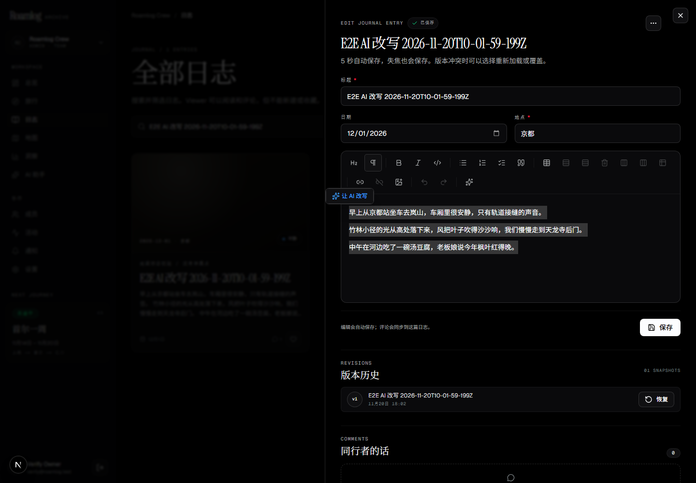
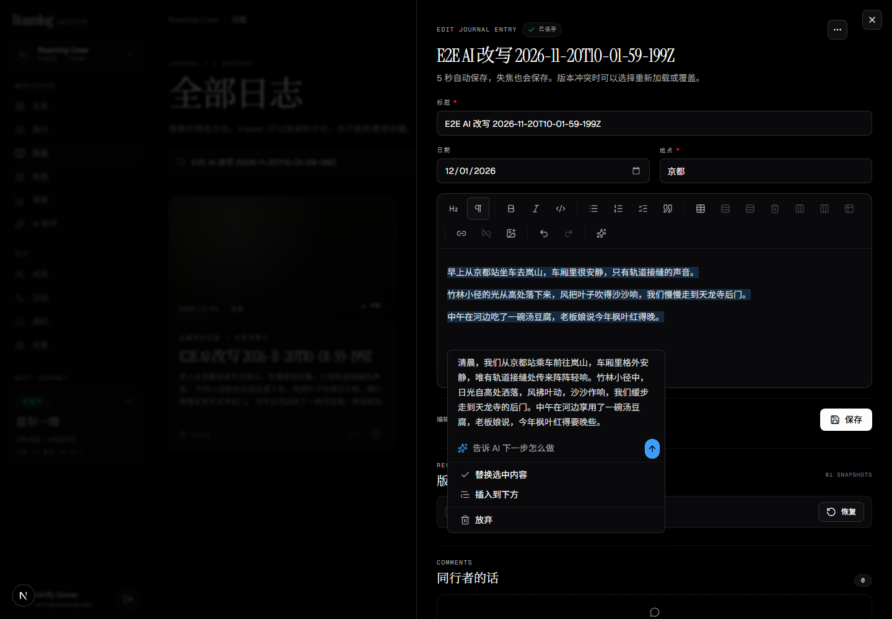
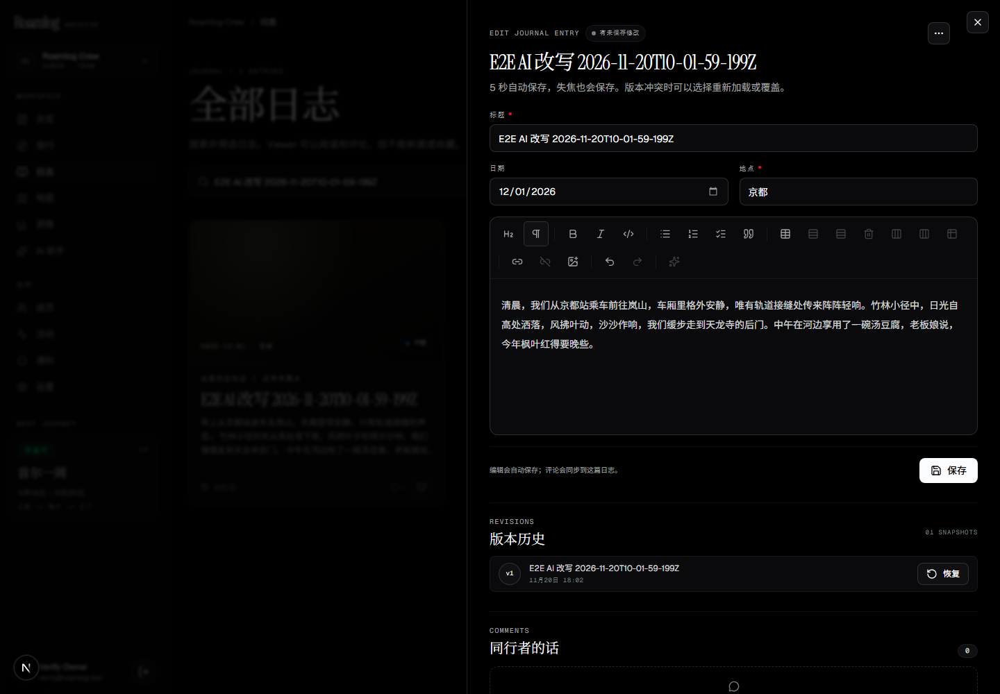
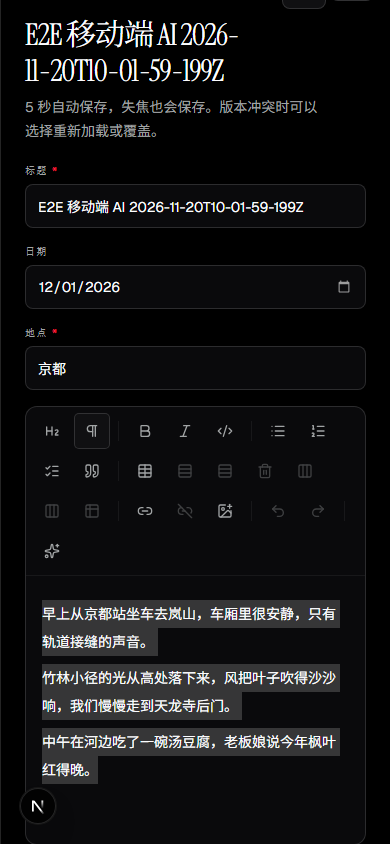
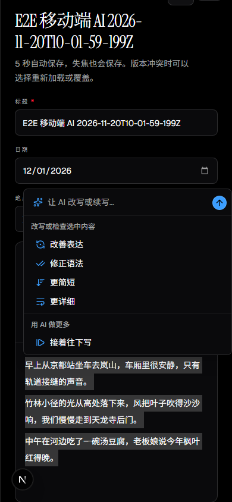

# EDITOR_AI_PORT — 日志编辑器 AI：Novel 干净完整移植

- 任务 ID：`EDITOR_AI_PORT`
- 状态：**DONE**
- 唯一上游：`steven-tey/novel` @ `fa95098e66476c466faebb8211baa5869c101a9c`（Apache-2.0，已实测 LICENSE）
- 验收运行：2026-11-20T10:01:59Z（本地 18:01:59 CST）起，`e2e/web/journal-ai.spec.ts` **2 passed (37.3s)**

## 1. 变更文件（含删除）

新增：

| 文件 | 内容 |
|---|---|
| `apps/web/lib/editor/ai-highlight.ts` | AI 高亮 mark（Novel 整文件） |
| `apps/web/lib/editor/text-context.ts` | `getPrevText` / `getAllContent` / `selectionMarkdown` |
| `apps/web/components/journal/ai/editor-bubble.tsx` | `EditorBubble` + `shouldShowBubbleMenu` |
| `apps/web/components/journal/ai/generative-menu-switch.tsx` | 气泡入口「让 AI 改写」 |
| `apps/web/components/journal/ai/ai-selector.tsx` | 面板状态机 + SSE 消费 |
| `apps/web/components/journal/ai/ai-selector-commands.tsx` | 4 个改法 + 续写 |
| `apps/web/components/journal/ai/ai-completion-command.tsx` | 替换 / 插入到下方 / 放弃 |
| `apps/web/components/journal/ai/command.tsx` | cmdk 面板基元（Novel `ui/command.tsx`） |
| `apps/api/src/modules/ai/ai-rewrite.controller.ts` | `POST .../ai/rewrite/stream`（SSE） |
| `apps/web/lib/editor/text-context.test.ts` | 11 条 |
| `apps/web/lib/editor/ai-highlight.test.ts` | 10 条 |
| `apps/web/components/journal/ai/editor-bubble.test.tsx` | 5 条 |
| `apps/web/components/journal/ai/ai-selector.test.tsx` | 12 条 |
| `e2e/web/journal-ai.spec.ts` | 真实浏览器 2 条 journey |

修改：`packages/contracts/src/api/ai.ts`、`packages/contracts/src/__tests__/ai.test.ts`、
`apps/api/src/modules/ai/ai-rewrite.prompts.ts`、`apps/api/src/modules/ai/ai-rewrite.service.ts`、
`apps/api/src/modules/ai/ai.module.ts`（+1 行 controller 注册）、
`apps/api/src/modules/ai/__tests__/ai-rewrite.service.spec.ts`、`apps/api/src/modules/ai/__tests__/ai.controller.spec.ts`（1 个 fixture 字面量）、
`apps/web/lib/ai/rewrite.ts`、`apps/web/lib/ai/rewrite.test.ts`、`apps/web/lib/ai/selection.ts`、
`apps/web/components/journal/journal-editor.tsx`、`apps/web/components/journal/journal-editor-sheet.tsx`（移出已废弃的 `readOnly` 透传）、
`apps/web/package.json`、`pnpm-lock.yaml`。

删除（用户明确要求的「删掉我们的自创」）：

- `apps/web/components/journal/journal-ai-rewrite.tsx`（467 行自定交互）
- `apps/web/components/journal/journal-ai-rewrite.test.tsx`
- `apps/web/lib/ai/rewrite-preview.ts`（diff 片段生成）
- `apps/web/lib/ai/diff.js`、`apps/web/lib/ai/diff.d.ts`（仅 diff 预览使用）

## 2. 移植来源（逐文件）

| # | Novel 路径 @ fa95098 | 行号 | 我们的目标 | 形式 |
|---|---|---|---|---|
| 1 | `packages/headless/src/extensions/ai-highlight.ts` | 1–124（`Mark.create` 29–112，命令 69–87，`Mod-Shift-h` 89–93，`removeAIHighlight` 114–118，`addAIHighlight` 119–124） | `apps/web/lib/editor/ai-highlight.ts` | 整文件 |
| 2 | `packages/headless/src/components/editor-bubble.tsx` | 24–37（`shouldShow`） | `apps/web/components/journal/ai/editor-bubble.tsx`（`shouldShowBubbleMenu`） | 整文件 |
| 3 | `packages/headless/src/utils/index.ts` | 24–44（`getPrevText` 25–36，`getAllContent` 39–44） | `apps/web/lib/editor/text-context.ts` | 片段 |
| 4 | `apps/web/components/tailwind/generative/generative-menu-switch.tsx` | 1–48（effect 15–17，`EditorBubble` 19–28，`Ask AI` 30–40，children 41） | `apps/web/components/journal/ai/generative-menu-switch.tsx` | 整文件 |
| 5 | `apps/web/components/tailwind/generative/ai-selector.tsx` | 1–111（`useCompletion` 29–41，`hasCompletion` 43，结果区 47–55，加载 57–65，输入 68–75，提交 76–94，两态 96–106） | `apps/web/components/journal/ai/ai-selector.tsx` | 整文件 |
| 6 | `apps/web/components/tailwind/generative/ai-selector-commands.tsx` | 1–73（选项 5–26，分组 37–53，`continue` 55–68） | `apps/web/components/journal/ai/ai-selector-commands.tsx` | 整文件 |
| 7 | `apps/web/components/tailwind/generative/ai-completion-command.tsx` | 1–66（props 5–11，替换 16–37，插入到下方 38–52，放弃 56–61） | `apps/web/components/journal/ai/ai-completion-command.tsx` | 整文件 |
| 8 | `apps/web/components/tailwind/ui/command.tsx` | 1–134 | `apps/web/components/journal/ai/command.tsx` | 整文件（去 `CommandDialog`） |
| 9 | `apps/web/app/api/generate/route.ts` | 39–116（六个 option 的 system/user 原文），118–128（`streamText`） | `apps/api/src/modules/ai/ai-rewrite.prompts.ts` | 片段（只取 prompt） |
| 10 | 装饰：`ui/icons/magic.tsx`（32）、`ui/icons/crazy-spinner.tsx`（11） | — | `Sparkles`（lucide）、内联 `ThinkingDots` | 等价替换 |

许可证义务（Apache-2.0 §4(b)）：每个移植文件头都保留了「移植来源 + commit + 许可 + 修改说明」块。

## 3. 依赖变更

```
pnpm --filter @roamlog/web add @tiptap/core@3.34.0 @tiptap/pm@3.34.0 \
  @tiptap/extension-bubble-menu@3.34.0 @floating-ui/dom@^1.6.0 cmdk
```

- 结果：`Packages: +5`，`Done in 7.2s`；随后 `pnpm install` → `Already up to date`（0 冲突）。
- `cmdk@^1.1.1` 安装成功，**未自写键盘导航**。
- `@floating-ui/dom` 声明为 `^1.6.0`，实际解析 **1.8.0**（仓库原有版本，避免把 tiptap 的既有 peer 降级）。
- 锁文件证据：`git diff pnpm-lock.yaml` **只有 1 行删除**，且是
  `@tiptap/extension-floating-menu@3.34.0` 的 `optional: true` 标记被清掉
  （因为新装的 `@tiptap/extension-bubble-menu` 现在依赖它）；其余全部为新增
  （`@tiptap/core`、`@tiptap/pm`、`@tiptap/extension-bubble-menu`、`cmdk`、`@floating-ui/dom` 的 specifier 条目与快照）。
  没有任何其它包被改动或升级。

## 4. 契约变更（`packages/contracts/src/api/ai.ts`）

```ts
export const AI_REWRITE_INSTRUCTIONS = [
  "continue", "improve", "shorter", "longer", "fix", "zap",
] as const;
```

- **删除的旧指令**：`shorten`、`expand`、`polish`、`fix_grammar`、`tone_formal`、`tone_casual`（后两者是本仓库自创，上游完全没有）。
- **新字段**：`contextBefore?: string`（Novel `getPrevText`；`continue` 的数据源）、`command?: string`（`zap` 的自由指令）。
- **长度上限**：新增 `AI_REWRITE_MAX_CONTEXT_CHARS = 6_000`（服务端截断）、`AI_REWRITE_MAX_COMMAND_CHARS = 500`。
- **安全姿态（未因为移植 zap 就全开闸门）**：
  - `command` 只允许配 `instruction: "zap"`（`superRefine` 拒绝其它组合）；
  - `continue` 必须带非空 `contextBefore`；
  - 保留 `text`（必填、被哈希）与 `selectionHash`（SHA-256），服务端仍复算比对；
  - `prompt` / `system` 等未声明字段依旧被 `.strict()` 拒绝。
- 测试锁：`packages/contracts/src/__tests__/ai.test.ts` 新增 4 组断言（指令全集、zap+command 合法与超长拒绝、非 zap 拒绝 command、continue 需 contextBefore），**166 passed**。

## 5. 后端 prompt（逐字抄 + 修上游 bug）

`apps/api/src/modules/ai/ai-rewrite.prompts.ts`：

| 指令 | Novel 逐字原文（`route.ts`） | 落点 |
|---|---|---|
| `continue` | :44–47 | `SYSTEM_PROMPTS.continue` |
| `improve` | :58–60 | `improve` |
| `shorter` | :71 | `shorter` |
| `longer` | :82–83 | `longer` |
| `fix` | :94–96 | `fix` |
| `zap` | :107–109（保留上游笔误 `You area`） | `zap` |

user 模板逐字对应：`:49-52`（continue＝上文）、`:62-65/:73-76/:85-88/:98-101`（`The existing text is: …`）、`:111-114`（`For this text: …. You have to respect the command: …`）。

**上游 bug 的修正**：Novel `route.ts:118-119` 是
`streamText({ prompt: messages[messages.length - 1].content })` —— **只把最后一条 user 消息当 prompt**，
前面 `role: "system"` 的消息从未生效，那六段 system 文案在 Novel 里是死代码。
本仓库的 `AiProtocolAdapter.step/streamStep` 把 `system` 作为独立字段，三个 adapter 都真正写进 provider 请求体
（`openai-chat.adapter.ts:49,118` → `messages[0].role="system"`；`anthropic-messages.adapter.ts:50,116` → 顶层 `system`；`openai-responses.adapter.ts:47,119` → `instructions`）。
因此 system 与 user **两条都真实下发**。这一点在文件头注释里也写明了。

**其它有意偏离（均注释在案）**：① `Use Markdown formatting when appropriate` 删除（结果以纯文本 `insertContentAt` 写回，若保留会写出星号；上游删掉该句后 `sentences.Use`/`textUse` 的漏空格笔误自然消失）；② `${prompt}`/`${command}` 改为 JSON 数据块（防注入）；③ `locale` 语言规则（上游没有，中文产品需要）。

**未采纳的偏离**：上游 `improve`/`fix`/`continue` 的「no more than 200 characters」**原样保留**（规格 R6 列为「需批准后才改 budget」，本任务未获批，故照抄；中文长段落的截断风险见 §10）。

## 6. TipTap 2 → 3 适配（D1–D12）

| 项 | 处理 |
|---|---|
| D1 | `BubbleMenu` 从 `@tiptap/react/menus` 导入 |
| D2 | `tippyOptions` → `options`；`onHidden` → `options.onHide`（已从 `@tiptap/extension-bubble-menu` 源码 `BubbleMenuView.hide()` 确认是等价回调）；`onCreate` 的 blur 拦截改为 ref + effect；`moveTransition` → `transition-transform duration-150 ease-out` |
| D3 | 四个新依赖已装（见 §3） |
| D4 | `journal-editor.tsx:131` 的 `shouldRerenderOnTransaction: true` **保留**；并且**修掉了它与 v3 BubbleMenu 的交互陷阱**（见 §9） |
| D5 | `editor.storage.markdown.manager.serialize(doc.toJSON())`（v3 只接受 JSONContent）；`selectionMarkdown` 用 `slice.content.toJSON()`；`editor.getMarkdown()` 亦可 |
| D6 | 沿用仓库既有 v3 import 路径（`@tiptap/extension-table`、`@tiptap/extension-placeholder` 等），未引入 v2 分包 |
| D7 | 未用 `setContent` 写结果，走 `insertContentAt`，天然不触发 update 回环 |
| D8 | `Replace selection` / `Insert below` 仍是 `insertContentAt`，行为未变 |
| D9 | 无自定义 NodeView，无影响 |
| D10 | 不涉及字数统计 |
| D11 | 全部 `"use client"`；`immediatelyRender: false` 保留；无模块级 `window` 访问 |
| D12 | **未引 AI SDK**：`streamRewrite` 手写 fetch + ReadableStream，事件沿用冻结 v1（`meta/text.delta/usage/error/done`），中止为 `done{aborted}` |

## 7. 交互对照（Novel 有 → 我们做成什么样）

| Novel | 我们 |
|---|---|
| 选中非空文字 → 气泡出现「Ask AI」 | 气泡出现「让 AI 改写」（`data-testid=ai-ask-ai`） |
| 不可编辑 / 图片 / 空选区 / NodeSelection → 整条气泡消失 | 逐行照抄 `shouldShow`（单测 5 条） |
| 面板：命令列表（improve/fix/shorter/longer）分组 + continue | 同顺序：改善表达 / 修正语法 / 更简短 / 更详细；「用 AI 做更多」→「接着往下写」 |
| `continue` 传 `getPrevText(editor, selection.from)`，**不传选区** | 同（`contextBefore` + `text`） |
| 输入框自由指令 = `zap`；聚焦输入框即高亮选区 | 同（`onFocus → addAIHighlight`） |
| 有结果时再次提交 = 在上一次结果上迭代 | 同（`run(completion, {option:"zap", command})`） |
| 结果态：Replace selection / Insert below / Discard | 替换选中内容 / 插入到下方 / 放弃（三操作均在 DOM 中被 E2E 断言） |
| 加载态 `AI is thinking` + spinner，输入行消失 | 「AI 正在思考」+ 三点 spinner，输入行消失 |
| 429 → toast.error，其它错误 → toast.error | 面板内错误 + 重试/关闭（spec §6.2 #11：面板内比 toast 更可达） |
| 高亮 mark + `Mod-Shift-h` | 同（`Mod-Shift-h` 单测覆盖） |
| 结果 Markdown 富文本预览 | **纯文本预览**（见 §8） |

## 8. 标注为适配层的部分（逐条理由）

1. **终止/停止按钮（本仓库原创）**：Novel 从不调用 `useCompletion.stop`，没有中止 UI。长日志改写可能十几秒，加「停止」+ `AbortController`；服务端收尾 `done{aborted}`，**不写文档**。上游缺它是因为 demo 不需要。
2. **移动端常驻工具栏入口（本仓库原创）**：Novel 无任何触摸/小屏分支，气泡在触摸选区下不稳定；因此保留工具栏「让 AI 改写」按钮——空选区时 `disabled` + `title="先选中一段文字，再让 AI 改写"`（不隐藏，用户仍知道功能存在）。
3. **纯文本结果预览**：Novel 用 `react-markdown`，因为它的 prompt 要求 Markdown。本仓库没有该依赖（未获批），且后端 prompt 已删掉 Markdown 指令、结果以纯文本写回，所以纯文本预览**才是等价实现**，避免「预览富文本、插入星号」。
4. **面板宽度/溢出约束**：Novel 无移动端宽度策略。v3 给气泡元素写死 `width: max-content`，中文结果没有空格可换行，长结果会把气泡拉到视口外（实测 `document.scrollWidth` 超出 1440 → 页面横向滚动）。适配为面板显式 `width: min(350px, calc(100vw - 24px))` + 结果区 `w-[350px] max-w-[calc(100vw-24px)] [overflow-wrap:anywhere]`，实测面板 350px、右边界 1073 < 1440。
5. **AI 高亮不入库（本仓库原创，必需）**：Novel 没有持久化；本仓库日志 5 秒自动保存。高亮 mark 会①把文档标脏②自动保存后重置编辑器③选区塌陷 → 气泡 `shouldShow=false` → 关闭面板、丢掉正在流式输出的结果（实测：AI 流开始 4s 后，PATCH /entries 于 8.6s 触发，面板 9.7s 消失）。修法：`journal-editor.tsx` 的 `onUpdate` 用 `stripAIHighlight` + `stripAIHighlightHtml` 剥掉 mark 再比较签名，签名不变则不上报；`stripAIHighlight` 还会把高亮切开的相邻 text 节点合并，使「只有高亮变化」与原文逐字节相同（单测覆盖）。
6. **Type 适配**：上游 `useEditor()`（novel 的 EditorProvider context）→ 显式 `editor` prop。原因：v3 的 `EditorProvider` 会再渲染一个 `EditorContent`，与 `journal-editor.tsx` 已有的冲突。
7. **设计 token / i18n**：`bg-popover/text-muted-foreground/purple-500` → `bg-surface-1/text-muted/accent-blue`；高亮色 `#c1ecf970` → `rgba(59,158,255,0.22)`；全部文案按 spec §6.5 中译表替换。
8. **`meta` 帧的会话 id**：改写的流不持久化任何会话，但冻结的 v1 `meta` 要求 UUIDv7，因此服务端为每条流生成一次性 id（不存库、不复用）。这是传输层适配，未改任何事件名或字段。

## 9. 本任务的技术产出：v3 BubbleMenu × `shouldRerenderOnTransaction` 死循环

首次全量 web 测试时 `journal-editor-sheet.test.tsx` 4 条同时报：

```
Error: Maximum update depth exceeded. This can happen when a component
repeatedly calls setState inside componentWillUpdate or componentDidUpdate.
React limits the number of nested updates to prevent infinite loops.
  at forceStoreRerender … @tiptap/react/dist/index.js:241:44
  at Editor.emit … @tiptap/core/dist/index.js:3500:59
```

根因：`@tiptap/react/dist/menus/index.js` 的 `BubbleMenu` 有一个 effect，在
`options` / `shouldShow` 的**引用**变化时执行
`pluginEditor.view.dispatch(tr.setMeta(key, {type:"updateOptions", ...}))`；
而 `journal-editor.tsx:131` 的 `shouldRerenderOnTransaction: true`（D4，必须保留）让每个事务都重渲染
→ 新 `options` 对象 → 再 dispatch → 无限循环。

修法：`options` 用 `useMemo`、`shouldShow` 用 `useCallback` 固定引用；`EditorBubble` 不再 `{...options}` 复制。

**为什么不能靠去掉 `shouldRerenderOnTransaction` 绕过**：它同时驱动既有的 AI 模型卡 / 工具卡 / 计划卡在事务后刷新（另一 agent 的 `components/ai/**` 依赖它）；关掉会让那些卡片停在旧状态（工具卡不更新、流式气泡不刷新）。所以必须保留标志、修引用稳定性。

## 10. 测试清单

单元 / 组件（全部通过）：

| 文件 | 条数 | 覆盖 |
|---|---|---|
| `apps/web/lib/editor/text-context.test.ts` | 11 | getPrevText 位置边界、getAllContent、selectionMarkdown、**Markdown 扩展不改变 getJSON/getHTML/getText**、**insertContentAt 字面星号**、**旧编辑器读新 HTML / 新编辑器读旧 HTML / DB JSON 往返** |
| `apps/web/lib/editor/ai-highlight.test.ts` | 10 | 三命令注册、data-color+inline 背景、显式颜色、全文清除、幂等、`Mod-Shift-h`、`<mark>` 解析、strip JSON 合并切分节点、strip HTML、保留其它 mark |
| `apps/web/components/journal/ai/editor-bubble.test.tsx` | 5 | 空选区 / 只读 / 图片 / NodeSelection / 有选区 |
| `apps/web/components/journal/ai/ai-selector.test.tsx` | 12 | 5 个命令顺序与分组、流式结果 + 三操作、替换、插入到下方、放弃、选区漂移拒写、continue 取上文、二次提交迭代（zap）、错误 + 重试、加载态 + 停止、聚焦高亮 |
| `apps/web/lib/ai/rewrite.test.ts` | 18 | 新增 `streamRewrite` 6 条：逐字节分块解析（含中文多字节）、continue/zap 上线字段、429 预检、坏帧、缺 done、abort |
| `apps/api/.../ai-rewrite.service.spec.ts` | 19 | 新增 7 条：continue 截尾 6000、长 continue 不 422、zap 数据块 + system 原文、流式事件序列、abort、空结果、非 zap 带 command 400 |
| `packages/contracts/src/__tests__/ai.test.ts` | 45（全 166） | 指令全集锁、zap/command 边界、continue 必需 contextBefore |

全量结果：

- `apps/web` **605 passed / 71 files**（0 失败）
- `apps/api` AI 模块 **193 passed / 28 skipped**（skipped 为需要 `ROAMLOG_TEST_DATABASE_URL` 的 DB e2e）
- `packages/contracts` **166 passed**
- `npx tsc --noEmit`：web **0 错误**、api **0 错误**

真实 UI 自动化：`e2e/web/journal-ai.spec.ts`

- 运行命令：
  `node node_modules/@playwright/test/cli.js test e2e/web/journal-ai.spec.ts --project=web --reporter=list`
- 结果：**2 passed (37.3s)**；`retries: 2`（三次尝试），本轮 deskop journey **attempts=2**（第一次命中网关 `AI_UPSTREAM`，面板内「重试」第二次成功），mobile journey 未触达模型。
- 覆盖：真实登录（`verify@roamlog.test`）→ `/w/roamlog-crew/journal` → 新建日志（真实 API + DB）→ 选中全文 → **空选区时断言气泡不存在** → 气泡出现 → 改善表达 → SSE 流式结果（`content-type: text/event-stream; charset=utf-8`，HTTP 200）→ 三操作齐全 → 替换 → **断言正文变为结果** → 再次空选区断言气泡消失 + 工具栏按钮 `disabled` 且 `title` 为原因；移动 390 走工具栏入口、断言面板在视口内。
- 网关 stub：**无**。仅第三方模型网关偶发失败由重试吸收，未伪造任何响应。

## 11. 真实 UI 截图

生成时间均为 **2026-11-20 18:02 CST**（本地时间；`run-timestamp.txt` = `2026-11-20T09:59:19.073Z`）。

桌面 1440：





移动 390：




机器可读证据：`desktop-1440.json`（attempts、streaming 状态码/content-type、替换前后正文）。

## 12. 验证命令与结果

```bash
pnpm --filter @roamlog/web add @tiptap/core@3.34.0 @tiptap/pm@3.34.0 \
  @tiptap/extension-bubble-menu@3.34.0 @floating-ui/dom@^1.6.0 cmdk   # +5 packages, ok
pnpm install                                                          # Already up to date
cd apps/web && npx tsc --noEmit                                       # 0 errors
cd apps/web && npx vitest run                                         # 605 passed
cd apps/api && npx tsc --noEmit                                       # 0 errors
cd apps/api && npx vitest run src/modules/ai                          # 193 passed / 28 skipped
cd packages/contracts && npx vitest run                               # 166 passed
node node_modules/@playwright/test/cli.js test e2e/web/journal-ai.spec.ts \
  --project=web --reporter=list                                      # 2 passed (37.3s)
curl -s -o /dev/null -w '%{http_code}' -X POST \
  http://127.0.0.1:4000/v1/workspaces/<id>/ai/rewrite/stream -d '{}'  # 401（路由存在；不存在是 404）
```

## 13. CodeGraph 证据

- `codegraph status` → `Files: 2,095 / Nodes: 35,076 / Edges: 81,852`（移植前 2,053 文件，新增即本任务文件；`codegraph sync` 期间被另一进程持锁，但索引已含新文件）。
- `codegraph explore "generative-menu-switch AISelector AISelectorCommands AICompletionCommands streamRewrite"`
  → 命中 7 个文件 / 53 个符号，并自动给出调用链：
  `AISelector (ai-selector.tsx:59) → run (:88) → streamRewrite (apps/web/lib/ai/rewrite.ts:188)`，
  以及动态渲染关系 `GenerativeMenuSwitch → AISelector → AICompletionCommands / AISelectorCommands / CommandInput`。
- blast radius：`journal-ai-rewrite.tsx`（已删）的 4 处调用点全部收敛到新的 `ai/generative-menu-switch.tsx`；
  `hashSelection` / `rewriteBlockReason` 的引用保持（`lib/ai/selection.ts` 仅换标签表）。

## 14. 已知风险 / 未覆盖

1. **上游 200 字符上限保留**：`improve`/`fix`/`continue` 的 system 仍写「no more than 200 characters」。中文长段落会被截短（实测 200 字以内的中段改写正常）。改成按比例预算需要用户批准（规格 R6），一行即可切换。
2. **`continue` 上下文截断策略是产品参数**：取「选区之前全文的尾部 6000 字」（因为 Novel 自己的 prompt 说「later characters 权重更高」）。上游完全不截断。
3. **`zap` 的注入面**：`command` 走 JSON 数据块 + 500 字上限 + 只允许配 zap；但自由指令本身仍能影响输出风格（这是功能本身）。
4. **撤销栈污染（照抄上游 R4）**：`addAIHighlight`/`removeAIHighlight` 未设 `addToHistory:false`，开关面板会在 undo 栈留下一步。已剥离持久化，但历史栈行为与上游一致。
5. **`Insert below` 落点**：照抄 `insertContentAt(selection.to + 1)`，在块级边界上的落点与上游完全一致（可能插入到下一块起点）。未做额外智能。
6. **多设备/并发**：改写结果写回仍走既有 `version` 乐观锁；选区漂移用哈希拦截。未覆盖「同一段落两端同时改写」的跨端场景（无 CRDT）。
7. **`components/api-client` 生成物**：`packages/api-client/src/generated/**` 里仍是旧的 6 个指令枚举，未重新生成 OpenAPI/Orval（不在可写范围）。服务端已按新契约校验，生成物需由契约再生任务同步。
8. **并发提交**：18:04 有另一个 agent 的提交 `b22fc16` 顺带把部分已跟踪文件（含 `packages/contracts/src/api/ai.ts` 我的改动）纳入版本库；我未执行任何 `git add` / `commit`。
9. **移动端仅验证到面板可见与宽度**：未做触摸拖拽选区的自动化（上游本身无触摸适配）。