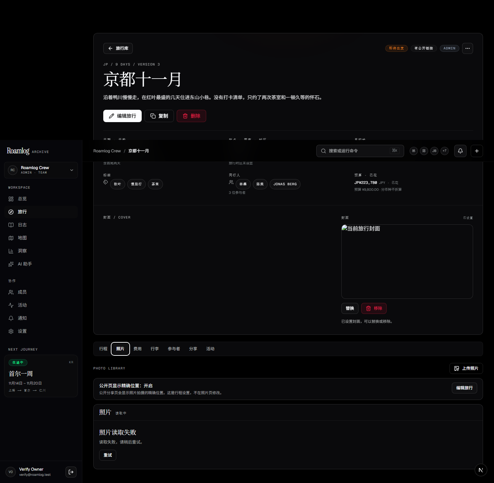
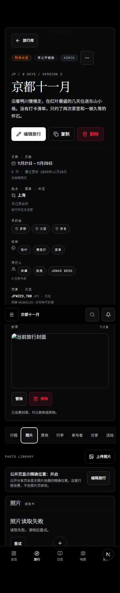

# P0-ERROR-COPY — 照片查询 503 错误态

## 环境

- Web: `http://localhost:3000`（真实 Next dev）
- API: `http://localhost:4000`，`/v1/ready` 返回 200
- 登录：真实 Better Auth owner 会话（`verify@roamlog.test`）
- 目标：`roamlog-crew` / `京都十一月` / `019b7a6f-24fc-78df-98d4-214f1c0779f7`
- 拦截：Playwright 将 `GET /v1/trips/*/media` 固定返回 503，响应体不是合法 Problem Details，因此走用户文案兜底。

## 断言

- `照片读取失败` 可见。
- `读取失败，请稍后重试。` 可见。
- `重试` 按钮可见。
- 页面可见文本不含 `/v1/`。
- 页面可见文本不含 `HTTP 503`。
- 每个视口拦截到 2 次 media 读请求，错误态不是缓存或空数据误判。

## 截图

### 桌面 1440



### 移动 390



## 复跑

```bash
node .audit/error-copy/capture-photos-503.ts
```

机器可读证据：`photos-503-evidence.json`。
