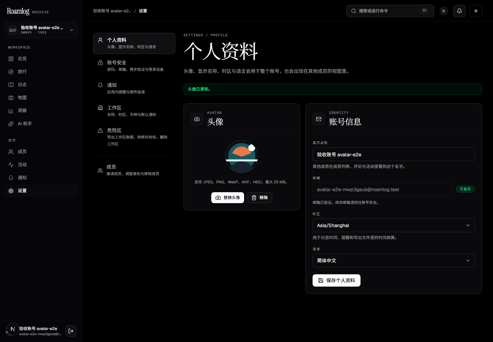
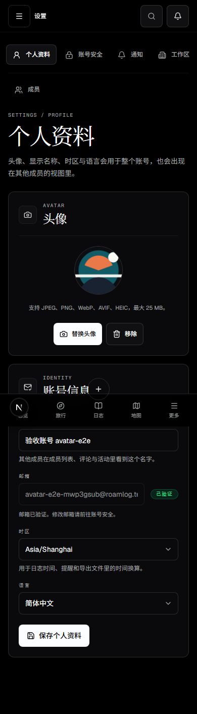
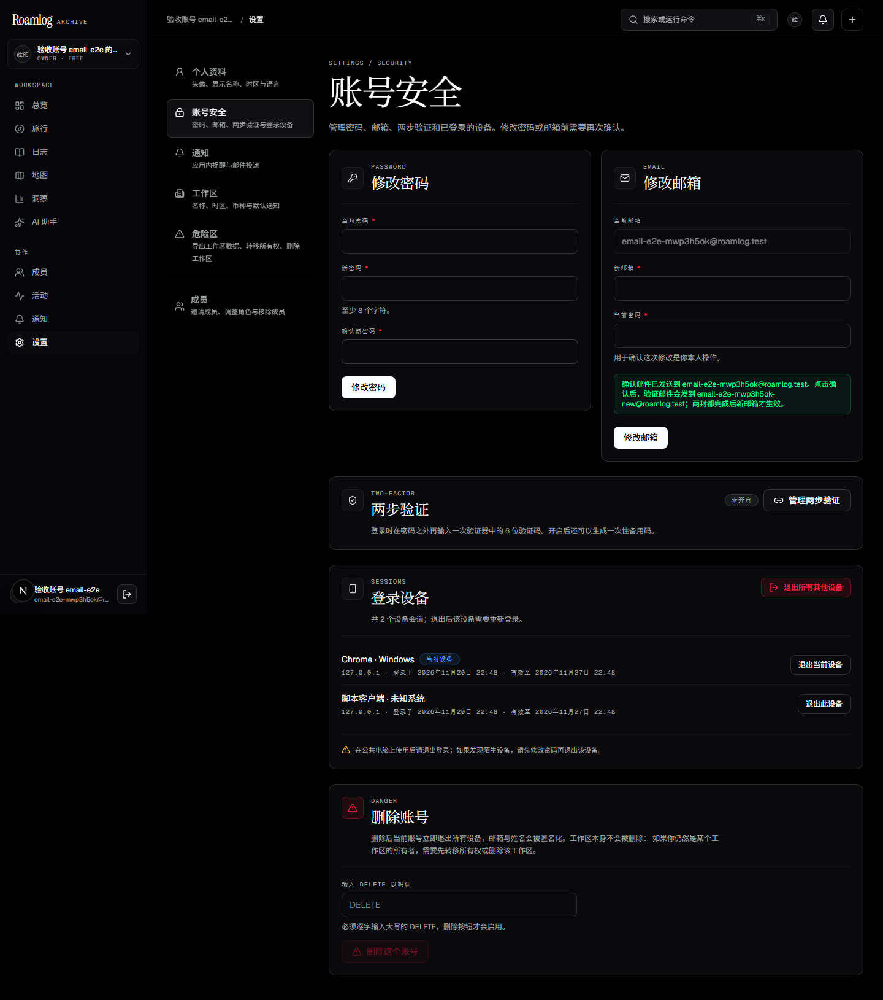
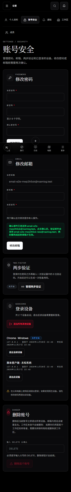
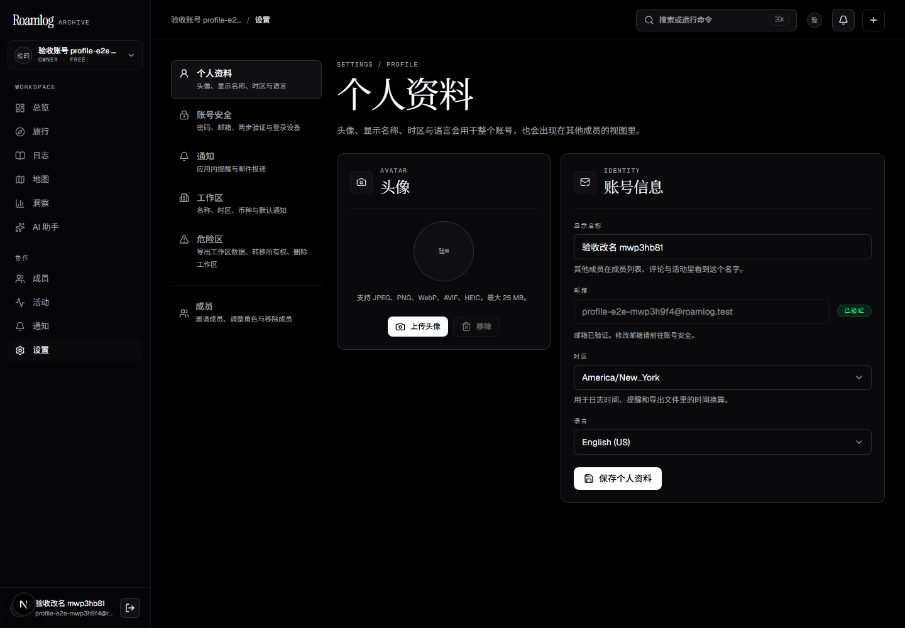
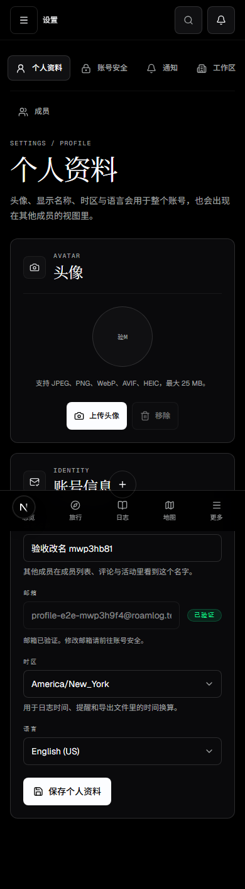

# P0-LIVE-LIMITS-QA — isolated live stack acceptance

状态: **DONE / PASS**
任务 ID: **P0-LIVE-LIMITS-QA**
验收结论: **ACCEPT**

## 变更文件

只新增了 `.audit/live-limits-qa/**` 证据文件；没有修改产品源码，也没有修改
`e2e/avatar-email/**`。

- `.audit/live-limits-qa/report.md`
- `.audit/live-limits-qa/playwright-run.log`
- `.audit/live-limits-qa/limits-probe.json`
- `.audit/live-limits-qa/db-evidence.json`
- `.audit/live-limits-qa/probe-limits.mjs`
- `.audit/live-limits-qa/db-probe.mjs`
- `.audit/live-limits-qa/db-evidence.mjs`
- `.audit/live-limits-qa/pg.log`
- `.audit/live-limits-qa/worker.out.log` / `worker.err.log`
- `.audit/live-limits-qa/api-4173.out.log` / `api-4173.err.log`（空日志，API 以
  `LOG_LEVEL=warn` 正常启动）

`e2e/avatar-email/` 的 mtime 全部早于本任务开始时间（22:33）：README 21:34、
change-email 21:17、support 19:49、avatar-stability 19:51。该目录在当前工作树中是
未跟踪目录，本任务没有写入。

## 结论

1. 三个 live 用例在隔离 API `4173` + Web `3200` 上全部通过：**3 passed (2.0m)**。
2. 跑测试的 4173 API 进程 **PID 20588，启动于 22:47:07**，晚于
   `media-upload-limits.service.ts` 的 mtime **21:01:02.5248869**。因此该进程加载的是
   限额改动之后的源码。
3. 单独的限额探针由 **PID 18652（启动于 22:50:22）** 的 4173 API 提供；
   `GET /v1/workspaces/:workspaceId/media/limits` 返回 **200**：

```json
{
  "maxFilesPerBatch": 20,
  "maxFileBytes": 26214400,
  "maxBatchBytes": 157286400,
  "presignPerMinute": 20
}
```

   四个值都是有限正整数；响应原文不含 `NaN` / `null`
   （`finitePositiveIntegers=true`、`containsNaNOrNull=false`）。
4. 第一次执行确实失败，但失败点是 **PostgreSQL 55444 未运行**（Prisma `P1001`），
   不是头像/邮箱/限额代码。恢复仓库既有 dev cluster 后复跑全绿。

## 验证命令与结果

### CodeGraph 前置检查

```bash
cd /c/Users/BY9700/Desktop/UI/roamlog
codegraph status
```

结果：`[OK] Index is up to date`，2,171 files / 36,432 nodes / 85,579 edges。

### 第一次执行（失败，环境原因）

沙箱内直接执行：

```bash
node node_modules/@playwright/test/cli.js test e2e/avatar-email \
  --config=playwright.avatar-email.config.ts
```

tsx 在启动阶段失败：

```text
SystemError [ERR_SYSTEM_ERROR]: A system error occurred:
uv_os_get_passwd returned ENOMEM (not enough memory)
```

原因：本会话的沙箱账号是 `花落晓斩神\CodexSandboxOffline`，没有 Windows 用户配置；
裸 `node -e "require('os').userInfo()"` 也复现同样错误。与应用代码无关。
改用真实桌面用户（escalated）执行后，tsx 正常启动。

### 第二次执行（失败，PostgreSQL 未运行）

```bash
node node_modules/@playwright/test/cli.js test e2e/avatar-email \
  --config=playwright.avatar-email.config.ts
```

结果：`3 failed`，三个用例都在 `signUpVerifiedAccount` 之前失败（0ms）：

```text
Error: sign-up failed: 500
  at signUpVerifiedAccount (e2e/avatar-email/support.ts:110:11)

PrismaClientKnownRequestError: Invalid `prisma.user.findFirst()` invocation:
Can't reach database server at 127.0.0.1:55444
code: 'P1001'
```

同时 `GET /v1/public/settings` 返回 500
`INTERNAL_SERVER_ERROR`（API 进程仍存活、`/v1/health` 仍 200）。这证明是数据库不可达，
不是限额或头像/邮箱逻辑。

失败时生成的 trace（`test-results/avatar-email/playwright/.../trace.zip`）已被随后
成功复跑的 Playwright `outputDir` 清理；失败步骤和错误原文保留在本报告与
`playwright-run.log` 的对应时间段说明中。

### 恢复真实本地依赖

1. 启动仓库既有 dev PostgreSQL cluster（数据目录
   `.data/bootstrap-e2e/pgdata-mwktcppk`，不是新建库）：

```powershell
& .data/bootstrap-e2e/node_modules/@embedded-postgres/windows-x64/native/bin/pg_ctl.exe `
  -D .data/bootstrap-e2e/pgdata-mwktcppk `
  -l .audit/live-limits-qa/pg.log `
  -o "-p 55444 -c listen_addresses=127.0.0.1" -w start
```

结果：`server started`；`127.0.0.1:55444` LISTENING，PID **30512**。
pg.log 显示 `database system is ready to accept connections`（22:41:32）。
随后既有 4000 API 立即重连；`GET http://127.0.0.1:4000/v1/public/settings`
从 500 恢复为 200。

2. 启动真实 BullMQ worker（隔离 API 使用真实 Redis 6379）：

```powershell
$env:DATABASE_URL='postgresql://postgres@127.0.0.1:55444/roamlog_local?schema=public'
$env:REDIS_URL='redis://127.0.0.1:6379'
$env:S3_ENDPOINT='http://127.0.0.1:9000'
$env:S3_BUCKET='roamlog-local'
$env:S3_PUBLIC_BASE_URL='http://127.0.0.1:9000/roamlog-local'
Start-Process node -ArgumentList 'node_modules/tsx/dist/cli.mjs','src/main.ts' `
  -WorkingDirectory apps/worker ...
```

结果：PID **17176**，日志
`{"event":"worker.ready","queues":["media","email","export","reminders","maintenance"],"redisHost":"127.0.0.1"}`。

### 复跑 live e2e（通过）

```bash
node node_modules/@playwright/test/cli.js test e2e/avatar-email \
  --config=playwright.avatar-email.config.ts
```

结果：

```text
ok 1 avatar-stability.spec.ts:71:3 › avatar stability ... (15.0s)
ok 2 change-email.spec.ts:46:3 › change email ... (4.6s)
ok 3 settings-fail-safe.spec.ts:38:3 › profile settings ... (5.1s)

3 passed (2.0m)
```

完整日志：`playwright-run.log`。

### 限额接口探针（通过）

使用真实账号登录（`POST /v1/auth/sign-in/email` 200），再调用
`GET /v1/workspaces/:workspaceId/media/limits`：

```bash
node .audit/live-limits-qa/probe-limits.mjs
```

结果：`probe_exit=0`；`limits-probe.json` 记录 sign-in 200、`/v1/me` 200、
`/v1/workspaces` 200、limits 200。登录响应中的 session token 已脱敏为
`[REDACTED]`；证据文件不含 cookie 值。

## 隔离栈与接口证据

| 项 | 值 |
| --- | --- |
| API（跑测试） | `127.0.0.1:4173`，PID **20588**，启动 **2026-11-20 22:47:07** |
| Web（跑测试） | `127.0.0.1:3200`，由 Playwright `webServer` 启动（`next dev` 于 `.e2e-live/runtime/web`） |
| API（限额探针） | `127.0.0.1:4173`，PID **18652**，启动 **2026-11-20 22:50:22.1648382** |
| 限额源码 mtime | `apps/api/src/modules/media/media-upload-limits.service.ts` = **21:01:02.5248869** |
| API health | `GET /v1/health` → **200** `{"status":"ok","version":"0.0.0","uptimeSeconds":44}` |
| 公共设置 | `GET /v1/public/settings` → **200**（数据库恢复后；数据库宕机时为 500） |
| 限额接口 | `GET /v1/workspaces/01a1f924-8119-7473-b91b-8d9ef1b35566/media/limits` → **200** |

限额响应原文：

```json
{
  "maxFilesPerBatch": 20,
  "maxFileBytes": 26214400,
  "maxBatchBytes": 157286400,
  "presignPerMinute": 20
}
```

校验：`ALL_FINITE_POSITIVE_INTEGERS=true`，`CONTAINS_NAN_OR_NULL=false`。
端点鉴权为真实会话；未登录访问 `/v1/workspaces` 返回 401。

### 真实数据库证据（只读查询）

`db-evidence.json`：

- Avatar：`avatar-e2e-mwp3gsub@roamlog.test` 的 `User.image` 是媒体 UUID
  `01a1f96e-83f4-784f-81e7-204bf2959608`，对应 `Media` 行
  `status=ready`、`mimeType=image/png`、`size=5016`。这证明头像走完了真实
  `presign → PUT → complete → worker` 管道，而不是存签名 URL。
- Change email：`email-e2e-mwp3h5ok@roamlog.test` 已变为
  `email-e2e-mwp3h5ok-new@roamlog.test`；`EmailLog` 中
  `auth.change-email`（发往旧地址）与 `auth.verify-email`（发往新地址）状态均为
  `sent`。

## 截图证据

全部截图来自本轮成功复跑（22:48:53–22:49:07），桌面 1440×1000、移动 390 宽：













截图显示真实账号、真实头像像素、真实邮箱确认提示；不是设计稿或 mock 数据。

## CodeGraph 证据

1. `codegraph explore "media upload limits endpoint media-upload-limits.service MediaController avatar upload limit"`
   - 命中 `MediaUploadLimitsService`（`apps/api/src/modules/media/media-upload-limits.service.ts:111`）
   - `resolve()` 第 122 行调用 `toEffectiveUploadLimits()`（第 79 行）
   - `MediaController.uploadLimits`（`apps/api/src/modules/media/media.controller.ts:81`）注册
     `GET workspaces/:workspaceId/media/limits`
   - blast radius：`MediaUploadRateLimitGuard`、`MediaService`、`media-upload-limits.spec.ts`
2. `codegraph explore "worker main.ts media job handleMediaJob queue name"`
   - 命中 `handleMediaJob`（`apps/worker/src/jobs/media.ts:136`）、`QUEUE_DEFINITIONS` /
     `QUEUE_NAMES`，确认 media 队列与 worker 处理器
3. `codegraph status`
   - `[OK] Index is up to date`（2,171 files / 36,432 nodes / 85,579 edges）

## 已知风险

1. **沙箱账号无 Windows 用户配置**：`CodexSandboxOffline` 下任何 tsx/Node child 调
   `os.userInfo()` 都会 `ENOMEM`。本任务所有真实栈命令均需 escalated；未来 CI
   不能在同类沙箱账号里直接跑 tsx。
2. **55444 dev PostgreSQL 原本未运行**：`/v1/health` 仍返回 200，但
   `/v1/public/settings`、`sign-up`、登录全部 500。健康检查没有区分 liveness 与
   readiness。为让 3000/4000 继续可用，本次恢复了既有 cluster 并**保留运行**
   （PID 30512）；如果不希望它常驻，需要显式停库，但 4000 会再次 500。
3. **S3 是本地 stub**：`.audit/tools/s3-stub.mjs`（9000）不校验 SigV4，
   这是仓库既有验收替代；Redis 6379、Mailpit 1025/8025、PostgreSQL 55444 均为真实
   本地服务。Mailpit 是本地 SMTP 捕获，不是真实收件箱。
4. **tsx 子进程会脱离父 shell 存活**：探针 API 的 listener PID 18652 在父进程结束后
   仍监听 4173，已按端口确认并显式关闭；不能只按启动 PID 清理。验收后
   `4173/3200` 均无 LISTENING。
5. **共享 dev 库新增测试数据**：本轮新增 avatar/email/profile 三个验收账号，profile
   账号的显示名/时区/语言被 fail-safe 用例改成 `验收改名 ...` /
   `America/New_York` / `en-US`；这是测试账户，不是真实用户数据。
6. **4000 仍是 21:01 之前的进程**：本任务按要求未重启 4000；本次证明的是 4173
   隔离进程加载了当前源码，不是 4000。若要用 4000 验收，需要重启 4000。
7. 首轮失败的 trace 被成功复跑的 Playwright outputDir 清理；失败原文保留在本报告，
   但磁盘上没有对应 trace.zip 可复查。

## 未覆盖项

- 未运行全仓 `pnpm test` / `pnpm build`；本任务只验收限额接口真实响应和 3 个
  avatar-email live 用例。
- 未验证超过限额时的 429 / `RateLimit-*` 响应头；只验证了
  `GET /media/limits` 的数值和 avatar 单文件上传。仓库已有
  `apps/api/src/modules/media/__tests__/media-upload-limits-http.spec.ts` 与
  `media-upload-limits.spec.ts`，建议纳入下一轮 live 验收。
- Web 3200 由 Playwright 托管，未单独记录其 PID（端口与页面行为已由通过的用例覆盖）。
- 未覆盖 4000 长驻进程的代码新鲜度；按任务要求未触碰 3000/4000。

## 建议下一步

1. 保留/固定本地 PostgreSQL 55444 的启动脚本与 readiness 检查，避免“health 200 但
   全部业务 500”的窗口；最好把 DB readiness 暴露为独立端点。
2. 在真实 4173/3200 栈上补跑 media batch 限额用例（超过 `maxFilesPerBatch` /
   `presignPerMinute` 的 429 与响应头），把“数值正确”升级为“执行正确”。
3. 如果验收目标包含 4000，按正式流程重启 4000（显式 `DATABASE_URL=55444`、
   `REDIS_URL`、S3 配置）后复跑同一套脚本。
4. 在 CI/自动化环境使用具备 Windows 用户配置的账号，或修复沙箱账号的
   `os.userInfo()`，否则 tsx 无法启动。
