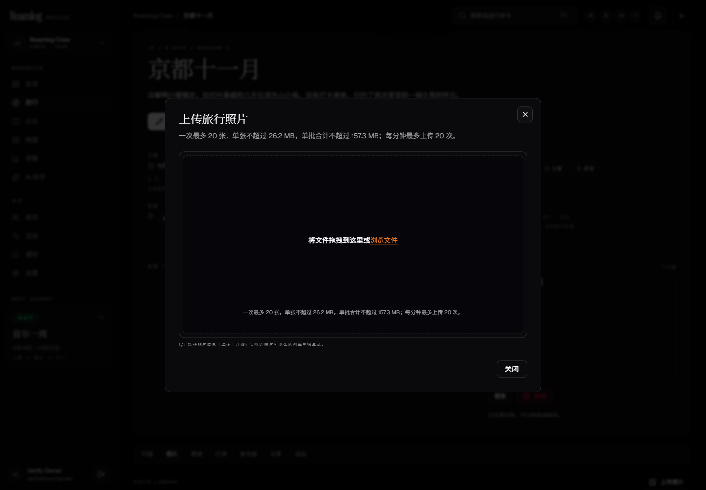
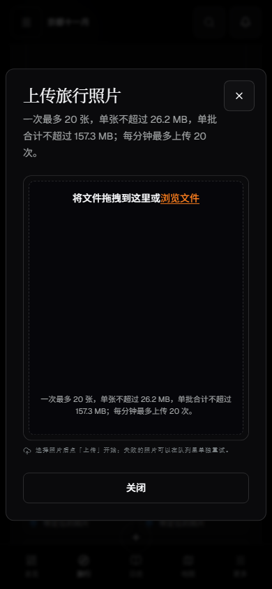

# P0-PHOTO-LIMITS-COPY

状态: DONE

## 变更

- `apps/web/lib/upload/photo-upload-limits.ts`
  - 已知限额：`一次最多 20 张，单张不超过 26.2 MB，单批合计不超过 157.3 MB；每分钟最多上传 20 次。`
  - 超批提示：`一次最多上传 20 张，每分钟最多上传 20 次。请先上传这批照片，再继续选择剩下的。`
  - 未知限额：`上传时会按当前账号的上限校验。`
  - 频率限制：`上传太频繁：每分钟最多上传 20 次，请稍后再试。`
- `apps/web/components/media/photo-uploader.tsx`
  - 未知限额状态：`选择照片后点「上传」开始；系统会按当前账号的上限校验这次上传。`
- `apps/web/lib/upload/roamlog-uploader.ts`
  - 超大小：`照片超过允许的大小，没有上传。`
  - 格式错误：`不支持这种图片格式。`
- `apps/web/lib/upload/photo-upload-limits.test.ts`
  - 更新旧断言。
  - 新增禁止实现术语断言：`/服务端|签发|上传链接|HTTP/u`。

限额计算、批量拒绝、Uppy 配置和上传状态均未修改。

## 验证

- `pnpm --filter @roamlog/web exec vitest run lib/upload/photo-upload-limits.test.ts`
  - PASS: 1 file / 8 tests
- `pnpm --filter @roamlog/web exec vitest run components/media`
  - PASS: 6 files / 71 tests
- `pnpm --filter @roamlog/web typecheck`
  - PASS: `next typegen` + `tsc --noEmit`，无输出错误
- `rg -n "服务端|签发|上传链接|HTTP"` 目标生产代码
  - 无命中；仅测试中的禁止术语正则有命中

## 截图证据

2026-11-20 22:43，使用当前 `:3000` Web、`:4000` API 与真实账号会话截图。截图前隐藏 Next.js 开发指示器，未修改产品内容。

```json
{"status":"ok","checks":{"database":{"status":"up","latencyMs":31},"redis":{"status":"up","latencyMs":2},"storage":{"status":"up","latencyMs":35}}}
```

接口返回的真实限额：

```json
{"maxFilesPerBatch":20,"maxFileBytes":26214400,"maxBatchBytes":157286400,"presignPerMinute":20}
```

桌面 1440（PNG 1440×1000）：



移动 390（PNG 390×844）：



两处肉眼可见的主提示均为：

> 一次最多 20 张，单张不超过 26.2 MB，单批合计不超过 157.3 MB；每分钟最多上传 20 次。

复跑命令：`node .audit/photo-limits-copy/capture.mjs`

## CodeGraph 证据

- `codegraph status`
  - `[OK] Index is up to date`
- `codegraph explore "photo-upload-limits photo upload limits formatPhotoUploadLimit photo uploader max files per minute"`
  - 命中 `uploadLimitHint`、`overBatchLimitMessage`、`restrictionMessage`、`presignRateLimitMessage` 与 `PhotoUploader` 调用关系。
- `codegraph explore "RoamlogUploader constructor uploadOne withRetry presign describeFailure Uppy plugin options"`
  - 命中 `describeFailure`，并确认 `#emitUploadError` 是唯一调用方。

## 剩余风险

- `413/415` 两条上传错误文案已修改，但该函数是模块私有逻辑，仓库没有现成测试缝；本次未为改文案引入额外导出或结构性改动。
- 截图导航过程中观察到 MapLibre worker 加载失败与一个资源 `ERR_NETWORK_ACCESS_DENIED`；上传面板与限额文案正常渲染，不属于本任务范围，未修改。
