# PHOTO_UPLOAD_MAP_IMPL 收口报告

状态: DONE
任务 ID: P0-PHOTO
日期: 2026-11-20
范围: Web 照片上传、照片网格、YARL 灯箱、照片地图、EXIF/精确位置、删除、角色权限与真实浏览器验收

## 变更文件

本次收口直接修改：

- `e2e/web/trip-photos.spec.ts`：从 5 个用例扩展到 10 个串行用例，补齐删除、Viewer、空态、加载态、503 错误态、刷新持久化和灯箱切换断言。
- `apps/web/components/trip-workspace/photos-tab.tsx:509`：删除确认文案改为用户语言「删除后照片不再出现在旅行相册和分享页；存储清理会自动完成。」
- `.audit/photo-upload/**`：验收日志、诊断脚本与本报告。
- `.audit/trip-photos/**`：当前代码版本的真实浏览器截图。

本次没有修改后端、上传限额服务、设置、头像/邮箱、contracts 或数据库代码。当前工作树里的实现文件（`apps/web/components/media/**`、照片地图、`media-urls.ts` 等）是本任务开始前已有的未提交成果；本次对它们做了调用链核对和真实浏览器验收。

## 实现摘要

- 上传链：`PhotoUploader` → `PhotoUploadPanel` → `createPhotoUppy` → `RoamlogUploader`（presign → PUT → complete）→ 媒体列表失效并刷新。Uppy Dashboard 保持内嵌 Dialog，数量/单文件/总量限制来自服务端 limits。
- 照片网格：`photosFromMedia` / `mediaPreviewUrl` 驱动日期分组和卡片；上传成功后新照片进入网格，刷新后仍可读。
- 地图：`PhotosTab` → `PhotoMapSection` → `MapCanvas`（MapLibre，`photosAsMarkers`），GPS 照片渲染为可点击标记；点击标记打开同一个 YARL viewer。
- 灯箱：`yet-another-react-lightbox` + Zoom + Thumbnails；支持打开、左右切换、Esc 关闭、焦点管理；签名 URL 失效时由父层重新签发。
- 权限：Viewer 可以读取照片，但上传与删除入口禁用；真实 Viewer 会话直接调用 presign/delete 也返回 403。
- 删除：确认后软删除记录从网格和照片地图消失，刷新后仍不存在。

## 验证命令与结果

本地栈（启动前确认 3000/4000/46379/55444/9000 无监听）：

```bash
bash .audit/tools/run-local-stack.sh
bash .audit/tools/worker-drain.sh --watch
```

- API `GET /v1/health` → `200`；Web `GET /login` → `200`。
- PG：`127.0.0.1:55444`；Redis stub：`127.0.0.1:46379`；API：`:4000`；Web：`:3000`；本地 S3 stub：`:9000`。只启动了一个 `:4000` API 实例。
- 由于仓库本地 Redis 是 stub，媒体处理使用仓库既有 `worker-drain.sh --watch` 驱动；不是 mock 掉上传接口，也不是只跑组件测试。

真实浏览器：

```bash
E2E_SKIP_ADMIN_SERVER=1 \
  node node_modules/@playwright/test/cli.js test e2e/web/trip-photos.spec.ts \
  --project=web --reporter=list
```

结果：`10 passed (50.6s)`。完整日志：`.audit/photo-upload/playwright.log`。

静态与单测：

```bash
pnpm --filter @roamlog/web typecheck
pnpm --filter @roamlog/web exec vitest run components/media components/map/photo-layer.test.tsx
pnpm exec eslint e2e/web/trip-photos.spec.ts apps/web/components/trip-workspace/photos-tab.tsx
git diff --check -- e2e/web/trip-photos.spec.ts apps/web/components/trip-workspace/photos-tab.tsx
```

- Web typecheck 通过（`next typegen && tsc --noEmit`）。
- Vitest：`7` 个测试文件、`83` 个测试通过。
- ESLint：无报错。
- 目标文件 `git diff --check`：无 whitespace 错误。全仓仍有 `media-upload-limits.service.ts` 的文件末尾换行告警，该文件属于另一个 Agent，本次没有触碰。

## Playwright 覆盖

| 验收项 | 断言落点 | 结果 |
|---|---|---|
| 批量上传 3 张 GPS PNG | Uppy complete 200、3 个 `data-media-id`、刷新后仍在 | 通过 |
| 服务端 20 张批量上限 | 超限提示可见、未产生超额上传 | 通过 |
| EXIF / 精确位置展示 | 分组字段、坐标文本、详情抽屉 | 通过 |
| 地图打点打开对应照片 | 点击 `photo-marker-*`，YARL current slide 的对象路径等于该照片 viewer 变体 | 通过 |
| 灯箱切换/键盘/关闭 | ArrowRight 路径变化、ArrowLeft 返回、Esc 关闭且页面不被关闭 | 通过 |
| 行程地图照片层 | 路线、停靠点和照片标记共存 | 通过 |
| 空状态 | 新旅行显示空态，不渲染照片地图 | 通过 |
| 加载态 | 延迟 API 时显示「读取中」和骨架 | 通过 |
| 错误态 | 注入 503 显示「照片读取失败」与「重试」，解除后恢复真实网格 | 通过 |
| Viewer 只读 | 上传/删除按钮禁用及 title 说明；真实 Viewer 会话直接请求 presign/delete 均为 403 | 通过 |
| 删除与刷新持久化 | 确认文案、卡片和标记消失、API 记录消失、刷新后仍不存在 | 通过 |
| 移动端 390 | 照片页、上传面板、行程地图无横向溢出 | 通过 |

Viewer 用例通过真实注册、Mailpit 邮件验证、Workspace 邀请、接受邀请和 Better Auth 会话完成，没有伪造角色或 mock 权限。

## 截图证据

桌面 1440：

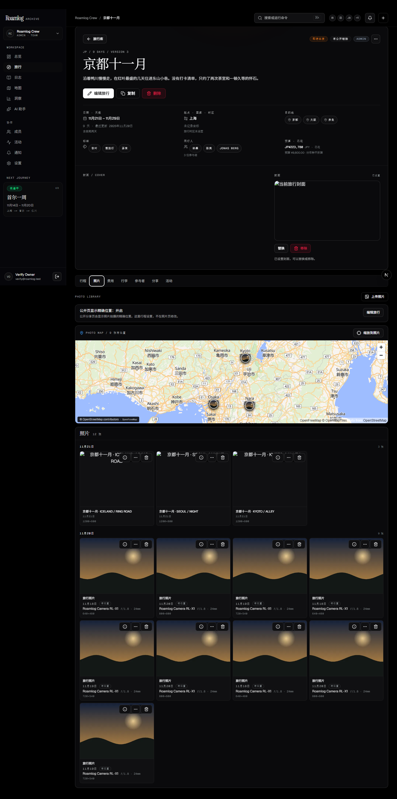
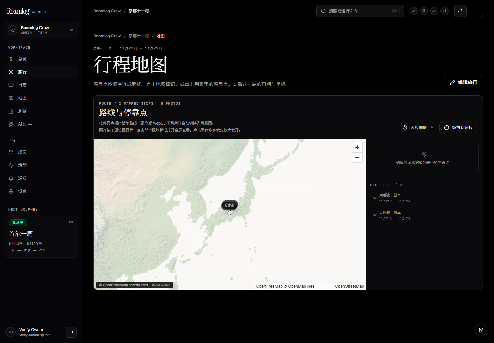
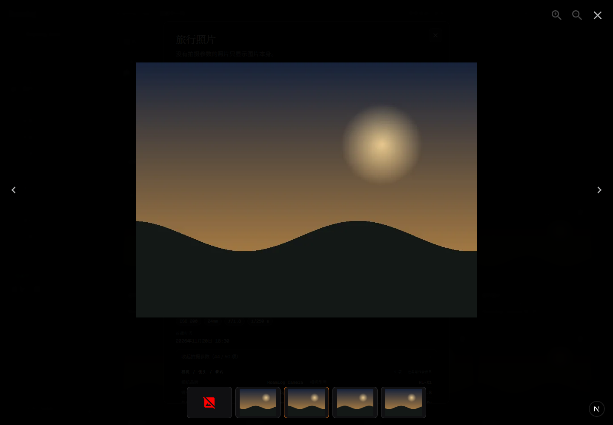
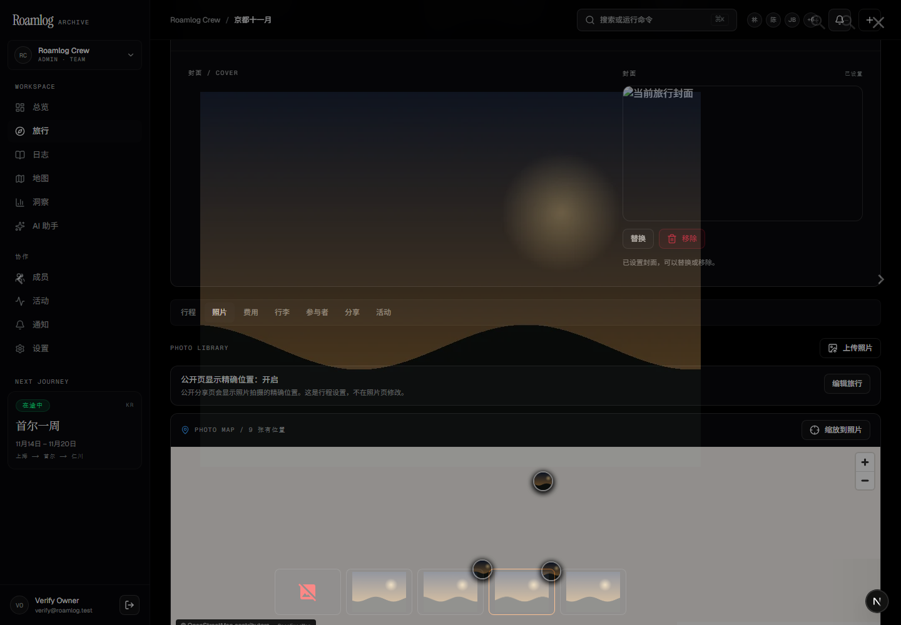
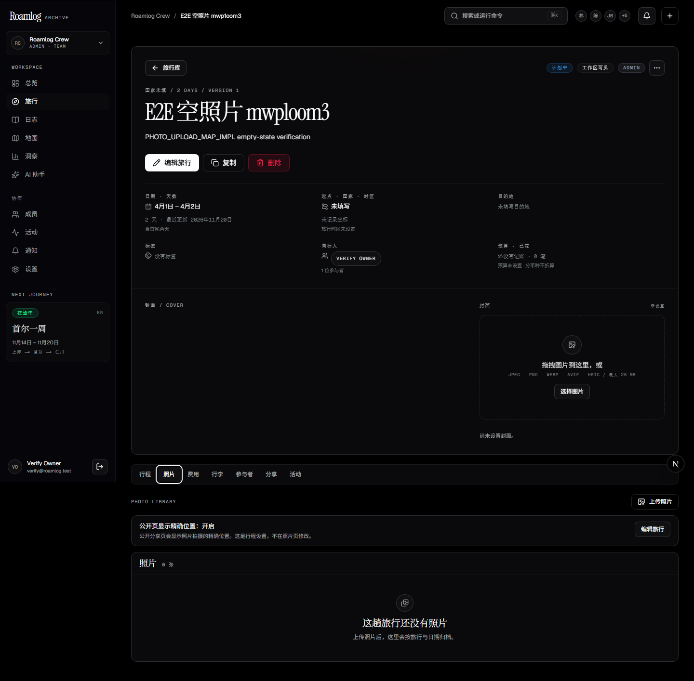
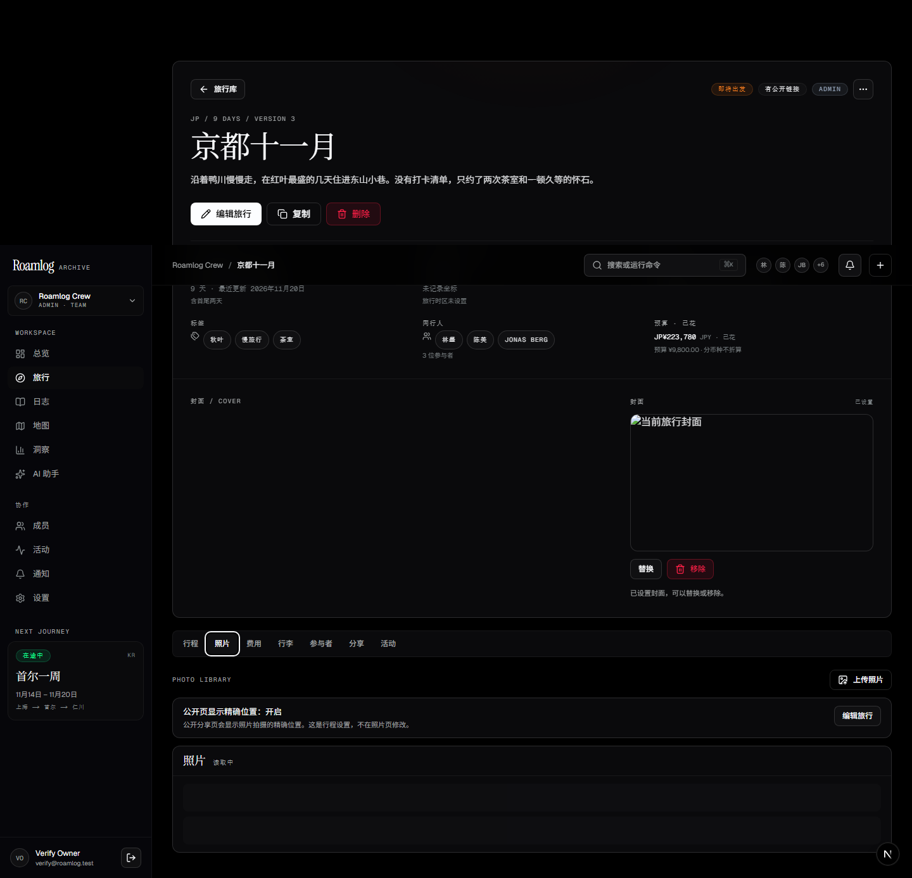
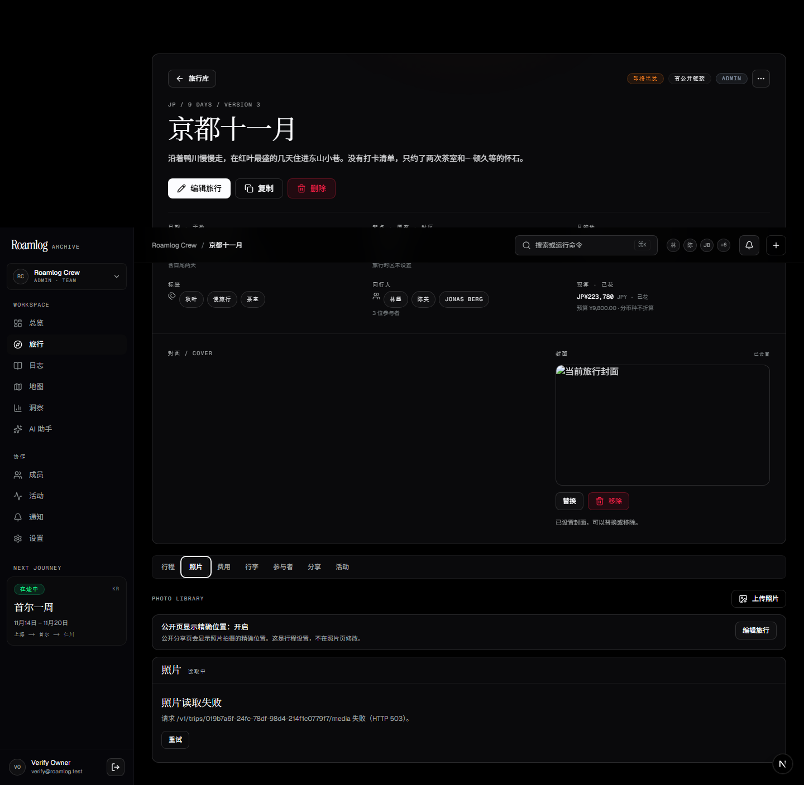
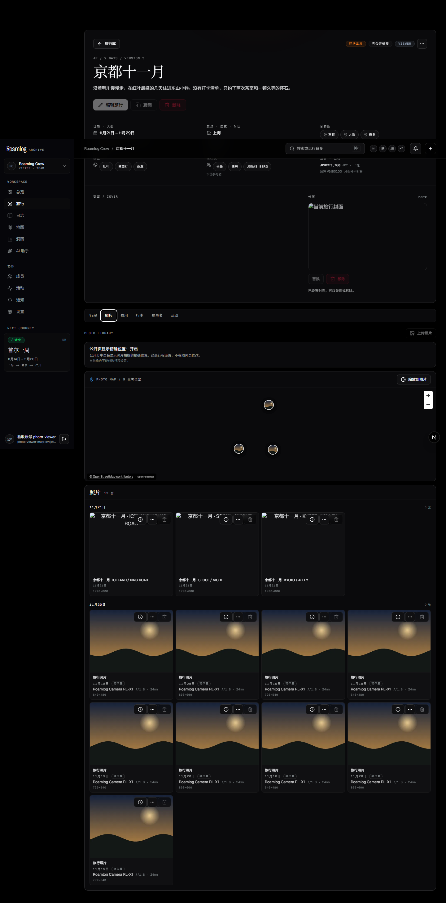
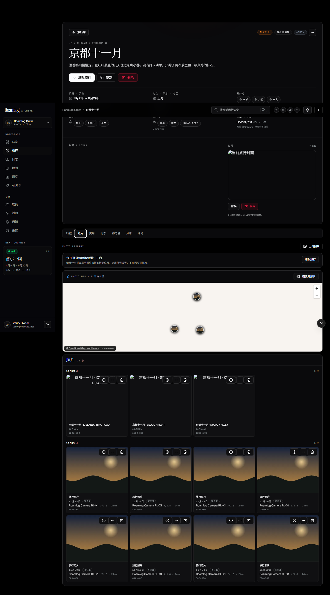
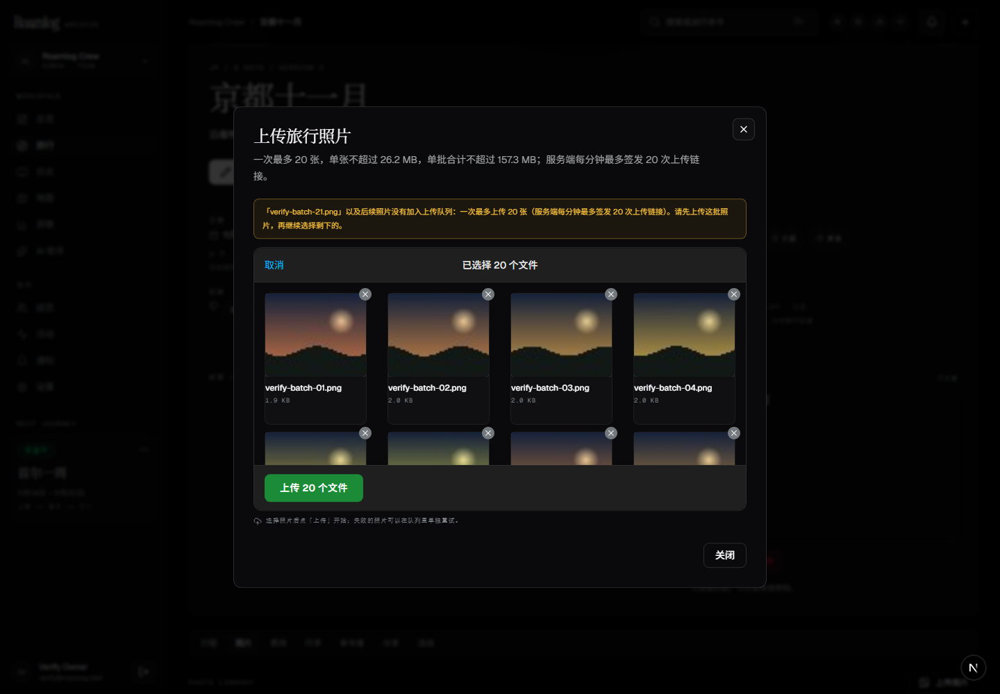

移动 390：

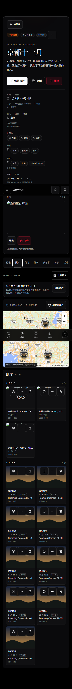
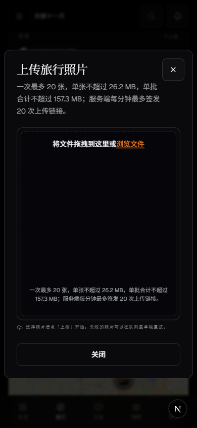
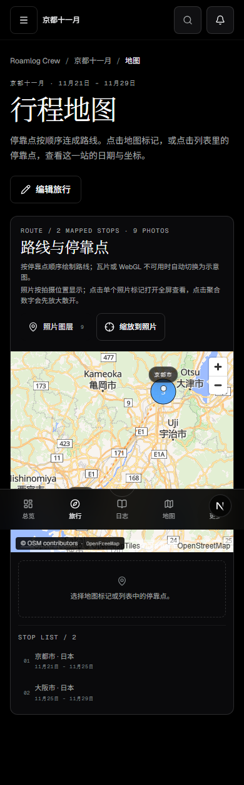

以上截图均由本轮 2026-11-20 21:42 前后的当前代码版本生成。

## ImageOff 结论

结论：**历史 seed fixture 在本地 S3 stub 中缺对象**，不是签名 URL 过期，也不是本次前端上传链回归。

证据：

- 三条历史 seed 媒体（Iceland / Seoul / Kyoto）的 `thumb` URL `HEAD` 均为 `404`：
  - `/roamlog-local/variants/iceland-ring-road-3-thumb.webp` → 404
  - `/roamlog-local/variants/seoul-night-2-thumb.webp` → 404
  - `/roamlog-local/variants/kyoto-alley-1-thumb.webp` → 404
- 同一份 API 响应中新上传照片的 `thumb` URL `HEAD` 均为 `200`，对象位于 `/roamlog-local/<media-id>/.../thumb.webp`。
- 本地对象根目录只有按 media id 生成的对象；`seed/` 与 `variants/` 目录不存在。seed 行引用的 `variants/*.webp` 从未写入本地 S3 stub。
- 404 不是 403；API 每次读取媒体时重新签发 900 秒 URL，排除“旧签名过期”。
- 同一个卡片/viewer 组件对新上传照片正常显示，排除照片网格和灯箱本身的前端回归。

失败态截图已保留：

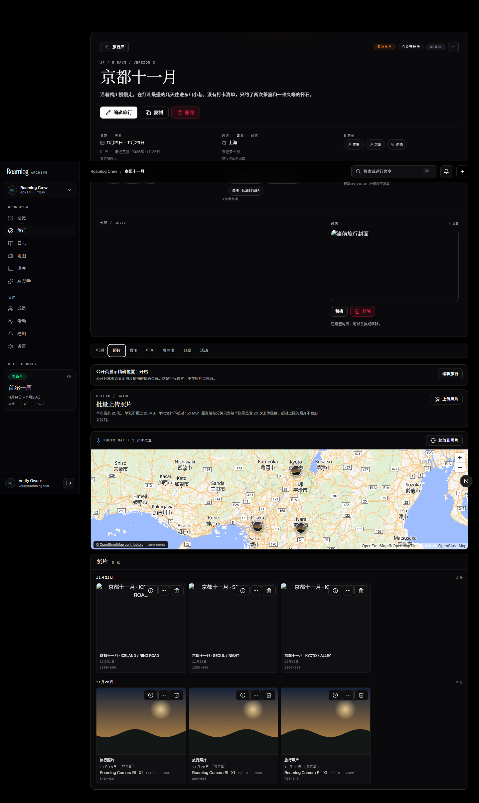

这是 seed/本地存储 bootstrap 的 fixture 缺口，不属于本次允许修改的前端文件。未改 API 或存储代码；应由 seed 负责人上传 seed 原图并生成/写入对应 variants，或在本地 bootstrap 中把 seed 行重新送进媒体处理流程。

## CodeGraph 证据

```bash
cd /c/Users/BY9700/Desktop/UI/roamlog
codegraph status
# [OK] Index is up to date
# Files: 2,166 / Nodes: 36,359 / Edges: 85,444
```

```text
codegraph_explore "PhotoUploader PhotoUploadPanel PhotoMapSection PhotoLightbox photosFromMedia mediaViewerUrl"
→ PhotoUploader / PhotoUploadPanel / PhotosTab
→ PhotoMapSection → MapCanvas
→ PhotoLightbox
→ photosFromMedia → mediaPreviewUrl
→ mediaViewerUrl → mediaPreviewUrl
→ blast radius: PhotosTab、PhotoMapSection、MapCanvas、trip-workspace tab tests
```

```text
codegraph_explore "MapCanvas photosAsMarkers map container class data-testid map-canvas"
→ MapCanvas (apps/web/components/map/map-canvas.tsx:72)
→ PhotoMapSection dynamic import → MapCanvas
→ TripMap / AtlasMap / TripStopMap 共 5 个调用方
→ 关键 DOM: data-testid="maplibre-canvas"、photo-marker-${id}
```

## 移植来源

许可均为允许移植的 MIT / BSD-3-Clause；未复制 AGPL / SSPL / Commons Clause / BSL 代码。

| 能力 | 来源（固定版本/提交） | 本仓库落地 | 许可证 |
|---|---|---|---|
| 批量上传 | `transloadit/uppy` `4c7fed69a67c6112c7e2134cd372a25140a8ca12`；`@uppy/core@6.3.2` `packages/@uppy/core/src/Restricter.ts:11,87-96`、`packages/@uppy/core/src/Uppy.ts:762`；`@uppy/dashboard@6.0.3` `Dashboard.tsx` | `apps/web/lib/upload/photo-uppy.ts`、`roamlog-uploader.ts`、`photo-upload-panel.tsx` | MIT |
| 大图查看 | `igordanchenko/yet-another-react-lightbox@3.33.1`，commit `6ef6a6e9807ff65023a8acf01a167ea8a8cabcc0`；`src/Portal.tsx:94-145`、`src/hooks/useKeyboardNavigation.ts:29-45`、`src/LightboxState.tsx:79` | `apps/web/components/media/photo-lightbox.tsx`（整包 + Zoom/Thumbnails 插件） | MIT |
| 地图聚合/照片图层 | `maplibre/maplibre-gl-js` 官方 cluster 示例，commit `b8a71bd487e97c811da1acc5f4eff707df2da5f8`，`test/examples/create-and-style-clusters.html` | `apps/web/components/map/cluster-points-source.tsx`、`photo-points.ts`、`photo-map-section.tsx` | BSD-3-Clause |
| EXIF 格式与信息架构 | `LibrePhotos/librephotos` `dev` commit `11daff09ba226781e15ecd2bdc650f79f138f32f`，MIT；`apps/frontend/src/util/exifFormat.ts`、`apps/frontend/src/components/lightbox/CameraInfoSection.tsx:19-44`、`apps/frontend/src/components/allmetadata/AllMetadataModal.tsx:56-90` | `apps/web/components/media/media-exif.tsx` | MIT |

适配层说明：

- Uppy 的 `RoamlogUploader` 是逐事件适配 presign → PUT → complete，不能使用 `@uppy/xhr-upload` 的单次 multipart POST；分支顺序和失败/abort 语义保留。
- YARL 已整包采用；仅增加中文 labels、Roamlog 的 900 秒重签回调，以及 Esc 只关心查看器的契约。
- MapLibre 集群层已参数化以复用 footprint / photo 两个图层，算法和 layer paint 来自官方示例。
- EXIF 的字段顺序、`ƒ/`、`1/250`、`ISO`、`mm` 等格式化与 LibrePhotos 对齐；`MediaExif` 类型、中文标签和本仓库字段投影是适配层。Immich（AGPL）只作为只读设计参考，没有复制其代码。

## 已知风险与未覆盖项

- 历史 seed 的三张照片仍会在本地栈显示破图；这是本地 fixture 缺对象，修复需要 seed/存储负责人处理。
- 本地 Redis 是 stub，媒体处理由 `worker-drain.sh --watch` 驱动；尚未在真实 Redis/BullMQ worker 上重跑。生产队列重试、幂等和对象清理仍需 staging 验证。
- 删除验证覆盖了软删除记录从 UI/API/刷新中消失；未验证服务端异步删除 S3 对象的最终一致性。
- E2E 每轮上传 3 张测试照片，删除用例只清理 1 张；本轮验收前已清理 11 张本轮生成的重复上传，保留既有测试数据。Viewer 用例每轮会创建一个 unique 测试账号和成员关系，当前未自动清理。
- MapLibre 底图来自 OpenFreeMap；截图时若瓦片尚未返回，地图区域可能短暂为空，但标记、按钮和交互断言仍基于真实 DOM。
- 全仓 `git diff --check` 仍受另一个 Agent 的 `media-upload-limits.service.ts` EOF 问题影响；本任务目标文件已单独通过。

## 建议的下一步

1. 由 seed/storage 负责人在本地 bootstrap 中上传 seed 原图并生成 variants，消除历史 `ImageOff`。
2. 在 staging-full 用真实 Redis + BullMQ worker + S3 重跑本 spec，并验证删除后的对象清理。
3. 给 E2E 增加测试数据清理（上传照片、unique Viewer 账号/邀请），保证可重复运行不留残余。
4. 根 Agent 验收后统一提交；本次未 `git add` / `commit` / `push`。
