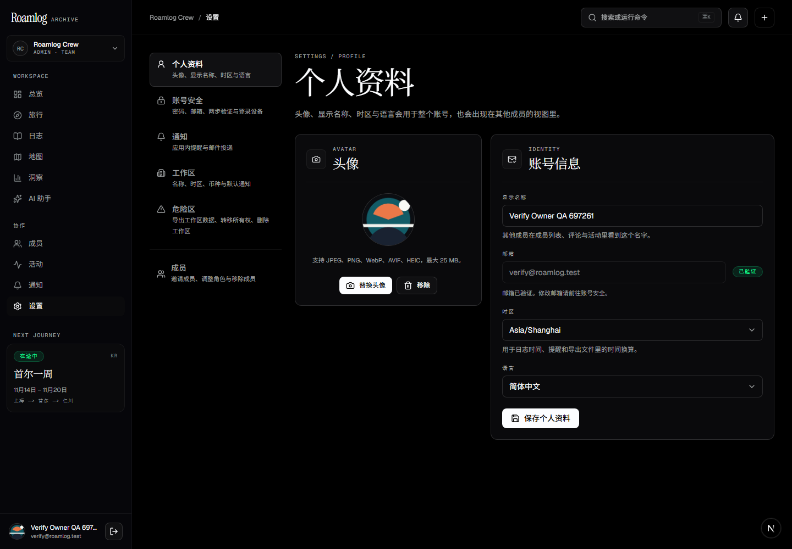
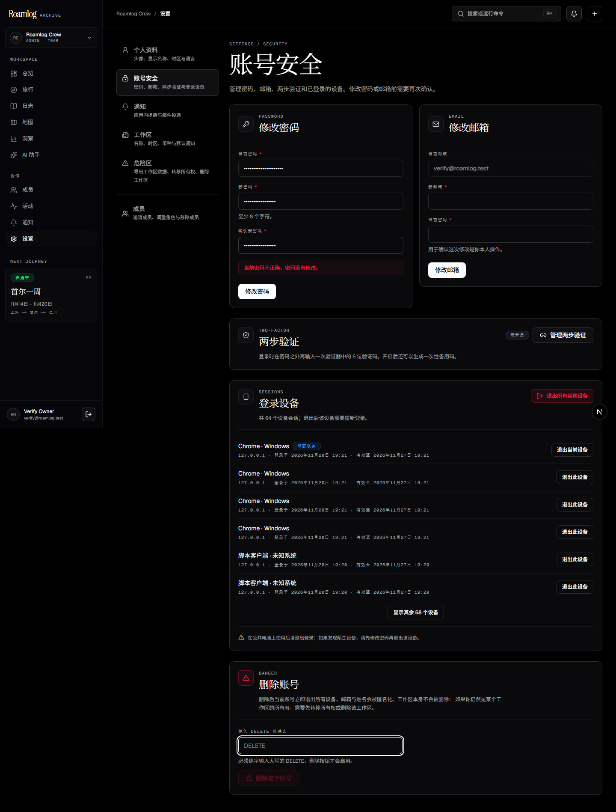
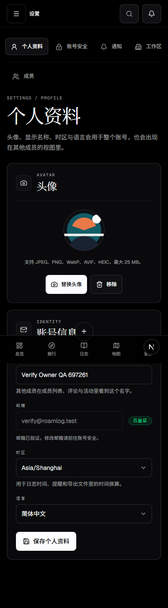
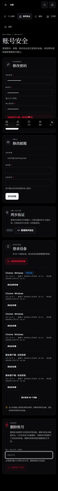
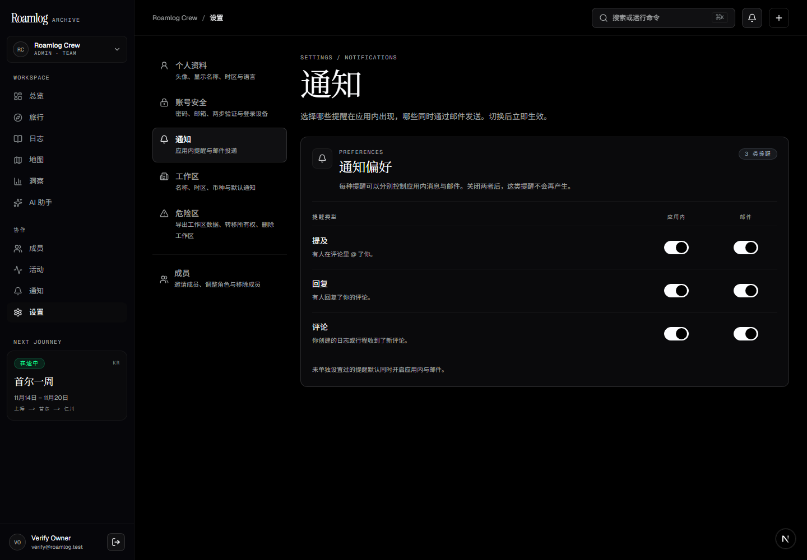
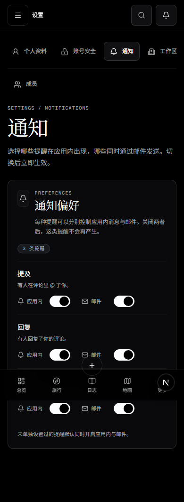

# SETTINGS_PROFILE_SECURITY — 设置 IA 重建 + 个人资料 + 账号安全 + 通知

状态: DONE
任务 ID: `SETTINGS_PROFILE_SECURITY`
生成时间: **2026-11-20 19:22 (Asia/Shanghai, CST)** · 证据截图均来自该次运行（Playwright，真实 web:3000 + API:4000 + PostgreSQL + S3 stub）

---

## 变更文件

| 类型 | 路径 |
| --- | --- |
| 新增 | `apps/web/lib/api/me.ts`（头像上传链路 / 会话列表 / 账号删除 / 媒体 URL 过期判定） |
| 追加 | `apps/web/lib/api/auth.ts`（仅追加：`verifyCurrentPassword` `changePassword` `changeEmail` `revokeOtherSessions` `accountSecurityErrorMessage`，未改动 `requestPasswordReset` 等既有函数） |
| 新增 | `apps/web/components/settings/settings-nav.tsx` |
| 新增 | `apps/web/components/settings/profile-settings.tsx` |
| 新增 | `apps/web/components/settings/security-settings.tsx` |
| 新增 | `apps/web/components/settings/notifications-settings.tsx` |
| 新增 | `apps/web/app/(app)/w/[workspaceSlug]/settings/layout.tsx` |
| 改写 | `apps/web/app/(app)/w/[workspaceSlug]/settings/page.tsx`（原 `SettingsLive` 两卡页面 → 重定向到 `profile`） |
| 新增 | `apps/web/app/(app)/w/[workspaceSlug]/settings/profile/page.tsx` |
| 新增 | `apps/web/app/(app)/w/[workspaceSlug]/settings/security/page.tsx` |
| 新增 | `apps/web/app/(app)/w/[workspaceSlug]/settings/notifications/page.tsx` |
| 新增 | `e2e/web/settings-profile.spec.ts` |
| 证据 | `.audit/settings/*.png`、`.audit/settings/fixtures/avatar.png` |

未触碰 `apps/api/**`、`packages/**`、`apps/admin/**`，未触碰 `components/ai|journal|trip-workspace|map`、`lib/api/ai.ts`。
未执行 `git add` / `git commit` / `push`。

---

## 新 IA

`/w/<slug>/settings` 是索引，服务端 `redirect()` 到 `profile`（浏览器落到 `/settings/profile`，导航有唯一高亮项）。

| 分区 | 真实路由 | 所属 |
| --- | --- | --- |
| 个人资料 | `/w/<slug>/settings/profile` | 本任务 |
| 账号安全 | `/w/<slug>/settings/security` | 本任务 |
| 通知 | `/w/<slug>/settings/notifications` | 本任务 |
| 工作区 | `/w/<slug>/settings/workspace` | 另一 agent（已存在，实测 200） |
| 危险区 | `/w/<slug>/settings/danger` | 另一 agent（已存在，实测 200） |
| 成员 | `/w/<slug>/members` | 已有页面 |

- `settings/layout.tsx` 渲染唯一的分区导航 + 内容列（`data-testid="settings-content"`，移动端防裁切断言的锚点）。
- 导航是 `<Link>` + `aria-current="page"`，桌面为左列（`lg:grid-cols-[240px_minmax(0,1fr)]`，`lg:sticky`），移动端为可横滑列表。
- 全部文案中文，无「即将上线 / 暂不可用 / 占位 / 尚未接入」类字样。

---

## 头像链路

**结论：`User.image` 存「媒体签名展示 URL」，不是 mediaId。**

依据（读后端现状，不自创形态）：

- `packages/contracts/src/entities/user.ts:13` → `image: z.url().nullable()`：只接受 URL，uuid 无法通过契约。
- `apps/api/src/common/services/user-presenter.ts:23-38` `presentUser` 原样透传 `record.image`，不做再签名。
- `apps/api/src/modules/users/users.service.ts:59-87` `updateMe` 接受 `image` 并写入 `User.image`。
- `packages/contracts/src/api/media.ts:179-207` `MediaRead` 提供 `url` / `thumbUrl` / `expiresAt`（签名 URL）。

上传链路（复用既有 cover 上传机器，未新写协议）：

1. `POST /v1/workspaces/:wid/media/presign`（`createCoverMediaClient().presign`）
2. `PUT <uploadUrl>`（`putObjectToSignedUrl`，XHR 带真实进度）
3. `POST /v1/media/:mediaId/complete`
4. 轮询 `GET /v1/media/:mediaId` 直到 `status === "ready"`，取 `thumbUrl ?? url`
5. `PATCH /v1/me { image: <签名 URL> }`（走既有 `useUpdateMeMutation` → 真实 API）
6. 移除：`PATCH /v1/me { image: null }`

实测（curl，同一账号同一 workspace）：presign → PUT 200 → complete → worker 生成 `large.webp` / `thumb.webp`，`GET /v1/media/:id` 返回 `status: ready`、`url` 带 `X-Amz-Signature`、`X-Amz-Expires=900`、`expiresAt`。

UI：圆形 96px 预览（`@roamlog/ui` `Avatar`）、替换、移除、分阶段文案（检查/准备/上传/登记/生成尺寸）、`Progress` 真实百分比、失败可见（`role="alert"`）、成功后 `role="status"` 提示；`img[src]` 加载失败时 `Avatar` 自动回落到姓名首字母。

**已知限制（见风险 1）**：签名 URL 有 TTL（`MEDIA_SIGNED_URL_TTL_SECONDS`，本地 900s）。因此 profile 页会解析 `X-Amz-Date + X-Amz-Expires` 判断该头像链接是否过期，过期时显示「这张头像的图片链接已过期…重新上传即可恢复」，而不是静默显示首字母。提供 `mediaIdFromImageUrl()` 从 key 段（`<ws>/<yyyy>/<mm>/<mediaId>/<variant>.<ext>`，`buildMediaKey` 形态）恢复 mediaId，为后续服务端再签名留好入口。

---

## 改密码 / 改邮箱

| 操作 | 端点 | 成功 | 失败 |
| --- | --- | --- | --- |
| 改密码 | `POST /v1/auth/change-password` `{currentPassword,newPassword,revokeOtherSessions:false}` | 内联 `role="status"`：「密码已更新。当前设备保持登录状态。」清空三格 | 400 `INVALID_PASSWORD` → 「当前密码不正确，密码没有修改。」 |
| 改邮箱 | `POST /v1/auth/verify-password`（校验当前密码）→ `POST /v1/auth/change-email` `{newEmail,callbackURL}` | 「验证邮件已发送到 X。点击邮件中的链接后，新邮箱才会生效。」 | `CHANGE_EMAIL_DISABLED` → 「当前部署没有开启邮箱修改。请联系管理员在认证配置中启用后重试。」；密码错 → 「当前密码不正确。」 |

- 两次操作都先弹确认对话框（`Dialog`），确认后才发请求。
- 「当前密码」不是装饰：`change-email` 的请求体只接受 `newEmail`/`callbackURL`（better-auth 1.7.25 `dist/api/routes/update-user.mjs:398-404`），所以先用 `/v1/auth/verify-password`（`dist/api/routes/password.mjs:167-193`）真实校验密码，再改邮箱。
- 实测：错误密码 → `400 {"code":"INVALID_PASSWORD"}`；`/change-email` 在本部署 → `400 {"code":"CHANGE_EMAIL_DISABLED"}`（见风险 2）。

---

## 设备管理

- 列表：`GET /v1/me/sessions` → `Session[]`（`id / userId / expiresAt / createdAt / ip / userAgent`，无 `lastActive` 字段，因此展示「登录于 createdAt · 有效至 expiresAt」+ IP，不编造最后活跃时间）。
- 当前设备：`/v1/auth/get-session` 的 `session.id` 与列表 id 比对，标记 `当前设备`。
- 单个退出：`DELETE /v1/me/sessions/:id`（每个设备行一个按钮，行内 pending 文案）。
- 全部退出：`POST /v1/auth/revoke-sessions`（保留当前设备），二次确认对话框。
- 长列表：默认渲染 6 条 + 「显示其余 N 个设备」/「收起设备列表」（仓库账号因反复登录已累积 40+ 会话，见风险 3）。
- 设备名由 UA 解析为「Chrome · Windows」这类标签，`describeDevice()` 为适配层（见风险 9）。

**两步验证：采用「链接到既有 `/settings/security` + 内嵌状态徽标」，不嵌组件。**
理由：`apps/web/components/auth/two-factor-security.tsx:714-716` 的 `TwoFactorSecurityView` 自带 `<main className="relative min-h-dvh overflow-hidden bg-canvas">` 全页外壳与自己的 `PageGlow`，直接塞进设置内容列会产生嵌套 `<main>`、双画布与重复的页面级间距，等于两套 IA 叠在一起。改为在账号安全页实时显示「已开启/未开启」（`getSecuritySession()`）并给出显著的「管理两步验证」入口，解决「2FA 只在登录页有入口」的抱怨，同时不破坏既有页面。

---

## 通知偏好

真实字段集合（读契约，未编造）：`packages/contracts/src/entities/notification.ts:25-32`

```
NotificationPreference = { userId: UUIDv7, type: string, inApp: boolean, email: boolean }
```

- `GET /v1/me/notification-preferences` 只返回**已显式写入**的行（当前账号初始为 `[]`）；服务端在缺行时按 `inApp ?? true`、`email ?? true` 兜底（`apps/api/src/modules/notifications/notifications.service.ts:127-152`）。
- 真实产生提醒的 type（后端唯一生产者 `apps/api/src/modules/comments/comments.service.ts:389-445`）：`mention`（提及）、`comment_reply`（回复）、`comment`（评论）。前端目录以这三项为基线，并合并接口返回的其它 type（不丢数据）。
- 每类两个开关（应用内 / 邮件），切换即 `PATCH /v1/me/notification-preferences { preferences: [...] }`（契约要求 `min(1)`，所以每次提交当前全部 type 的完整状态），乐观更新 + 失败回滚。

---

## 移植来源（逐条 path + 行号）

1. **设置卡片视觉与表单骨架** ← `apps/web/components/settings/settings-live.tsx:138-178`：`surface-card p-5` → 图标方块 + `type-eyebrow` + `font-serif text-2xl` 标题 + `border-b border-hairline` 分隔 → `FormField/Input/Select` → 主按钮。个人/账号安全/通知三页一致沿用，`PageHeader` 用法同 `settings-live.tsx:112-118`。
2. **头像上传状态机与进度分配** ← `apps/web/components/media/use-cover-upload.ts:43-70`（`BUSY_PHASES`、压缩 0–20%、上传 20–90%、完成 92、处理 96、应用 98）与 `use-cover-upload.ts:128-147`（`phase/progress/error` 状态形状）；本任务按同一套百分比分段实现 `apps/web/lib/api/me.ts:39-42`，跳过压缩阶段（头像不压缩，服务器生成变体）。
3. **presign→PUT→complete→轮询** ← `apps/web/components/media/use-cover-upload.ts` 的 `uploadBlob/complete` 顺序 + `apps/web/lib/api/media.ts:185-231` `createCoverMediaClient()`；`putObject` 复用 `apps/web/lib/api/media.ts:95-166` `putObjectToSignedUrl`（XHR 真实进度）。
4. **文件类型/大小校验** ← `apps/web/components/media/cover-upload-validation.ts:46-64` `resolveCoverMimeType`（HEIC 空 MIME 回退扩展名）+ `apps/web/lib/api/media.ts:37-52` `COVER_MAX_BYTES` / `COVER_MIME_TYPES` / `COVER_ACCEPT_ATTRIBUTE`。
5. **确认对话框结构** ← `apps/web/components/moderation/report-dialog.tsx:127-147`（`DialogHeader/Title/Description/Footer` + 取消/确认按钮）与 `apps/web/components/share/share-link-dialog.tsx:139-146,228-235`。
6. **偏好开关交互与 type 文案** ← `apps/web/components/notifications/notifications-live.tsx:18-31`（`typeLabels` 中 `mention/comment` 等中文标签）与 `@roamlog/ui` `Switch` 用法；更新 mutation 复用 `apps/web/lib/query.ts:409-420` `useUpdateNotificationPreferencesMutation`。
7. **头像消费端渲染**（不改）← `apps/web/components/app-shell/user-footer.tsx:13` `<Avatar name={user.name} src={user.image ?? undefined} size={30} />`、`apps/web/components/app-shell/topbar-members.tsx:71`。
8. **区块导航样式基线** ← `apps/web/components/app-shell/app-shell-nav.ts:52-115`（`isSectionActive` 前缀判定 + `SidebarNavItem` 结构），改为设置分区版并保留相同的 `active` 语义。
9. **2FA 页面现状判定** ← `apps/web/components/auth/two-factor-security.tsx:43,714-716`（全页 `<main>` 外壳）。

**适配层（显式标注，无法原样照搬的部分）**：

- 上游 `useCoverUpload` 绑定 trip（`setCover/clearCover`），头像没有 trip，故只复用其 presign/putObject/complete/轮询四步与进度分段，落库目标改为 `PATCH /v1/me`（`lib/api/me.ts`）。
- 设备标签 `describeDevice()`（`security-settings.tsx:74-100`）：仓库内没有任何 UA 解析实现可移植（全仓 `userAgent` 仅出现在后端存储与契约），这是新写的最小适配层，不是交互/协议自创。
- 中文文案、`aria-label`、设计 token（`surface-card` / `hairline` / `accent-*`）替换为 Roamlog 体系。

---

## 测试清单（Playwright，真实栈）

文件：`e2e/web/settings-profile.spec.ts`（一条命令可复跑，见下）

| # | 名称 | 断言（全部落在 UI / 真实 HTTP 响应） | 结果 |
| --- | --- | --- | --- |
| 1 | 设置根路径重定向到个人资料，五个分区导航都是真实链接 | `/settings` → `waitForURL(/settings/profile)`；5 个分区链接 `toHaveCount(1)` + 可见 + 文案；危险区副标题为工作区级措辞；成员链接 href；依次点击 账号安全 / 通知 / 工作区 / 危险区 / 个人资料 并断言 URL 与 h1 | **通过** (7.3s) |
| 2 | 头像上传写入 PATCH /v1/me，显示名称与头像刷新后仍然生效 | `setInputFiles` 后 `waitForResponse(PATCH /v1/me)` = **200**；`section[aria-label="头像"] img[src]` 含 `X-Amz-Signature`；按钮变「替换头像」；改显示名称 → PATCH 200 + `role=status`；**reload 后**输入框值仍是新名字、`img[src]` 仍是同一张签名 URL；`GET /v1/me` 复核 `name`/`image` | **通过** (7.2s) |
| 3 | 账号安全：设备列表有真实条目，改密码错误路径给出错误提示 | 设备 `ul > li` ≥1、含「当前设备」「登录于」；超 6 条时「显示其余 N 个设备」展开后行数变多、收起后复原；2FA 链接 href `/settings/security`；错误当前密码 → 确认对话框 → `POST /v1/auth/change-password` **400** + 可见「当前密码不正确，密码没有修改。」；改邮箱表单存在且有当前密码；删除账号区块未输入 `DELETE` 时按钮 `disabled`，输入后启用，确认框可取消（**不执行删除**） | **通过** (6.1s) |
| 4 | 通知偏好切换即时保存，刷新后保持 | `switch[aria-label="提及的邮件通知"]` 切换 → `PATCH /v1/me/notification-preferences` **200** + 「通知偏好已保存。」；`aria-checked` 真的改变；**reload 后**仍为新值；`GET /v1/me/notification-preferences` 复核 `mention.email` | **通过** (4.3s) |

汇总：**4 passed (26.9s)，0 failed**。用例在 `finally` 里把账号的 name/image/timezone/locale 与通知偏好还原，并删除本次运行创建的 session，避免污染共享验收账号。

---

## 真实 UI 截图

均为 2026-11-20 19:22 (CST) 运行产物，真实数据（verify@roamlog.test / Roamlog Crew）。

### 桌面 1440

个人资料（头像已上传为新图，右下角 shell 头像同步变化）：



账号安全（密码/邮箱/两步验证状态/登录设备/删除账号）：



通知偏好（3 类 × 应用内/邮件）：


### 移动 390






导航落地页（`/settings/notifications`，重定向后首个分区）：




---

## 验证命令与结果

```bash
# 1) TypeScript（apps/web）
cd apps/web && node ../../node_modules/typescript/bin/tsc --noEmit -p tsconfig.json
# → 0 error（最后一次运行无输出；期间曾出现 components/trip-workspace/photos-tab.tsx 的
#   mediaViewerUrl 错误，属另一 agent 正在编辑的文件，稍后其修复后消失）
```

```bash
# 2) 既有单测（apps/web 数据层，含 lib/api）
cd apps/web && node ../../node_modules/vitest/vitest.mjs run lib/api
# → Test Files 4 passed (4) / Tests 32 passed (32)  [ai 17, media 11, real 3, trip-form 1]
```

```bash
# 3) 真实 UI 自动化（本任务验收脚本）
cd roamlog && E2E_SKIP_ADMIN_SERVER=1 node node_modules/@playwright/test/cli.js \
  test e2e/web/settings-profile.spec.ts --project=web --reporter=list
# → 4 passed (26.9s)
#   ok 1 设置根路径重定向到个人资料，五个分区导航都是真实链接 (7.3s)
#   ok 2 头像上传写入 PATCH /v1/me，显示名称与头像刷新后仍然生效 (7.2s)
#   ok 3 账号安全：设备列表有真实条目，改密码错误路径给出错误提示 (6.1s)
#   ok 4 通知偏好切换即时保存，刷新后保持 (4.3s)
```

```bash
# 4) 路由可达性（真实 HTTP）
for p in profile security notifications workspace danger; do
  curl -s -o /dev/null -w "%{http_code} /w/roamlog-crew/settings/$p\n" \
    http://localhost:3000/w/roamlog-crew/settings/$p
done
# → 200 200 200 200 200（workspace/danger 由另一 agent 提供，本任务只保证导航可达）
```

```bash
# 5) 链路手工复核（curl，同一账号）
# POST /v1/workspaces/<ws>/media/presign → 200（uploadUrl 带签名）
# PUT <uploadUrl>                        → 200
# POST /v1/media/<id>/complete           → 200
# GET  /v1/media/<id>                    → status:ready, url/thumbUrl 带 X-Amz-Signature
# PATCH /v1/me {image:"<签名 URL>"}      → 200，User.image 落库
```

---

## CodeGraph 证据

- 查询：`codegraph_explore "ProfileSettings SecuritySettings NotificationsSettings SettingsNav uploadAvatar useUpdateMeMutation"`（projectPath `C:\Users\BY9700\Desktop\UI\roamlog`）
- 结果（关键）：
  - 调用链 `ProfileSettings (components/settings/profile-settings.tsx:60) → handleFile (:131) → uploadAvatar (lib/api/me.ts:124)`；
  - 动态渲染接线：`SettingsProfilePage → ProfileSettings`、`SettingsSecurityPage → SecuritySettings`、`SettingsNotificationsPage → NotificationsSettings`、`SettingsLayout → SettingsNav`；
  - `SettingsNav` 仅被 `app/(app)/w/[workspaceSlug]/settings/layout.tsx` 引用；`useUpdateMeMutation`（`lib/query.ts:485`）调用方为 `settings-live.tsx` 与 `profile-settings.tsx`；
  - blast radius：新组件无既有测试依赖；`updateMe` 链路命中 `users.service.ts:59`。
- 另有早期定位查询：`"settings-live settings page profile workspace updateMe presentUser"`（确认 `UserSchema.image = z.url().nullable()` 与 `presentUser` 透传）、`"CoverUploader use-cover-upload presign complete media api"`（确认 `MediaRead.url/thumbUrl/expiresAt` 与 `createCoverMediaClient`）、`"NotificationPreferenceSchema ... sessions"`（确认偏好真实字段与 `/v1/me/sessions` 契约）。

---

## 已知风险 / 未覆盖

1. **头像 URL 会过期（重要）**：`User.image` 按契约只能是 URL，而媒体只提供签名 URL（本地 `MEDIA_SIGNED_URL_TTL_SECONDS=900`）。过期后 shell / topbar 的 `<Avatar>` 会回落到姓名首字母；profile 页会识别过期并提示重新上传。彻底修复需要后端提供「头像端点」或稳定的公开 URL（例如把 media key 映射到 `S3_PUBLIC_BASE_URL`），这超出本任务文件边界（不得改 `apps/api/**`）。已把 `mediaIdFromImageUrl()` 备好，后端补端点后可直接再签名。
2. **改邮箱在本部署不可用**：`POST /v1/auth/change-email` 返回 `400 CHANGE_EMAIL_DISABLED` —— better-auth 1.7.25 的 `user.changeEmail.enabled` 默认关闭，`apps/api/src/modules/auth/auth-options.ts` 未开启。UI 已完整接入（真实密码校验 + 二次确认 + 精确错误文案），开关需要后端配置变更，属另一任务。
3. **共享账号会话膨胀**：`verify@roamlog.test` 因多 agent 反复登录已累积 40+ 设备会话；截图中的「共 47 个设备会话」是真实数据。UI 默认折叠 6 条并提供「显示其余 N 个设备」。测试自身会在结束时删除本次创建的 session。
4. **工作区/危险区属另一 agent**：本任务只保证导航链接指向真实路由（实测 200），未对其页面内容做断言，也未创建 `workspace/page.tsx`、`danger/page.tsx`。
5. **`settings-live.tsx` 已无引用**：新的 `/settings` 改为重定向，旧的两卡页面组件保留未删（可能被工作区页复用），未改动其内部实现。
6. **未新增组件级单测**：仓库 `components/settings` 下本来没有组件测试，本次以真实浏览器 e2e 承担验收；`lib/api` 既有 32 个单测全绿。
7. **`GET /v1/workspaces/roamlog-crew/members` 当前 500**（另一 agent 修复中）：会影响「成员」链接的目标页与危险区的转移接收人列表；本任务未触碰 `apps/api/**`。
8. **删除账号只验证到「确认框 + 取消」**：为避免破坏共享验收账号，脚本从未真正执行 `DELETE /v1/me`；后端在用户仍拥有工作区时返回 409 `OWNER_MUST_TRANSFER_OR_DELETE_WORKSPACE`，UI 已按该 code 给出可读提示（代码路径未在 e2e 中触发）。
9. **`describeDevice()` 是适配层**：仓库无可移植的 UA 解析实现，做了最小实现；未知 UA 回落「浏览器 · 未知系统」，不影响功能。
10. **`isImageUrlExpired()` 依赖 SigV4 查询参数**：非媒体来源的 `image`（例如未来接入的第三方头像 URL）不会被判定过期，返回 `false`。
11. **鉴权速率限制**：`/v1/auth/*` 变更类请求有 IP 级限流（`AUTH_RATE_LIMIT_MAX=10`/60s），多 agent 并发时测试会 429；脚本按 `Retry-After` 重试最多 5 次，把限流与产品缺陷区分开。