# Roamlog

[](https://github.com/Self-Command/roamlog/actions/workflows/ci.yml)
[](https://github.com/Self-Command/roamlog/actions/workflows/release.yml)
[](https://github.com/Self-Command/roamlog/releases)


**协作式旅行档案。** Roamlog 把行程、日志、照片、地图、预算与共同决策放进同一个 Workspace，让一趟旅行从愿望清单一直沉淀为可回看的记录。

- Workspace 优先的多人协作，Owner / Admin / Editor / Viewer 权限清晰。
- Trip、Stop、Journal、Itinerary、Packing、Expense 与评论组成完整旅行档案。
- 私有媒体上传、异步图片处理、地图、搜索、公开分享与 ZIP 导出。
- 独立 Admin 控制台，覆盖用户、Workspace、内容、审计、功能开关、邮件与队列。
- OpenAPI/Zod 契约先行，Web、Admin、API、Worker 共用一套类型与权限规则。

> [!IMPORTANT]
> **当前为 v1 hardening，不是 production-ready。** API、Worker、数据库、Admin 与 Web 核心 API 页面已实现；媒体、邮件、导出、Admin 操作和本地隔离 staging release gate 已取得真实运行证据。远端 TLS、DNS、真实 OAuth/Resend、单一边缘代理、GHCR/Docker 实跑、备份恢复和告警演练仍未完成。Web 的 Socket.IO 客户端与 presence/query invalidation 也仍需接线。

## 目录

- [当前状态](#当前状态)
- [产品概览](#产品概览)
- [角色与权限](#角色与权限)
- [功能清单](#功能清单)
- [演示截图](#演示截图)
- [系统架构](#系统架构)
- [技术栈](#技术栈)
- [快速开始](#快速开始)
- [环境变量](#环境变量)
- [常用命令](#常用命令)
- [路由与 API](#路由与-api)
- [测试矩阵](#测试矩阵)
- [CI/CD 与发布](#cicd-与发布)
- [可观测性与安全](#可观测性与安全)
- [视觉语言](#视觉语言)
- [文档导航](#文档导航)
- [贡献](#贡献)

## 当前状态

| 范围                   | 状态         | 说明                                                                                                                                            |
| ---------------------- | ------------ | ----------------------------------------------------------------------------------------------------------------------------------------------- |
| v1 功能面              | 已实现       | Workspace、旅行、日志、行程、地图、预算、打包、分享、导出、通知、搜索与 Admin 模块均已落地。                                                    |
| Web mock 模式          | 可用         | 开发/测试环境使用 MSW + contract fixtures，适合界面评审和确定性 E2E；不是真实协作。                                                             |
| Web API 模式           | 核心路径可用 | Dashboard、旅行、旅行详情、日志、成员、设置、分享等页面调用真实 API；部分高级视图仍在 API 模式补全。                                            |
| Admin API 模式         | 可用         | 登录、2FA、用户/Workspace/内容、审计、邮件、队列、功能开关与系统健康可连接真实 API。                                                            |
| 本地 staging gate      | PASS         | 2026-11-17 在本机真实 PostgreSQL/Redis/MinIO/Mailpit 上通过 E2E、Admin 操作、k6 与安全门禁；证据见 [release gate](STG_RELEASE_GATE_REPORT.md)。 |
| 媒体 / 邮件 / 导出链路 | PASS         | 真实入队、失败重试、Worker、私有对象存储与签名下载均取得本地证据；见 [full-chain report](STG_FULL_CHAIN_REPORT.md)。                            |
| Web realtime           | 待接线       | API 已提供 `/v1/ws`、房间鉴权、Redis presence 和缓存失效事件；Web 尚未连接 Socket.IO。                                                          |
| 远端 staging           | 未验证       | TLS、DNS、真实 Google/GitHub OAuth、Resend、边缘代理与跨主机网络仍需实跑。                                                                      |
| Production             | 未就绪       | 还需备份恢复、迁移回滚、监控告警、发布审批和生产 `super_admin` bootstrap 演练。                                                                 |

历史报告只证明对应版本在对应环境的结果；任何代码变更后都应重跑相应门禁，而不是引用旧结论。

## 产品概览

Roamlog 面向共同旅行的小队：有人负责规划路线，有人沿途写日志，有人只阅读和评论。产品不做“单人旅行博客”，而是把计划、回忆和费用放在同一个可追溯的协作空间。

核心旅程：

1. 注册并进入个人 Workspace，或用邀请链接加入已有 Workspace。
2. 创建旅行，填写日期、路线、停靠点、参与者、预算和可见性。
3. 在旅行中写日志、上传照片、维护行程、打包清单和分账。
4. 通过地图、搜索、活动流和通知持续协作。
5. 以只读链接分享旅行，或导出可长期保存的 ZIP 档案。

协作模型是异步协作：版本冲突返回 `409`，在线状态通过 presence 表达，服务端 mutation 发布 WebSocket 事件以失效查询缓存。**不使用 CRDT**，也不会在 v1 提供多人同时逐字编辑同一字段。

## 角色与权限

Workspace 是租户边界。每个用户注册后自动创建一个个人 Workspace，并可以加入多个 Workspace。

| 能力                                    | Owner | Admin | Editor | Viewer |
| --------------------------------------- | :---: | :---: | :----: | :----: |
| 查看 Workspace 内容                     |   ✓   |   ✓   |   ✓    |   ✓    |
| 评论与 `@` 成员                         |   ✓   |   ✓   |   ✓    |   ✓    |
| 创建、编辑、删除旅行与内容              |   ✓   |   ✓   |   ✓    |   —    |
| 邀请、移除成员，修改 Editor/Viewer 角色 |   ✓   |   ✓   |   —    |   —    |
| 修改 Workspace 设置                     |   ✓   |   ✓   |   —    |   —    |
| 创建/撤销公开分享链接                   |   ✓   |   ✓   |   ✓    |   —    |
| 查看审计日志                            |   ✓   |   ✓   |   —    |   —    |
| 转移所有权                              |   ✓   |   —   |   —    |   —    |
| 删除 Workspace                          |   ✓   |   —   |   —    |   —    |

`Viewer` 的准确含义是“只读 + 评论”，不能修改任何业务字段。

平台角色与 Workspace 角色相互独立：

| 平台角色      | 范围                                              |
| ------------- | ------------------------------------------------- |
| `user`        | 普通用户                                          |
| `support`     | 后台只读，以及用户/Workspace 暂停、恢复、重发邮件 |
| `analyst`     | 指标、审计、队列只读与审计 CSV 导出               |
| `admin`       | 运营管理，但不能修改平台角色或危险系统配置        |
| `super_admin` | 功能开关、平台角色、队列生命周期和全部危险操作    |

Admin 访问要求平台角色 + 已验证 TOTP。所有后台写操作进入只追加的审计日志。

## 功能清单

| 领域       | 当前能力                                                                    |
| ---------- | --------------------------------------------------------------------------- |
| Workspace  | 多 Workspace、邀请、成员角色、所有权转移、租户隔离                          |
| 旅行       | 状态、日期、路线、停靠点、封面、参与者、可见性、复制与版本检查              |
| 日志       | Tiptap 富文本、服务端 HTML 清洗、收藏、版本历史与恢复                       |
| 协作       | 评论、提及、解决/重新打开、活动流、站内通知、邮件偏好                       |
| 行程与打包 | 按日期分组、排序、负责人、完成状态、批量打包与进度                          |
| 预算       | `amountMinor` 金额、分类、均分/自定义分账、预算汇总、settle-up              |
| 媒体       | 预签名上传、MIME/大小校验、sharp 变体、blurhash、EXIF 处理、签名读取        |
| 地图       | MapLibre 世界地图、旅行路线、停靠点、地理编码与列表降级                     |
| 搜索       | PostgreSQL 全文搜索 + trigram 兜底，按 Workspace 与可见性过滤               |
| 公开分享   | hash 存储 token、过期、撤销、可选密码、`noindex`、可选预算摘要              |
| 导出       | Trip / Workspace / Account ZIP，私有对象、短时签名 URL、7 天过期            |
| 平台后台   | 指标、用户、Workspace、内容、媒体、审计、邮件、队列、功能开关、系统健康     |
| 安全       | Better Auth、2FA、CORS/Origin 校验、限流、CSP/HSTS 边缘配置、审计与日志脱敏 |

## 演示截图

截图资产索引、来源和发布要求见 [docs/assets/screenshots/README.md](docs/assets/screenshots/README.md)。以下截图来自 2026-11-18 当前开发预览的 MSW/fixture 演示数据，它是视觉证据，不是真实 API/生产数据证据。

> [!NOTE]
> PNG 已生成在 `docs/assets/screenshots/`，但仓库现有 `.gitignore` 的 `screenshots/` 规则仍会忽略该目录。提交前必须由根 Agent 显式追踪这些资产，或收窄 ignore 规则；否则 GitHub README 会断图。

### Web

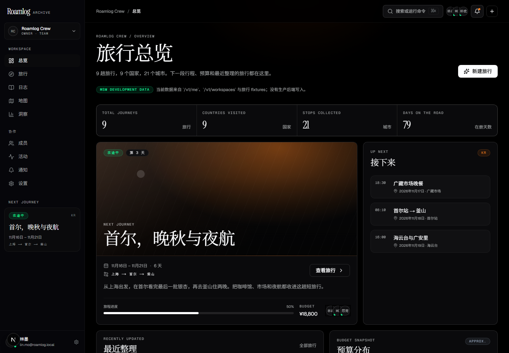

Web Dashboard：统计、下一段旅行、近期旅行和预算快照组成的工作型首屏。

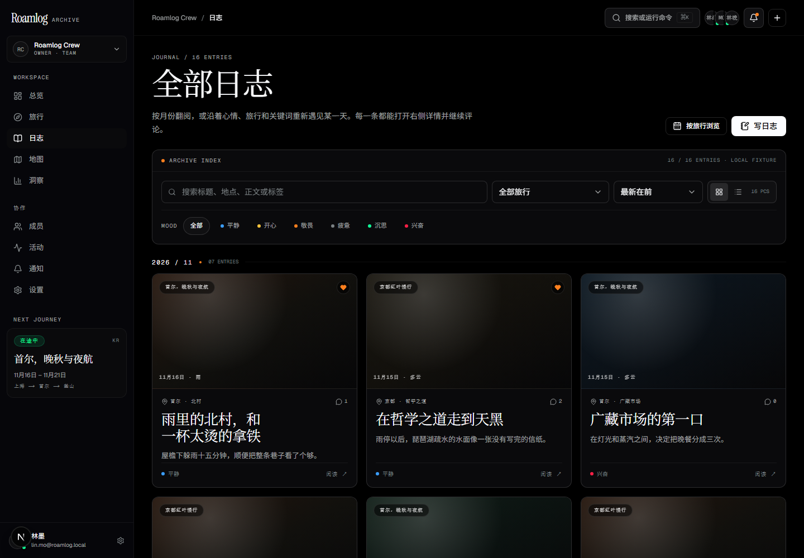

Journal：跨旅行日志索引、搜索、筛选与归档时间线。

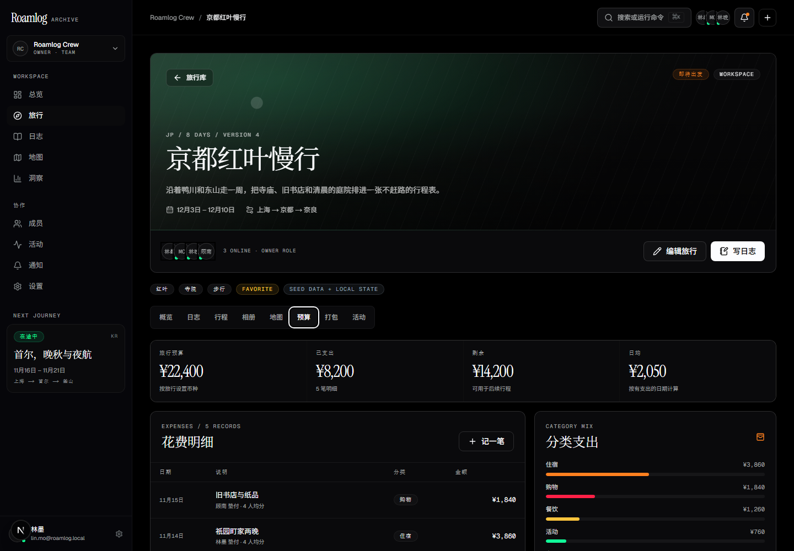

Trip Budget：预算摘要、分类支出、花费明细与建议结算。

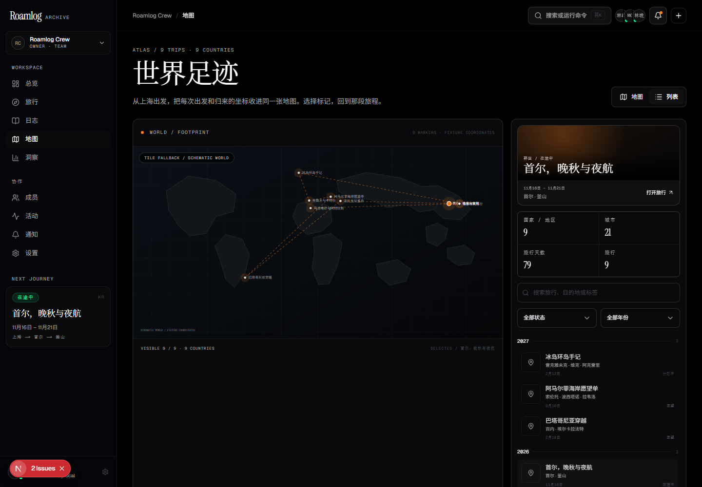

Map：地图降级视图、旅行标记与右侧旅行索引；地图无法加载瓦片时仍保留可操作列表。

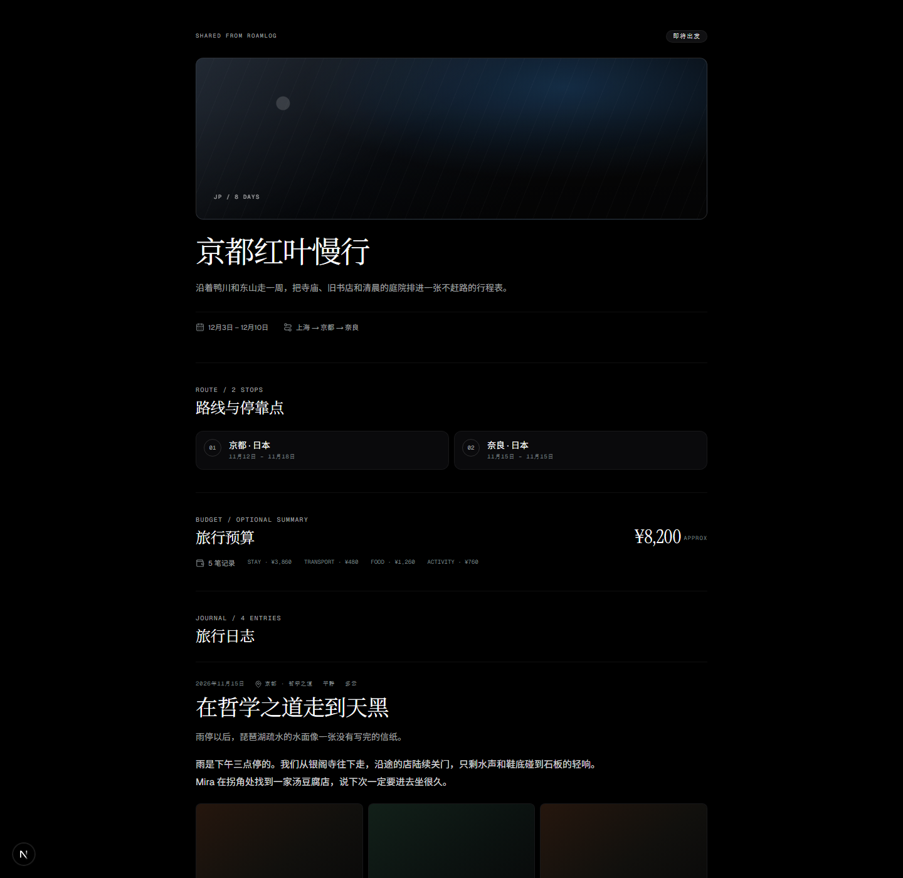

Public Share：只读分享页，包含路线、预算摘要与日志，不显示评论、邮箱或内部备注。

### Admin

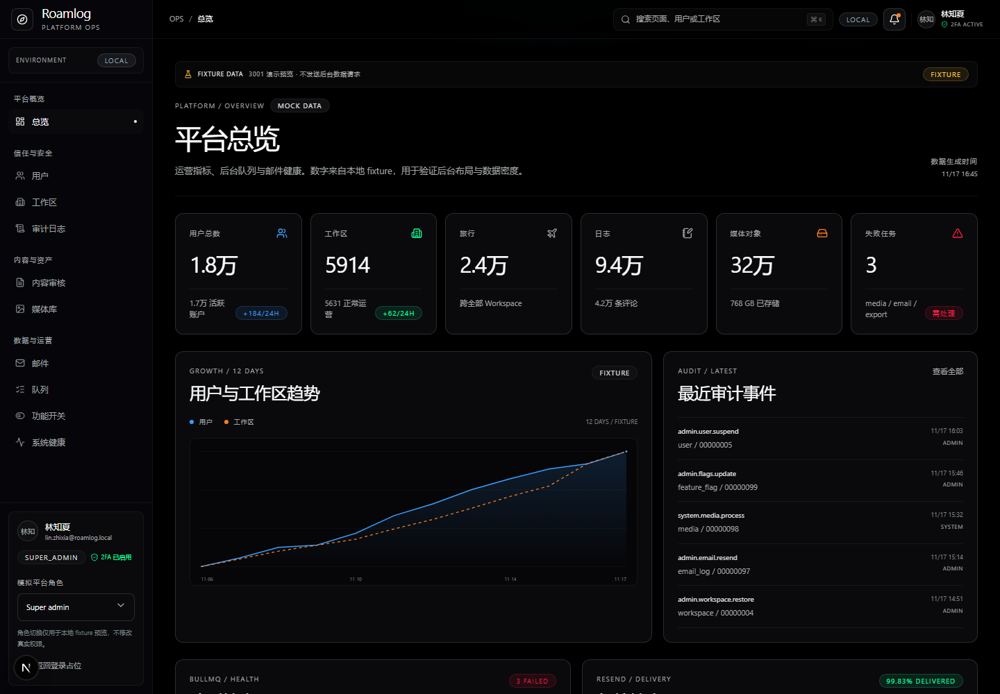

Admin Dashboard：用户、Workspace、内容、邮件、审计和队列健康。

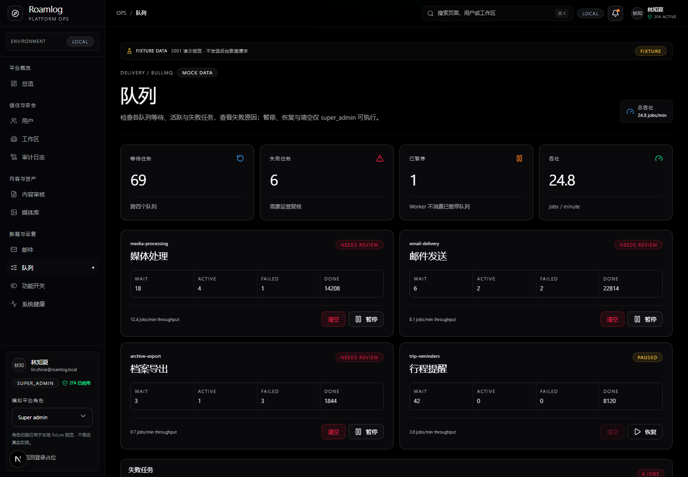

Admin Queues：BullMQ waiting/active/failed 计数、失败任务和权限受控操作。

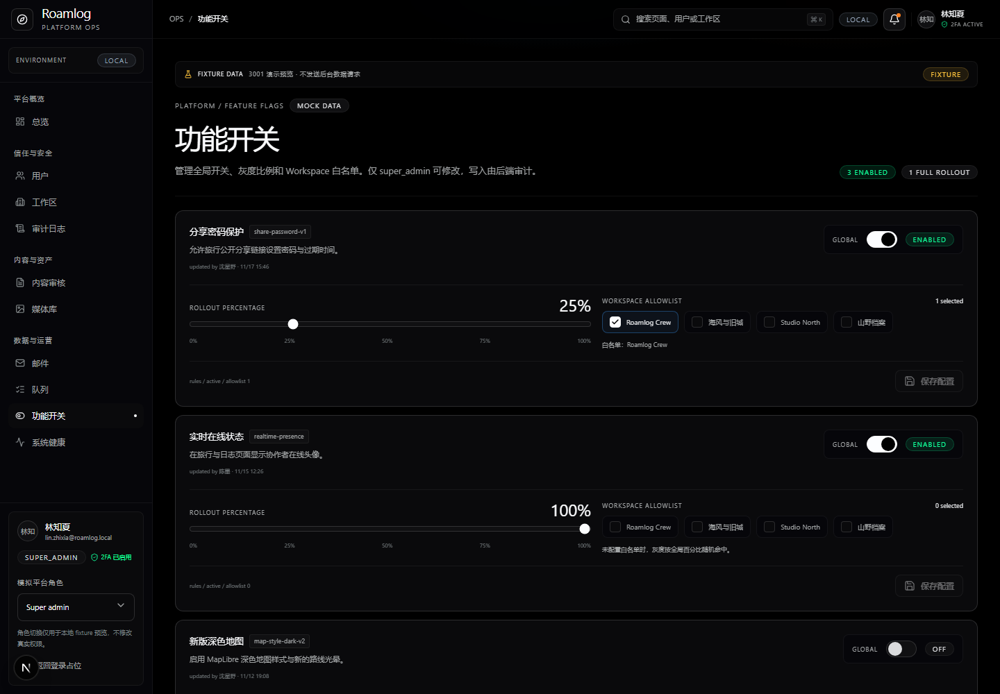

Admin Flags：功能开关、rollout 比例与 Workspace 白名单。

移动端、系统健康和更多页面见 [截图资产索引](docs/assets/screenshots/README.md)。

## 系统架构

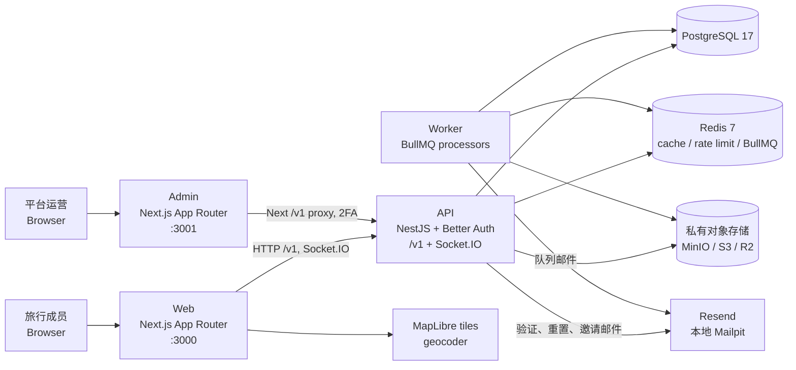

核心数据流：

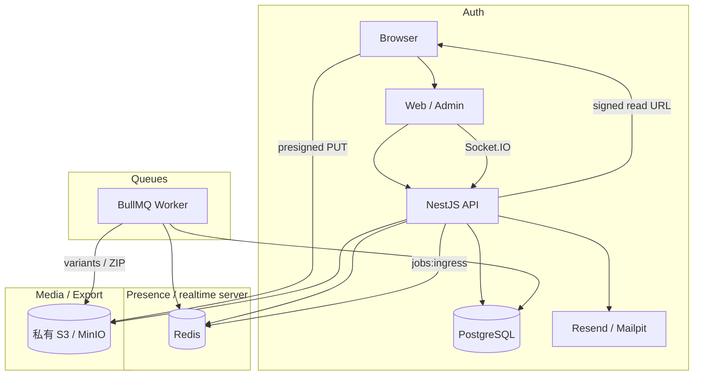

完整时序图、部署拓扑、失败模式和安全边界见 [架构文档](docs/architecture.md)。

### Monorepo 结构

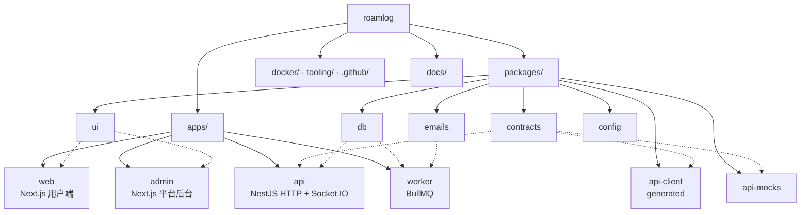

```text
roamlog/
├── apps/{web,admin,api,worker}
├── packages/{ui,contracts,api-client,api-mocks,db,emails,config}
├── docker/            # 本地与 staging Compose、Dockerfile、Caddy 示例
├── docs/              # 架构、验收与运维手册
├── e2e/               # Playwright API/Web/Admin/staging/a11y/visual
├── tooling/           # env check、k6、staging full-chain 与服务脚本
└── .github/workflows/ # CI 与 release gate
```

### 数据所有权

- `packages/contracts` 拥有 Zod、OpenAPI、权限矩阵和实时事件；禁止手写第二套 API 类型。
- `packages/api-client` 是生成目录，不手改。
- `packages/db` 拥有 Prisma schema、迁移、seed 和 test factories；迁移串行执行。
- `packages/ui` 拥有设计 tokens 与基础组件；Web/Admin 通过组件 API 使用。
- PostgreSQL 是业务事实源；Redis 可重建；对象存储是媒体和导出的权威副本，但不是公开读 bucket。

## 技术栈

版本以当前 `package.json` 为准，完整锁定版本见 `pnpm-lock.yaml`。

| 层          | 选型                           | 当前版本/基线                      |
| ----------- | ------------------------------ | ---------------------------------- |
| Runtime     | Node.js                        | 24.x；CI 使用 24.22.2              |
| 包管理      | pnpm                           | 12.18.0                            |
| Monorepo    | Turborepo                      | 2.11.11                            |
| 语言        | TypeScript                     | 5.9.3                              |
| Web / Admin | Next.js + React                | 16.4.6 + 19.3.1                    |
| UI          | Tailwind CSS 4 + Radix UI      | 4.3.5                              |
| API         | NestJS                         | 12.5.1                             |
| ORM / DB    | Prisma + PostgreSQL            | 7.10.1 / 17                        |
| 队列        | BullMQ + Redis                 | 6.7.7 / 7                          |
| 认证        | Better Auth                    | 1.7.25                             |
| 契约        | Zod + zod-to-openapi + Orval   | 4.6.7 / 9.1.0 / 8.48.0             |
| 实时        | Socket.IO + Redis adapter      | 4.8.4 / 8.3.0                      |
| 数据请求    | TanStack Query                 | 5.107.1                            |
| 富文本      | Tiptap                         | 3.34.x                             |
| 地图        | MapLibre GL + react-map-gl     | 6.18.0 / 8.1.0                     |
| 图像        | sharp                          | 0.35.5                             |
| 邮件        | Resend + React Email           | 本地 Mailpit；模板 1.0.x           |
| 观测        | pino + Sentry + Prometheus     | 10.4.0 / 11.13.0 / 15.1.3          |
| 测试        | Vitest + Playwright + axe + k6 | 5.1.0 / 1.65.0 / 4.14.0 / 外部 k6  |
| 编排        | Docker Compose + GHCR          | staging profile + immutable images |

## 快速开始

### 前置条件

| 工具                    | 要求                                               |
| ----------------------- | -------------------------------------------------- |
| Node.js                 | `>=24.0.0 <25`                                     |
| pnpm                    | `>=12.0.0`，仓库锁定 `12.18.0`                     |
| Docker Engine + Compose | API 模式和本地基础设施需要                         |
| Python 3 + PyYAML       | `pnpm staging:validate` 需要；CI 使用 PyYAML 6.0.3 |
| k6                      | 只有负载门禁需要，仓库不携带二进制                 |

```bash
node --version
pnpm --version
pnpm install --frozen-lockfile
```

### 模式 A：Mock 模式（只需 Node.js）

Web 默认 `NEXT_PUBLIC_DATA_MODE=mock`，Admin 默认 `fixture`。这是最快的界面查看方式：

```bash
# Terminal 1
pnpm --filter @roamlog/web dev

# Terminal 2
pnpm --filter @roamlog/admin dev
```

- Web: <http://localhost:3000>
- Admin: <http://localhost:3001>

Mock 边界：

- Web 在 development/test 下启动 MSW；生产构建不会启动 Service Worker。
- Admin fixture 操作写本地状态和模拟审计，不会请求 API。
- mock 模式不证明真实登录、数据库、上传、邮件、队列或实时协作。

### 模式 B：API 模式（完整本地栈）

1. 准备根环境文件。API/Worker/Prisma 会读取仓库根目录的 `.env.local`：

```bash
cp .env.example .env.local
```

至少替换：

- `BETTER_AUTH_SECRET`：不少于 32 字节的随机值。
- OAuth 变量：需要 Google/GitHub 登录时填写。
- `MINIO_ROOT_PASSWORD`、`S3_SECRET_KEY`：本地也不要复用示例值。
- `RESEND_API_KEY` 可继续使用 Mailpit 的 SMTP 配置，无需真实 Resend。

2. 启动本地基础设施：

```bash
docker compose --env-file .env.local -f docker/compose.yml up -d
```

3. 应用迁移并写入幂等 seed：

```bash
pnpm db:migrate
pnpm db:seed
```

Seed 只允许 local/staging。若要把 seed 图片上传到 MinIO，在 `.env.local` 设置
`ROAMLOG_SEED_S3_UPLOAD=true` 后重新运行 `pnpm db:seed`。

4. 在 Web/Admin 的开发环境启用 API 数据源。可分别创建被 Git 忽略的
   `apps/web/.env.local` 与 `apps/admin/.env.local`：

```dotenv
# apps/web/.env.local
API_URL=http://localhost:4000
NEXT_PUBLIC_DATA_MODE=api

# apps/admin/.env.local
API_URL=http://localhost:4000
NEXT_PUBLIC_ADMIN_DATA_MODE=api
```

也可以在启动前导出同名环境变量：

```powershell
$env:API_URL = "http://localhost:4000"
$env:NEXT_PUBLIC_DATA_MODE = "api"
$env:NEXT_PUBLIC_ADMIN_DATA_MODE = "api"
pnpm dev
```

```bash
export API_URL=http://localhost:4000
export NEXT_PUBLIC_DATA_MODE=api
export NEXT_PUBLIC_ADMIN_DATA_MODE=api
pnpm dev
```

5. 打开服务并检查 readiness：

| Surface             | URL                                               |
| ------------------- | ------------------------------------------------- |
| Web                 | <http://localhost:3000>                           |
| Admin               | <http://localhost:3001>                           |
| API                 | <http://localhost:4000>                           |
| API health          | <http://localhost:4000/v1/health>                 |
| API readiness       | <http://localhost:4000/v1/ready>                  |
| MinIO API / Console | <http://localhost:9000> / <http://localhost:9001> |
| Mailpit             | <http://localhost:8025>                           |
| PostgreSQL          | `localhost:5432`                                  |
| Redis               | `localhost:6379`                                  |

> [!NOTE]
> 官方 MinIO 社区镜像已不再允许匿名拉取。若新机器无法启动 MinIO，需要先登录
> 批准的 Quay 源，或把已验证 digest 镜像到私有 registry，并设置
> `MINIO_IMAGE` / `MINIO_MC_IMAGE`。不要用未知第三方镜像替换。

### 第一个 `super_admin`

Bootstrap 是两阶段流程，初始凭据不会打印：

```bash
pnpm admin:bootstrap -- --dry-run
pnpm admin:bootstrap -- --force
```

第一条 `--force` 只创建/邀请账号并发送验证与重置邮件。完成邮箱验证、设置密码、在
`/admin/2fa/enroll` 验证 TOTP 后，再次执行：

```bash
pnpm admin:bootstrap -- --force
```

只有 active、邮箱已验证、2FA 已启用且 TOTP factor 已验证的账号才能提升为
`super_admin`。完整步骤见 [staging deployment](docs/operations/staging-deployment.md#6-bootstrap-the-first-super_admin)。

## 环境变量

完整模板：

- 本地：[`.env.example`](.env.example)
- staging（legacy 双文件栈）：[`docker/staging.env.example`](docker/staging.env.example)
- production：[`docker/production.env.example`](docker/production.env.example) → `/opt/roamlog/config/.env.production`

关键变量：

| 分组       | 变量                                                                                                     | 用途                                  |
| ---------- | -------------------------------------------------------------------------------------------------------- | ------------------------------------- |
| Runtime    | `NODE_ENV`, `APP_ENV`, `LOG_LEVEL`, `ROAMLOG_ENV_FILE`                                                   | Node 运行模式、部署形态、日志级别     |
| URL        | `APP_URL`, `ADMIN_URL`, `API_URL`, `BETTER_AUTH_URL`                                                     | 公开 origin 与 Better Auth 基址       |
| 网络边界   | `CORS_ORIGINS`, `TRUST_PROXY`, `SESSION_COOKIE_DOMAIN`                                                   | 精确 CORS、代理信任、父域 cookie      |
| 前端模式   | `NEXT_PUBLIC_DATA_MODE`, `NEXT_PUBLIC_ADMIN_DATA_MODE`, `NEXT_PUBLIC_APP_ENV`                            | `mock/fixture` 或 `api`、环境徽标     |
| 限流       | `RATE_LIMIT_WINDOW_SECONDS`, `AUTH_RATE_LIMIT_MAX`, `PUBLIC_SHARE_*_RATE_LIMIT_MAX`                      | 登录、分享、预签名请求限流            |
| 数据库     | `DATABASE_URL`, `POSTGRES_*`                                                                             | PostgreSQL 连接与 Compose 初始化      |
| Redis      | `REDIS_URL`, `REDIS_PREFIX`, `REDIS_PASSWORD`                                                            | 队列、限流、幂等、presence 与隔离前缀 |
| 认证       | `BETTER_AUTH_SECRET`, `GOOGLE_CLIENT_*`, `GITHUB_CLIENT_*`                                               | session 签名与 OAuth                  |
| 管理后台   | `ADMIN_2FA_ENFORCED`                                                                                     | 平台后台强制 TOTP                     |
| 对象存储   | `S3_ENDPOINT`, `S3_BUCKET`, `S3_ACCESS_KEY`, `S3_SECRET_KEY`, `S3_REGION`, `S3_FORCE_PATH_STYLE`         | 私有媒体与导出（服务端内部 endpoint） |
| 媒体投递   | `S3_PUBLIC_ENDPOINT`, `S3_PUBLIC_BASE_URL`, `MEDIA_SIGNED_URL_TTL_SECONDS`, `MEDIA_CORS_ORIGINS`         | 浏览器可见的签名 origin、TTL、桶 CORS |
| MinIO 镜像 | `MINIO_IMAGE`, `MINIO_MC_IMAGE`                                                                          | 固定、可验证的镜像来源                |
| 邮件       | `EMAIL_PROVIDER`, `SMTP_HOST`, `SMTP_PORT`, `SMTP_USER`, `SMTP_PASSWORD`, `RESEND_API_KEY`, `EMAIL_FROM` | Mailpit / SMTP relay / Resend         |
| 地图       | `NEXT_PUBLIC_MAP_STYLE_URL`, `NEXT_PUBLIC_GEOCODER_URL`                                                  | 瓦片样式与城市搜索                    |
| 导出       | `EXPORT_SIGNED_URL_TTL`                                                                                  | 签名下载 URL 有效期，默认 900 秒      |
| 观测       | `SENTRY_DSN`, `SENTRY_TRACES_SAMPLE_RATE`, `OTEL_EXPORTER_OTLP_ENDPOINT`                                 | 错误与 trace                          |
| Bootstrap  | `BOOTSTRAP_SUPER_ADMIN_EMAIL`, `BOOTSTRAP_SUPER_ADMIN_NAME`                                              | 首个平台管理员目标                    |
| Seed       | `DEMO_SEED_ENABLED`, `DEMO_*`, `ROAMLOG_SEED_S3_UPLOAD`                                                  | 仅 local/staging 演示数据             |
| 发布       | `ROAMLOG_IMAGE_TAG`, `PRODUCTION_*_PORT`, `STAGING_*_PORT`                                               | 镜像 tag 与 loopback 端口             |

`APP_ENV` 与 `NODE_ENV` 的区别：staging 也以 `NODE_ENV=production` 运行以复用 Node 运行时行为，因此**生产专属校验（媒体公开 origin、真实邮件通道）只由 `APP_ENV=production` 触发**。省略 `APP_ENV` 会让 API 静默回落为 `development` 并跳过这些校验，`pnpm check:env -- --env production` 会因此直接报错。

加载规则：

- API、Worker、Prisma seed 会读取根 `.env.local`；显式路径可设 `ROAMLOG_ENV_FILE`。
- Next.js 的 `NEXT_PUBLIC_*` 在 development/build 时注入，必须在应用环境或 shell 中可见；staging Docker 构建使用 build args。`NEXT_PUBLIC_APP_ENV` 是**构建期**变量（web/admin Dockerfile 有同名 build arg，默认 `production`），不是运行时 env，容器里再设置不会改变徽标。
- production 只使用 `docker/compose.production.yml` + `/opt/roamlog/config/.env.production`；staging 的双文件（`docker/compose.staging.yml` + `docker/compose.server.yml`）是 legacy，不得叠加到 production 之上。
- production/staging 不应依赖任意向上查找的本地 env 文件；容器环境变量由编排显式提供。
- 不要提交 `.env`、`.env.local`、`docker/.env.staging`、密钥、token、数据库 dump 或真实用户数据。

启动前检查：

```bash
# 本地（允许占位符，仅告警）
pnpm check:env

# production：严格模式，进程环境变量不参与，只看被审的文件
pnpm check:env -- --env production --env-file /opt/roamlog/config/.env.production
```

严格模式复用 `apps/api/src/config/environment.ts` 的 `validateEnvironment()`，因此预检与 API 启动校验不会漂移。错误只报变量名与规则，不回显值；模板本身（含 `CHANGE_ME`）预期以退出码 `1` 失败，这是它作为“未填写”证明的方式。

## 常用命令

| 目的                   | 命令                                                                  |
| ---------------------- | --------------------------------------------------------------------- |
| 启动全部开发进程       | `pnpm dev`                                                            |
| 只启动 Web / Admin     | `pnpm --filter @roamlog/web dev` / `pnpm --filter @roamlog/admin dev` |
| Lint                   | `pnpm lint`                                                           |
| TypeScript             | `pnpm typecheck`                                                      |
| 单元/集成测试          | `pnpm test`                                                           |
| 全量构建               | `pnpm build`                                                          |
| 生成 OpenAPI           | `pnpm contracts:generate`                                             |
| 生成 API client        | `pnpm api-client:generate`                                            |
| 校验契约与生成物同步   | `pnpm contracts:check`                                                |
| 应用迁移               | `pnpm db:migrate`                                                     |
| 幂等 seed              | `pnpm db:seed`                                                        |
| Prisma Studio          | `pnpm db:studio`                                                      |
| 环境检查               | `pnpm check:env`                                                      |
| Bootstrap 首个管理员   | `pnpm admin:bootstrap -- --dry-run` / `--force`                       |
| 本地 Web/Admin/API E2E | `pnpm e2e:web`, `pnpm e2e:admin`, `pnpm e2e:api`                      |
| live API E2E           | `pnpm e2e:live`                                                       |
| staging E2E            | `pnpm e2e:staging`                                                    |
| 可访问性               | `pnpm e2e:a11y`, `pnpm e2e:a11y:axe`, `pnpm e2e:a11y:keyboard`        |
| 视觉回归               | `pnpm e2e:visual`                                                     |
| staging 静态校验       | `pnpm staging:validate`                                               |
| Compose 配置检查       | `pnpm staging:config`                                                 |
| k6 smoke / security    | `pnpm k6:staging:smoke` / `pnpm k6:staging:security`                  |
| 依赖安全门禁           | `pnpm security:check`                                                 |
| 格式化检查             | `pnpm format:check`                                                   |

`pnpm e2e` 使用默认 Playwright 配置；live/staging 命令依赖对应 fixture、端口和真实服务。先读 [测试矩阵](#测试矩阵) 与 [staging 运维](docs/operations/staging-deployment.md)，不要把“命令存在”当成“环境已就绪”。

## 路由与 API

### Web 路由

| 路由                                                                          | 说明                        |
| ----------------------------------------------------------------------------- | --------------------------- |
| `/login`, `/register`, `/forgot-password`, `/reset-password`, `/verify-email` | Better Auth 认证流程        |
| `/invite/[token]`, `/invite-accept`                                           | 邀请查看与接受              |
| `/settings/security`                                                          | 密码、OAuth、2FA 与会话     |
| `/w/[workspaceSlug]`                                                          | Workspace 总览              |
| `/w/[workspaceSlug]/trips`, `/trips/new`, `/trips/[tripId]`                   | 旅行库、创建、旅行详情      |
| `/w/[workspaceSlug]/journal`                                                  | 跨旅行日志                  |
| `/w/[workspaceSlug]/map`                                                      | 世界足迹与路线              |
| `/w/[workspaceSlug]/insights`                                                 | 旅行/花费/日志洞察          |
| `/w/[workspaceSlug]/members`                                                  | 成员、邀请与角色            |
| `/w/[workspaceSlug]/activity`, `/notifications`                               | 活动流与通知                |
| `/w/[workspaceSlug]/settings`                                                 | 个人、Workspace、通知与数据 |
| `/w/[workspaceSlug]/trips/[tripId]/map`                                       | 单次旅行地图                |
| `/share/[token]`                                                              | 公开只读分享页              |

### Admin 路由

| 路由                                | 说明                   |
| ----------------------------------- | ---------------------- |
| `/login`                            | 平台登录与 TOTP        |
| `/admin`                            | 指标、趋势与系统概览   |
| `/admin/users`, `/admin/workspaces` | 用户与 Workspace 运营  |
| `/admin/content`, `/admin/media`    | 内容审核与媒体管理     |
| `/admin/audit`                      | 只追加审计时间线       |
| `/admin/emails`, `/admin/queues`    | 邮件日志与 BullMQ 操作 |
| `/admin/flags`                      | 功能开关与灰度         |
| `/admin/system`                     | 依赖健康、版本与迁移   |
| `/admin/2fa/enroll`                 | TOTP 注册              |

### API 摘要

所有业务 API 位于 `/v1`，完整机器可读契约见 [`packages/contracts/openapi.json`](packages/contracts/openapi.json)。

| 分组                      | 端点示例                                                                                                    |
| ------------------------- | ----------------------------------------------------------------------------------------------------------- |
| Auth / Me                 | `/v1/auth/*`, `/v1/me`, `/v1/me/workspaces`, `/v1/me/notifications`, `/v1/me/sessions`                      |
| Workspace / Members       | `/v1/workspaces`, `/v1/workspaces/:id/members`, `/invitations`, `/transfer-ownership`                       |
| Trips / Stops / Itinerary | `/v1/workspaces/:id/trips`, `/v1/trips/:id`, `/stops`, `/itinerary`, `/reorder`                             |
| Journal / Comments        | `/v1/workspaces/:id/entries`, `/v1/entries/:id/revisions`, `/v1/comments`                                   |
| Media                     | `/v1/workspaces/:id/media/presign`, `/v1/media/:id/complete`, `/v1/trips/:id/media`                         |
| Expense / Packing         | `/v1/trips/:id/expenses`, `/budget/summary`, `/budget/settle-up`, `/packing`                                |
| Share / Export            | `/v1/trips/:id/share-links`, `/v1/public/trips/:token`, `/v1/exports`                                       |
| Search / Realtime         | `/v1/workspaces/:id/search`, Socket.IO namespace `/v1/ws`                                                   |
| Admin                     | `/v1/admin/metrics`, `/users`, `/workspaces`, `/content`, `/audit`, `/flags`, `/emails`, `/jobs`, `/system` |
| Health                    | `/v1/health`, `/v1/ready`, `/v1/metrics`                                                                    |

通用约定：

- 错误使用 RFC 7807 `application/problem+json`；未知 500 不泄露堆栈。
- 列表使用 cursor 分页；排序和筛选只接受白名单。
- 带 `version` 的写接口冲突返回 `409`。
- 邀请、导出、媒体完成与分享链接创建支持 `Idempotency-Key`。
- `x-request-id` 由 API 回传并贯穿日志。
- 业务查询必须先过 Workspace 成员校验；不能只按资源 id 直查。

## 测试矩阵

| 层               | 命令                                                | 覆盖                                                                   |
| ---------------- | --------------------------------------------------- | ---------------------------------------------------------------------- |
| 单元/集成        | `pnpm test`                                         | 权限、租户隔离、乐观锁、金额、日期、share token、sanitize、worker jobs |
| 契约             | `pnpm contracts:check`                              | OpenAPI 与 Orval 生成物无 drift                                        |
| 环境             | `pnpm check:env`                                    | 必填变量、URL、secret 长度、TTL、production seed guard                 |
| API E2E          | `pnpm e2e:api`                                      | 真实 Nest HTTP、鉴权、Problem Details、smoke                           |
| Web/Admin 浏览器 | `pnpm e2e:web`, `pnpm e2e:admin`                    | 关键页面、角色、队列、功能开关、响应式                                 |
| live API         | `pnpm e2e:live`                                     | 真实 fixture + API 下的 Web/Admin/API 路径                             |
| staging          | `pnpm e2e:staging`                                  | 真实服务、分享密码、安全门禁、Admin 操作与审计                         |
| 可访问性         | `pnpm e2e:a11y`                                     | axe serious/critical、键盘、焦点恢复、移动导航                         |
| 视觉             | `pnpm e2e:visual`                                   | 1440/1024/390、横向溢出、标题字号、primary 数量                        |
| 负载             | `pnpm k6:staging:smoke`, `pnpm k6:staging:security` | API p95/错误率、认证/分享/上传限流与 CSRF                              |
| 依赖安全         | `pnpm security:check`                               | `pnpm audit --audit-level high`                                        |
| 构建             | `pnpm build`                                        | Next.js、Nest、Worker、共享包                                          |

本地证据：

- [STG_RELEASE_GATE_REPORT.md](STG_RELEASE_GATE_REPORT.md)：隔离 staging 的 E2E、Admin、k6 与安全结果。
- [STG_FULL_CHAIN_REPORT.md](STG_FULL_CHAIN_REPORT.md)：媒体、邮件、导出、重试与幂等的真实链路。
- [W5_A11Y_PERF_REPORT.md](W5_A11Y_PERF_REPORT.md)：axe、键盘、视觉和移动端修复后的复验。

## CI/CD 与发布

### CI

[`.github/workflows/ci.yml`](.github/workflows/ci.yml) 在 PR、`main` push 和 release gate 调用时执行：

1. frozen install。
2. staging/Docker/workflow 静态检查、staging 与 production 两份 Compose 的 `config --quiet` 校验。
3. lint、typecheck。
4. Prisma migration + seed。
5. 测试、契约/生成 client 新鲜度。
6. monorepo build。
7. Playwright Web dashboard smoke 与 API smoke。

### Release gate

[`.github/workflows/release.yml`](.github/workflows/release.yml) 仅在 CI 通过后构建镜像：

| 镜像      | Dockerfile / target                    |
| --------- | -------------------------------------- |
| `api`     | `docker/api.Dockerfile` / `runtime`    |
| `migrate` | `docker/api.Dockerfile` / `migrate`    |
| `worker`  | `docker/worker.Dockerfile` / `runtime` |
| `web`     | `docker/web.Dockerfile` / `runtime`    |
| `admin`   | `docker/admin.Dockerfile` / `runtime`  |

- `v*` tag：构建并推送 `sha-*` 与版本 tag 到 GHCR，并生成 provenance/SBOM。
- 手动 dispatch：默认 `dry_run=true`，只构建不登录 GHCR、不推送。
- 手动 `dry_run=false` + `image_tag=staging`：发布 staging 镜像。
- GHCR 路径形如 `ghcr.io/self-command/roamlog/<component>`。

发布版本：

```bash
git tag v0.x.y
git push origin v0.x.y
```

发布 workflow **不负责部署**。把镜像部署到 staging 时需要 pull、retag 到 Compose 期望的名称，再 `up --no-build`。完整步骤见 [release gate runbook](docs/operations/release-gate.md)。

### Docker staging（legacy）

> staging 双文件栈仅用于既有 staging 环境，**不是 production**。production 使用 `docker/compose.production.yml`，见下一节。

```bash
cp docker/staging.env.example docker/.env.staging
chmod 600 docker/.env.staging
pnpm staging:validate
pnpm staging:config
docker compose --env-file docker/.env.staging -f docker/compose.staging.yml \
  --profile app up -d --build
```

- `migrate` 是一次性服务；迁移成功后才启动 API/Worker。
- PostgreSQL、Redis 不暴露宿主端口；Web/Admin/API、MinIO console 和 Mailpit 只绑定 loopback。
- 由 TLS ingress 负责 HSTS/CSP、精确 CORS 与阻断 `/v1/metrics`。
- staging 默认 `NODE_ENV=production`，不自动 seed。
- MinIO 必须使用批准的 Quay/私有镜像或 digest；clean host 无法匿名拉取。

### Docker production

production 只有一个 compose 文件，不叠加 legacy 双文件，也不使用 `--profile`：

```bash
cd /opt/roamlog/repo
docker compose \
  --env-file /opt/roamlog/config/.env.production \
  -f docker/compose.production.yml \
  config --quiet     # 静态校验；必填变量缺失会在这一步失败

docker compose \
  --env-file /opt/roamlog/config/.env.production \
  -f docker/compose.production.yml \
  up -d --no-build
```

- env 文件从 `docker/production.env.example` 复制为 `/opt/roamlog/config/.env.production`（`0600`），不要写进 Git。
- `APP_ENV=production` 缺失会让 API 跳过媒体与邮件强校验；`pnpm check:env -- --env production` 会拒绝这种文件。
- 发布镜像由 release gate 构建，`NEXT_PUBLIC_APP_ENV` 默认 `production`；staging 镜像必须显式传 `--build-arg NEXT_PUBLIC_APP_ENV=staging`，否则徽标会显示 `PRODUCTION`。
- 完整上线步骤、Nginx/TLS、备份与回滚见 [deploy/README.md](deploy/README.md)。

运维入口：

- [Operations index](docs/operations/README.md)
- [Release checklist (rc.4)](docs/operations/release-checklist.md)
- [Media delivery](docs/operations/media-delivery.md)
- [Email delivery](docs/operations/email-production.md)
- [Staging deployment](docs/operations/staging-deployment.md)
- [Migrations](docs/operations/migrations.md)
- [Backup and restore](docs/operations/backup-restore.md)
- [Rollback](docs/operations/rollback.md)
- [Secret rotation](docs/operations/secret-rotation.md)
- [Health and monitoring](docs/operations/health-and-monitoring.md)
- [Troubleshooting](docs/operations/troubleshooting.md)

## 可观测性与安全

### 健康与指标

| 端点               | 用途                              | 暴露范围                   |
| ------------------ | --------------------------------- | -------------------------- |
| `GET /v1/health`   | 无依赖进程 liveness               | ingress probe              |
| `GET /v1/ready`    | PostgreSQL / Redis / S3 readiness | ingress probe              |
| `GET /v1/metrics`  | Prometheus 指标                   | **禁止公网**，ingress 阻断 |
| Socket.IO `/v1/ws` | 认证后的 presence 与缓存失效      | 登录用户                   |

- API 使用 Pino JSON 日志，带 request/user/Workspace 上下文和敏感字段 redaction。
- Sentry 捕获 API/Worker/Web/Admin 异常；OpenTelemetry 导出 OTLP span。
- 基线 SLO：API p95 < 300ms、错误率 < 1%、队列 lag < 60s、媒体处理 p95 < 15s。
- Worker 进程健康检查不能替代队列 lag/stalled job 监控；Admin 队列页应配合 BullMQ 指标使用。

### 安全控制

- Better Auth session 使用 httpOnly、Secure、SameSite=Lax；Admin 强制 TOTP。
- Workspace 角色、平台角色、Trip 可见性、share token、管理员 2FA 分层校验。
- CORS 只允许精确 Web/Admin origin；自定义写接口校验 Origin。
- 认证、分享、密码尝试和上传使用 Redis 限流；部署只信任单一边缘代理。
- Tiptap HTML 服务端白名单清洗；媒体校验 magic bytes、大小与类型，剥离 EXIF GPS。
- 分享 token 只存 hash，明文只在创建时返回一次；可过期、撤销、密码保护。
- 依赖检查：`pnpm security:check` + GitHub CodeQL/Dependabot 配置按仓库设置启用。
- 安全漏洞请按 [SECURITY.md](SECURITY.md) 私下报告，不要公开 issue 或贴真实凭据。

## 视觉语言

Roamlog 的视觉参考 Resend 的编辑感，但实现必须是**真实产品界面，不是海报**：

- 纯黑 `#000000` 画布、近黑 surface、1px hairline 描边，不用大面积投影。
- Instrument Serif / Noto Serif SC 负责编辑标题；Geist / Noto Sans SC 负责 UI；Geist Mono 负责元数据。
- 页面标题最大 56px，旅行标题最大 48px，日志标题最大 36px。
- 每屏最多一个白色 primary 按钮，其余使用 ghost、outline 或 subtle。
- 首屏必须出现可操作内容：卡片、表格、列表、地图、图表或表单。
- 低透明度氛围光只做单屏一处 12%–18% 的局部层次，不变成彩色大色块。
- 桌面、平板、390px 移动端都有明确布局；触控目标、焦点环、对比度、键盘和 reduced motion 是门禁项。

截图索引与资产发布规则见 [docs/assets/screenshots/README.md](docs/assets/screenshots/README.md)。

## 文档导航

| 文档                                              | 内容                                        |
| ------------------------------------------------- | ------------------------------------------- |
| [架构](docs/architecture.md)                      | 容器、时序、部署、失败模式和安全边界        |
| [Operations](docs/operations/README.md)           | staging、迁移、备份、回滚、密钥、监控与排障 |
| [Release gate](docs/operations/release-gate.md)   | CI、GHCR、镜像发布与部署证据                |
| [Staging full-chain](e2e/staging-full/README.md)  | 本地真实服务全链路 harness                  |
| [截图资产索引](docs/assets/screenshots/README.md) | 截图命名、生成和发布要求                    |
| [贡献指南](CONTRIBUTING.md)                       | 开发、契约、测试和 PR 规则                  |
| [安全政策](SECURITY.md)                           | 漏洞报告与敏感信息处理                      |

设计文档位于仓库外部父工作区的 `docs/superpowers/specs/`；当前 GitHub 仓库不包含该目录，因此 README 不提供跨仓库相对链接。

## 贡献

开始开发前请阅读 [CONTRIBUTING.md](CONTRIBUTING.md)。最重要的边界：

- 先改契约，再改实现；不要手改 `packages/api-client`。
- 业务查询必须带 Workspace 上下文，并补跨租户拒绝测试。
- 数据库迁移串行生成，不在 migration 中运行 seed。
- 不提交 `.env`、密钥、真实用户数据或未脱敏截图。
- UI 改动必须覆盖桌面/移动端、键盘、焦点和 reduced motion。
- PR 必须说明验证命令、结果、已知风险与未覆盖项。

```bash
pnpm lint
pnpm typecheck
pnpm test
pnpm contracts:check
pnpm build
```

当前仓库没有 LICENSE 文件；在许可证正式加入前，不要假设代码可按某个开源许可证使用。
