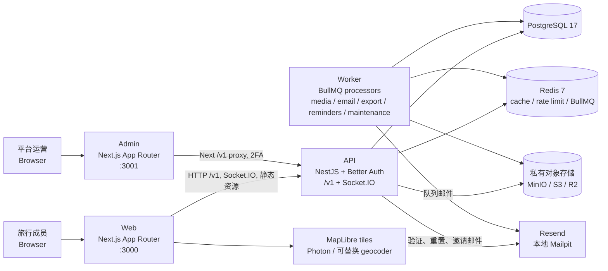
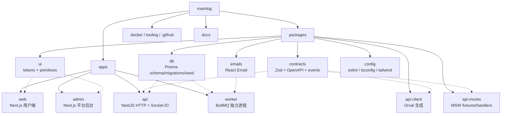
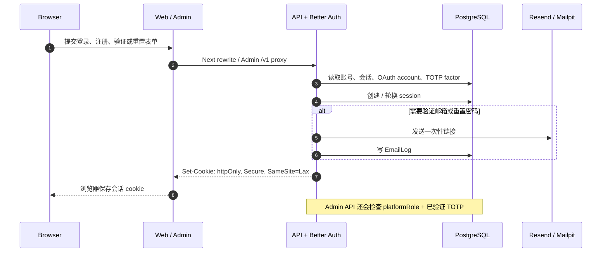
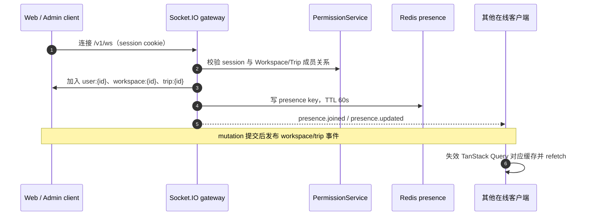
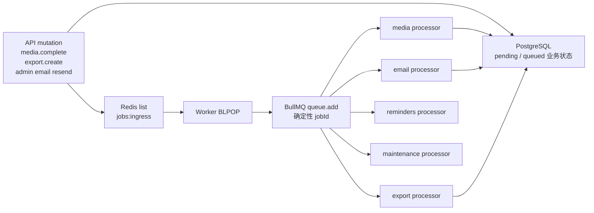
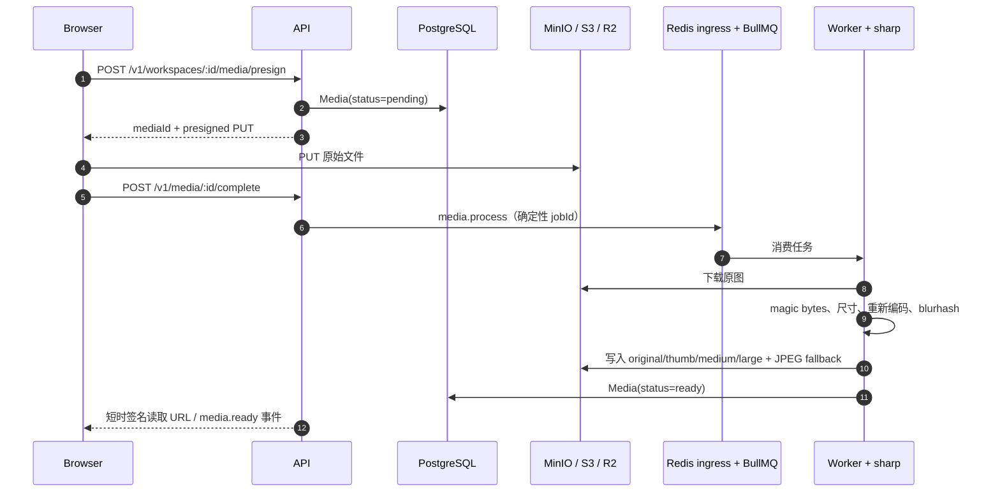
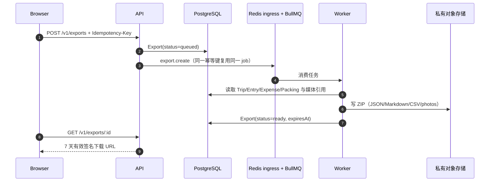
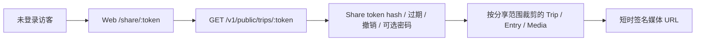
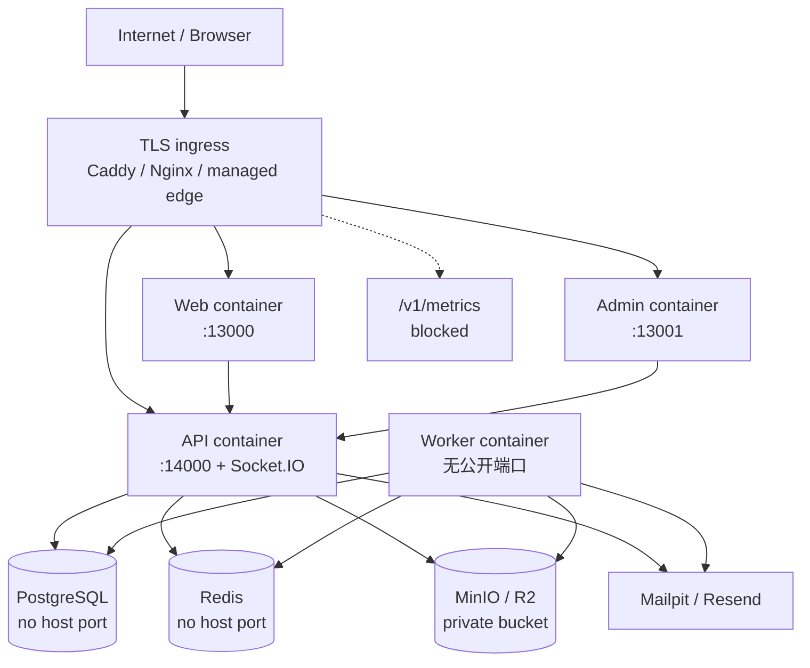

# Roamlog 架构

本文描述 Roamlog 当前 monorepo 的运行时边界、数据流和关键不变量。它面向需要运行、调试、扩展或审查系统的开发者；产品规则、页面细节和验收范围仍以项目设计文档为准。

> [!IMPORTANT]
> 当前状态是 **v1 hardening**，不是 production-ready。后端、Worker、Admin 与核心 Web API 模式已经实现，并在本机隔离 staging 环境取得真实链路证据；远端 TLS、DNS、真实 OAuth/Resend、单一边缘代理、Docker/GHCR 实跑、备份恢复和告警演练仍需在远端 staging 完成。Web 的 Socket.IO 客户端、presence 展示和 query invalidation 尚未接线。

## 1. 架构原则

- **Workspace 是租户边界。** 所有业务查询与写入都必须携带或解析 `workspaceId`，并先完成成员校验。
- **契约先行。** `packages/contracts` 是 Zod、OpenAPI、权限矩阵和实时事件的事实源；`packages/api-client` 只由生成器更新。
- **异步任务可重试且幂等。** API 只写入有确定性 `jobId` 的任务信封，Worker 通过 Redis ingress 转交 BullMQ。
- **实时只做缓存失效。** 服务端提交 mutation 后发布 `workspace` / `trip` 事件；客户端按事件失效 TanStack Query 缓存，不使用 CRDT。
- **私有对象存储。** 媒体与导出只通过短时签名 URL 读取，公开分享页也不会暴露 bucket 公共读权限。
- **外部依赖失败不破坏已提交事实。** PostgreSQL 是业务事实源；Redis 丢失后队列和 presence 可重建，但不应被当成数据库备份。

## 2. 系统上下文与容器



### 容器职责

| 容器           | 职责                                                                   | 不负责                                 |
| -------------- | ---------------------------------------------------------------------- | -------------------------------------- |
| Web            | 用户端页面、MSW/mock 演示模式、核心 API 模式页面、公开分享页           | 直接访问数据库、直接生成媒体变体       |
| Admin          | 平台指标、用户/Workspace/内容/媒体、审计、功能开关、邮件与队列操作     | 复用 Workspace 权限、绕过平台 2FA      |
| API            | Better Auth、租户/对象授权、CRUD、分享、导出任务创建、Socket.IO 服务端 | 长时间图片处理、ZIP 生成、后台重试循环 |
| Worker         | 媒体处理、邮件投递、导出、提醒、维护任务                               | 对外提供用户业务 API                   |
| PostgreSQL     | 用户、Workspace、Trip、Journal、费用、审计、导出和队列业务状态         | 对象字节、短期 presence                |
| Redis          | 限流、幂等、BullMQ、presence TTL、队列 ingress                         | 唯一业务事实源                         |
| MinIO/S3/R2    | 原始媒体、图片变体、ZIP 导出、私有对象                                 | 公共 CDN 直读；读取必须签名            |
| Resend/Mailpit | 事务邮件与本地捕获                                                     | 站内通知事实源                         |

## 3. Monorepo 结构



```text
roamlog/
├── apps/
│   ├── web/                 # 用户端，Next.js App Router
│   ├── admin/               # 平台后台，独立 Next.js 应用
│   ├── api/                 # NestJS API、Better Auth、Socket.IO
│   └── worker/              # BullMQ Worker 与任务处理器
├── packages/
│   ├── ui/                  # 设计 tokens、基础组件、业务无关模式
│   ├── contracts/           # Zod、OpenAPI、实时事件、权限矩阵
│   ├── api-client/          # Orval 生成，禁止手改
│   ├── api-mocks/           # MSW handlers 与 contract-parsed fixtures
│   ├── db/                  # Prisma schema、迁移、seed、factories
│   ├── emails/              # React Email 模板
│   └── config/              # 共享 lint/type/tailwind 配置
├── docker/                  # 本地与 staging Compose、Dockerfile、Caddy 示例
├── docs/                    # 架构与运维文档
├── e2e/                     # Playwright Web/Admin/API/staging/视觉与可访问性
├── tooling/                 # env、k6、staging full-chain、服务脚本
└── .github/workflows/       # CI 与 release gate
```

## 4. 核心数据流

### 4.1 认证与管理员 2FA



- 邮箱/密码、Google OAuth、GitHub OAuth 都汇入 Better Auth session。
- 平台后台不是独立的 Workspace 角色；必须同时满足平台角色和已验证 TOTP。
- 邀请只能用被邀请邮箱的账号接受，防止链接转发越权。

### 4.2 Realtime presence 与缓存失效



服务端已实现 `/v1/ws`、房间鉴权、Redis adapter 与 TTL presence。当前 Web 客户端尚未接入 Socket.IO；页面上的“实时未连接”提示是真实状态，不应在发布说明中声称实时协作在前端已经完成。

### 4.3 队列 ingress



队列策略：

| Queue         | 并发 | 重试次数 | 指数退避起点 |
| ------------- | ---: | -------: | -----------: |
| `media`       |    2 |        3 |           5s |
| `email`       |   10 |        5 |           2s |
| `export`      |    2 |        2 |          10s |
| `reminders`   |    5 |        3 |           5s |
| `maintenance` |    1 |        1 |          30s |

所有任务必须带非空、不含 `:` 的确定性 `jobId`。BullMQ 保留期内重复入队会折叠为同一 job；失败任务进入 failed/dead-letter 视图，可由 Admin 重试、暂停或清理，并写审计。

### 4.4 媒体上传与处理



失败任务按队列策略自动重试。坏字节不能进入 ready 状态；公开分享页只为当前分享范围内的媒体生成签名 URL。

### 4.5 导出



导出对象始终位于私有 bucket。数据库记录删除后，对象由 maintenance 任务清理；排队、生成、完成、失败与删除都写审计或结构化日志。

### 4.6 公开分享



- 明文 token 只在创建时返回一次，数据库只存 hash。
- 公开页默认 `noindex`，不显示评论框、成员邮箱、内部备注与花费明细；创建者显式开启后才可显示预算摘要。
- 媒体读取仍经过签名 URL，不依赖 bucket 公共读。

## 5. 领域边界

| 领域 | 核心表                                                      | 主要规则                                   |
| ---- | ----------------------------------------------------------- | ------------------------------------------ |
| 身份 | `User`, `Session`, `Account`, `TwoFactor`                   | 邮箱验证、OAuth、TOTP、会话撤销            |
| 租户 | `Workspace`, `WorkspaceMember`, `Invitation`                | 恰好一个 Owner；角色变更写审计             |
| 旅行 | `Trip`, `TripParticipant`, `Stop`                           | `private` 仅创建者 + Owner/Admin；日期合法 |
| 内容 | `JournalEntry`, `EntryRevision`, `ItineraryItem`, `Comment` | 版本冲突 409；HTML 清洗；软删除            |
| 媒体 | `Media`, `EntryMedia`                                       | 私有 bucket、MIME magic bytes、EXIF 剥离   |
| 费用 | `Expense`, `ExpenseParticipant`                             | 金额用 `amountMinor`；分账总和必须相等     |
| 打包 | `PackingItem`                                               | 参与者必须是 Workspace 成员                |
| 分享 | `ShareLink`                                                 | token hash、过期、撤销、密码、访问计数     |
| 运营 | `AuditLog`, `FeatureFlag`, `EmailLog`, `Export`             | 后台写操作审计；导出短时 URL               |
| 通知 | `Notification`, `NotificationPreference`                    | 站内与邮件偏好可分别关闭                   |

## 6. 契约与 API 约定

- Base path：`/v1`。
- 认证：httpOnly session cookie；Web/Admin 和 API 使用同源或受控父域。
- 错误：RFC 7807 `application/problem+json`。
- 分页：cursor-based；排序与筛选字段必须来自白名单。
- 冲突：带 `version` 的写接口在并发修改时返回 `409`，不静默覆盖。
- 幂等：邀请、导出、媒体完成、分享链接创建使用 `Idempotency-Key`，Redis 保存 24h。
- 请求追踪：`x-request-id` 贯穿 API、Worker 日志与错误响应。
- 限流：认证、分享、上传、普通 API 分别按 IP/user 限制；部署必须只信任单一边缘代理。
- OpenAPI：`packages/contracts/openapi.json`；客户端在 `packages/api-client/src/generated/`，由 `pnpm api-client:generate` 产生。

## 7. 部署拓扑



- staging Compose 使用一次性的 `migrate` 容器，迁移成功后才允许 API/Worker 启动。
- PostgreSQL、Redis 不发布宿主端口；MinIO、Mailpit 与应用端口只绑定 loopback，由 TLS ingress 暴露必要路由。
- release workflow 构建 `api`、`migrate`、`worker`、`web`、`admin` 五个 GHCR 镜像；tag 发布才推送，手动 dispatch 默认只 dry-run。
- GHCR 发布不等于自动部署；DNS、证书、主机 rollout、备份和外部监控仍由运维执行并留证。

## 8. 失败模式

| 失败              | 行为                                               | 恢复                                             |
| ----------------- | -------------------------------------------------- | ------------------------------------------------ |
| PostgreSQL 不可用 | `/v1/ready` 503；写请求失败                        | 恢复数据库，检查连接池和迁移版本                 |
| Redis 不可用      | readiness 降级；队列、限流、presence 受影响        | 重启 Redis；按业务表/幂等键核对队列              |
| S3/MinIO 不可用   | 上传/媒体/导出失败；readiness 503                  | 验证 endpoint、bucket policy、签名和 worker 网络 |
| Worker 停止       | 任务停留在 wait；业务状态保持 pending/queued       | 重启 Worker；Admin 查看队列 lag 与失败原因       |
| 邮件失败          | `EmailLog.status=failed`；API 不泄露 provider 细节 | 检查 provider、域验证、退信/投诉和重试           |
| 版本冲突          | `409` + 最新版本信息                               | 客户端重新加载或显式覆盖                         |
| 分享 token 泄露   | 撤销链接，必要时轮换密码                           | 审计访问计数与最后访问时间                       |

## 9. 可观测性与安全边界

- API 输出 Pino JSON 日志，包含 `requestId`、用户与 Workspace 上下文；敏感字段需保持 redaction。
- `GET /v1/health` 为无依赖 liveness；`GET /v1/ready` 检查 PostgreSQL、Redis、对象存储。
- `GET /v1/metrics` 输出 Prometheus 指标，生产/ staging 必须在 ingress 阻断公网访问。
- Sentry、OpenTelemetry exporter 由环境变量开启；默认不发送正文 PII。
- CSP、HSTS、`X-Frame-Options`、`Referrer-Policy` 和 `Permissions-Policy` 由边缘层配置；staging 的 Caddy 文件只是审查起点。
- 所有业务查询先校验 Workspace；平台后台强制 2FA；危险操作二次确认并写审计。
- 任何密钥、`.env`、数据库 dump、对象存储 credential 或用户隐私数据都不得进入仓库、日志、截图或工单。

## 10. 当前边界与后续工作

已经具备的本地证据：

- 本机真实 PostgreSQL、Redis、MinIO、Mailpit 上的媒体上传 → BullMQ → sharp → 私有读取链路。
- Admin 邮件 resend → Worker → Mailpit，以及导出 → Worker → ZIP → 签名下载链路。
- 本地隔离 staging 的真实浏览器 E2E、Admin 2FA、审计、权限拒绝、k6 smoke/security 与 a11y/视觉门禁。

上线前仍需完成：

1. 远端 staging 的 TLS、DNS、真实 Google/GitHub OAuth 与 Resend。
2. GHCR 非 dry-run 发布和从发布镜像启动的 Docker/Compose 实跑。
3. 单一边缘代理下的 XFF/限流、CSP/HSTS、Secure cookie domain 复验。
4. 备份恢复、迁移回滚、监控告警和首次部署演练。
5. Web Socket.IO 客户端、presence 与 query invalidation 的接线和 E2E。
6. 提交稳定截图资产并重新执行桌面/移动端视觉检查。
